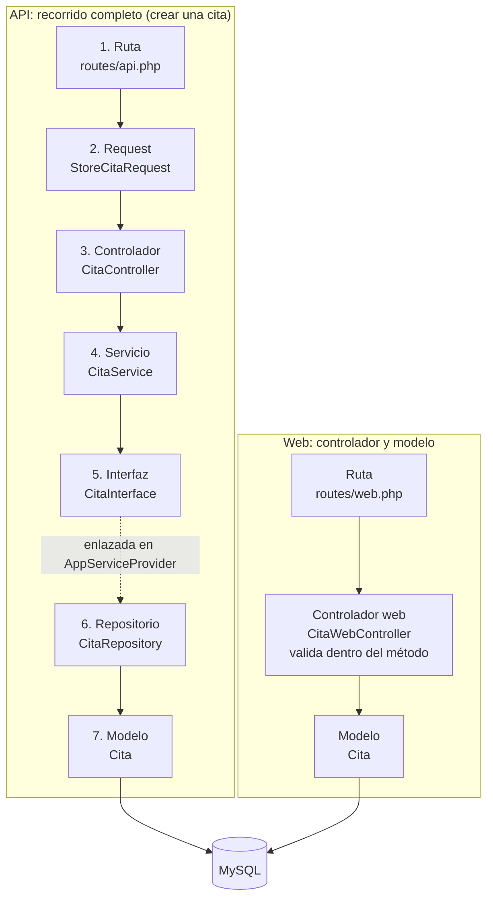
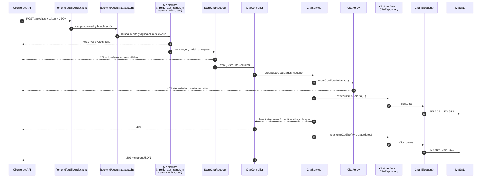
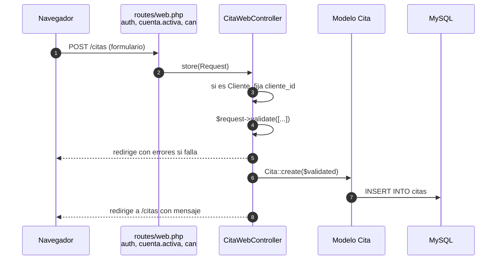

# Arquitectura por capas del backend

> **Base de verificación.** Este documento se elaboró leyendo el código de `spaa_codigo.zip` (5 de noviembre de 2026). Las rutas de archivo parten de la raíz del repositorio y los números de línea (`L`) corresponden a esa versión. Si la rama `feat/dolly2` cambia, las referencias deben volver a verificarse.
>
> **Comportamiento leído, no ejecutado.** Ninguna de las operaciones descritas se ejecutó durante la elaboración de este documento: no se levantó la aplicación ni se corrieron pruebas. Cuando el texto dice “responde 404” o “guarda la cita”, describe lo que el código está escrito para hacer, no un resultado observado. Los fragmentos de código se copiaron sin modificaciones; si un fragmento se acorta, se indica con un comentario `// …` fuera del código original.

## Contenido

1. [Qué es una arquitectura por capas y por qué la usa Asha Spa](#1-qué-es-una-arquitectura-por-capas-y-por-qué-la-usa-asha-spa)
2. [Conceptos necesarios, explicados con el código del proyecto](#2-conceptos-necesarios-explicados-con-el-código-del-proyecto)
3. [Mapa de archivos por capa y por entidad](#3-mapa-de-archivos-por-capa-y-por-entidad)
4. [Recorrido completo de una petición de la API](#4-recorrido-completo-de-una-petición-de-la-api)
5. [Capa 1 — Ruta](#5-capa-1--ruta)
6. [Capa 2 — Request](#6-capa-2--request)
7. [Capa 3 — Controlador](#7-capa-3--controlador)
8. [Capa 4 — Servicio](#8-capa-4--servicio)
9. [Capa 5 — Interfaz](#9-capa-5--interfaz)
10. [Capa 6 — Repositorio](#10-capa-6--repositorio)
11. [Capa 7 — Modelo](#11-capa-7--modelo)
12. [Componentes transversales: middleware, policies y proveedor de servicios](#12-componentes-transversales-middleware-policies-y-proveedor-de-servicios)
13. [Flujo de la interfaz web](#13-flujo-de-la-interfaz-web)
14. [Comparación entre el flujo de la API y el flujo web](#14-comparación-entre-el-flujo-de-la-api-y-el-flujo-web)
15. [Matriz de uso real de las capas](#15-matriz-de-uso-real-de-las-capas)
16. [Observaciones técnicas](#16-observaciones-técnicas)
17. [Cobertura de este documento](#17-cobertura-de-este-documento)

---

## 1. Qué es una arquitectura por capas y por qué la usa Asha Spa

Una **arquitectura por capas** divide el código en niveles. Cada nivel tiene una sola responsabilidad y, en el diseño ideal, solo conversa con el nivel siguiente. El backend de Asha Spa define **siete capas** para la **API**:

| N.º | Capa | Pregunta que responde | Carpeta |
| --- | --- | --- | --- |
| 1 | Ruta | ¿Qué código atiende esta URL y quién puede llegar a él? | `backend/routes/` |
| 2 | Request | ¿Los datos que llegan son válidos? | `backend/app/Http/Requests/` |
| 3 | Controlador | ¿Qué se pide hacer y cómo se responde por HTTP? | `backend/app/Http/Controllers/` |
| 4 | Servicio | ¿Qué reglas del negocio del spa se aplican? | `backend/app/Services/` |
| 5 | Interfaz | ¿Qué operaciones de datos están disponibles? | `backend/app/Interfaces/` |
| 6 | Repositorio | ¿Cómo se consultan y guardan esos datos? | `backend/app/Repositories/` |
| 7 | Modelo | ¿Cómo se representa cada tabla en PHP? | `backend/app/Models/` |

La ventaja de esta división se ve en un caso concreto del proyecto: la regla “un empleado no puede tener dos citas a la misma hora” está escrita **una sola vez**, en `CitaService` (`backend/app/Services/CitaService.php` L196–203). El controlador no la conoce y el repositorio solo responde si existe o no otra cita. Si mañana la regla cambia (por ejemplo, para tener en cuenta la duración del servicio), se modifica un solo método.

Las siete capas describen la **estructura** del backend de la API, **no un recorrido obligatorio** para cada petición. Muchas operaciones de la API omiten alguna capa, y la interfaz web omite casi todas. La sección 1.1 lo detalla con ejemplos.

### 1.1 Operaciones que no pasan por las siete capas

El recorrido completo (ruta → request → controlador → servicio → interfaz → repositorio → modelo) solo se da en operaciones que reciben datos y los guardan por el repositorio, como **crear una cita** (sección 4) o **crear un producto** (sección 7.3). Las demás operaciones omiten una o varias capas. Ninguna de estas omisiones se modificó ni se probó; se describen según el código.

| Caso | Capa que se omite | Ejemplo concreto del proyecto | Por qué ocurre |
| --- | --- | --- | --- |
| Listar, consultar o eliminar | **Request** | `GET /api/citas` → `CitaController::index(Request $request)` (`backend/app/Http/Controllers/CitaController.php` L24–28); `DELETE /api/producto/{id}` → `ProductoController::destroy(int $id)` (`ProductoController.php` L67–79) | No llegan datos en el cuerpo que validar; el parámetro es la URL. Es el comportamiento normal en Laravel. |
| Búsquedas por parámetro de ruta | **Request** | `GET /api/proveedores/email/{email}` (`backend/routes/api.php` L118–119) | El valor viene en la URL y solo se restringe por el tipo del parámetro PHP. |
| Inicio de sesión de la API | **Request** (clase) | `ApiAuthController::login` valida con `$request->validate([...])` dentro del controlador (`ApiAuthController.php` L27–31) | La validación está escrita en el controlador. |
| Editar o eliminar una cita; editar una factura o un pago | **Repositorio** (para guardar) | `CitaService::actualizar` guarda con `$cita->update($data)` (`CitaService.php` L131); `eliminar` usa `$cita->delete()` (L138); `FacturaService::update` usa `fill` y `save` (L81–82, L104); `PagoService::update` usa `$pago->update($data)` (L78) | El repositorio se usa para **encontrar** el registro (`buscarVisible`), pero el guardado se hace sobre el objeto del modelo (observación CAP-11). |
| Agregar una línea al detalle de una factura | **Interfaz y repositorio** (parcialmente) | `FacturaServicioService::store` consulta `Factura::query()` y `Servicio::query()` (`FacturaServicioService.php` L57–58) | Necesita bloquear la factura dentro de la transacción; lo hace con el modelo (observación CAP-02). |
| Recursos sin reglas de negocio | **Servicio** (existe, pero no agrega lógica) | `ProductoService::store` solo llama a `create` del repositorio (`ProductoService.php` L23–26) | El servicio se mantiene por uniformidad; la capa está presente pero vacía de reglas. |
| Roles y usuarios | **Policy** (componente transversal) | Las rutas usan `EnsureAdministrator` (`routes/api.php` L104–107); `RolPolicy` y `UsuarioPolicy` no se invocan | La autorización se resuelve con un middleware (observación CAP-07). |
| Toda la interfaz web | **Request, servicio, interfaz y repositorio** | `CitaWebController::store` valida en el método y guarda con `Cita::create` (`Web/CitaWebController.php` L127, L151) | Los controladores web trabajan con los modelos (sección 13; observación CAP-01). El login y el registro web usan `UsuarioService` de forma parcial. |
| Comando de consola | **Ruta, request, controlador, servicio, interfaz y repositorio** | `app:make-administrator` (`backend/app/Console/Commands/MakeAdministrator.php`) | Es un comando Artisan que trabaja con los modelos `Usuario` y `Rol`. |

La [sección 15](#15-matriz-de-uso-real-de-las-capas) resume, operación por operación, qué capas se usan realmente.

Una consecuencia práctica: la regla anterior sobre horarios **no se aplica** cuando una cita se crea desde la web, porque ese flujo no pasa por `CitaService`. Este punto se explica en la [sección 13](#13-flujo-de-la-interfaz-web).



---

## 2. Conceptos necesarios, explicados con el código del proyecto

Esta sección explica cada término técnico con un ejemplo de Asha Spa. Las secciones siguientes los usan sin volver a definirlos.

### 2.1 Elementos del lenguaje PHP

| Término | Qué significa | Ejemplo en Asha Spa |
| --- | --- | --- |
| **Clase** | Plantilla que agrupa datos (propiedades) y comportamientos (métodos). | `class CitaService` en `backend/app/Services/CitaService.php` L22 |
| **Objeto o instancia** | Un ejemplar concreto creado a partir de una clase. | Cada cita leída de la base de datos es un objeto de la clase `Cita`. |
| **Método** | Función que pertenece a una clase. | `crear()` en `CitaService.php` L58 |
| **Método público, privado y protegido** | `public` se puede llamar desde fuera de la clase; `private` solo desde la misma clase; `protected`, desde la clase y sus hijas. | `crear()` es público; `verificarDisponibilidad()` (L196) es privado porque solo lo usa `CitaService`. |
| **Propiedad** | Variable que pertenece a un objeto. | `protected $table = 'citas';` en `backend/app/Models/Cita.php` L20 |
| **Parámetro** | Dato que un método recibe al ser llamado. | En `crear(array $data, Usuario $actor)`, `$data` son los datos de la cita y `$actor` es el usuario que la crea. |
| **Tipo** | Clase de dato que se espera: `int` (entero), `string` (texto), `bool` (verdadero o falso), `array` (lista o diccionario), o el nombre de una clase. | `int $id` exige un número entero. |
| **Tipo anulable** (`?Cita`) | El valor puede ser un objeto de ese tipo o `null` (nada). | `buscarVisible(): ?Cita` devuelve la cita o `null` si el usuario no puede verla. |
| **Retorno** | Valor que el método entrega al terminar (`return`). Se declara después de `:`. | `crear(...): Cita` devuelve un objeto `Cita`. |
| **Constructor** | Método especial `__construct` que se ejecuta al crear el objeto. | `CitaService.php` L24–26 recibe el repositorio que el servicio usará. |
| **Promoción de propiedades en el constructor** | Escribir `protected CitaInterface $citaRepository` dentro de los paréntesis del constructor declara la propiedad y le asigna el parámetro en un solo paso. Por eso el cuerpo del constructor queda vacío `{}`. | `CitaService.php` L24–26 |
| **Herencia** (`extends`) | Una clase hija recibe los métodos de su clase padre. | `CitaRepository extends BaseRepository` hereda `create`, `getById`, `update` y `delete`. |
| **Interfaz** (`interface`, `implements`) | Lista de métodos que una clase se compromete a tener, sin decir cómo los hace. | `CitaRepository implements CitaInterface`. |
| **Namespace y `use`** | El namespace es la “dirección” de una clase (`App\Services`); `use` permite nombrarla de forma corta. | `use App\Interfaces\CitaInterface;` en `CitaService.php` L5 |
| **Excepción** | Objeto que interrumpe la ejecución para señalar un error. Se lanza con `throw` y se captura con `try … catch`. | `throw new InvalidArgumentException(...)` en `CitaService.php` L201; capturada en `CitaController.php` L47. |
| **Operador `?->`** | Accede a una propiedad o método solo si el objeto no es `null`; si es `null`, el resultado es `null` sin error. | `$actor->cliente?->cliente_id` en `CitaService.php` L61 |
| **Operador `??`** | Devuelve el valor de la izquierda si existe y no es `null`; si no, el de la derecha. | `$data['estado'] ?? 'pendiente'` en `CitaService.php` L76 |
| **Función anónima** (`function () use (...)`, `fn () =>`) | Función sin nombre que se pasa como dato a otro método. | `DB::transaction(function () use ($data) { ... })` en `FacturaService.php` L55 |

### 2.2 Conceptos de Laravel usados en el proyecto

| Término | Qué significa en Asha Spa | Dónde se ve |
| --- | --- | --- |
| **Laravel** | Framework de PHP que provee el enrutamiento, la validación, el acceso a datos, la autenticación y la autorización. El proyecto usa la versión 12.67.0. | `backend/composer.lock` |
| **Contenedor de servicios** | Componente de Laravel que crea los objetos que el código necesita y los entrega ya construidos. | Lo configura `AppServiceProvider::register()` (`backend/app/Providers/AppServiceProvider.php` L44–111). |
| **Inyección de dependencias** | En lugar de que una clase cree con `new` los objetos que necesita, los **declara como parámetros de su constructor** y el contenedor se los entrega. | `CitaController` declara que necesita `CitaService` (`CitaController.php` L20–22); nunca escribe `new CitaService()`. |
| **Facade** | Acceso estático a un servicio de Laravel: `Gate::`, `DB::`, `Log::`, `Hash::`, `Auth::`. | `Gate::authorize('view', $cita)` en `CitaController.php` L38 |
| **ORM y Eloquent** | Un ORM (*Object-Relational Mapping*) traduce entre tablas y objetos. **Eloquent** es el ORM de Laravel: cada fila de `citas` se convierte en un objeto `Cita` y `Cita::create([...])` se traduce en un `INSERT`. | `backend/app/Models/` |
| **Modelo** | Clase Eloquent que representa una tabla. | `Cita` representa la tabla `citas`. |
| **Consulta con constructor de consultas** | Cadena de métodos (`where`, `orderBy`, `get`, `first`, `exists`) que Eloquent convierte en SQL. | `CitaRepository.php` L84–90 |
| **Colección** (`Collection`) | Lista de objetos que devuelve una consulta con `get()`. | `listarPara()` devuelve `Collection` de citas. |
| **Borrado lógico** (`SoftDeletes`) | `delete()` no borra la fila: escribe la fecha en `deleted_at` y las consultas normales la ocultan. | `use SoftDeletes;` en `Cita.php` L15 |
| **Alcance** (*scope*) | Método `scopeNombre` del modelo que agrega condiciones reutilizables a una consulta. Se llama sin el prefijo: `->visiblePara($usuario)`. | `scopeVisiblePara` en `Cita.php` L74–87 |
| **Ruta** | Asociación entre una URL con un verbo HTTP (GET, POST, PUT, PATCH, DELETE) y un método de controlador. | `backend/routes/api.php` |
| **Middleware** | Filtro que se ejecuta antes del controlador y puede detener la petición. | `EnsureActiveAccount` (`backend/app/Http/Middleware/EnsureActiveAccount.php`) |
| **Request** (`FormRequest`) | Clase que valida los datos de una petición antes de que llegue al controlador. | `StoreCitaRequest` |
| **Controlador** | Clase que recibe la petición, delega el trabajo y construye la respuesta HTTP. | `CitaController` |
| **Servicio** | Clase propia del proyecto (no es un componente de Laravel) que contiene las reglas de negocio. | `CitaService` |
| **Repositorio** | Clase propia del proyecto que concentra las consultas a la base de datos. | `CitaRepository` |
| **Autenticación** | Comprobar **quién** es el usuario. En la web, con sesión; en la API, con un token de Sanctum. | Middleware `auth` y `auth:sanctum` |
| **Autorización** | Comprobar **qué puede hacer** el usuario ya identificado. | Policies, `Gate` y `config/permisos.php` |
| **Gate** | Servicio de Laravel que responde “¿puede este usuario hacer esta acción?”. Puede consultar una regla con nombre o una policy. | `Gate::define('administrar-sistema', ...)` en `AppServiceProvider.php` L123–126 |
| **Policy** | Clase que agrupa las reglas de autorización de un modelo. Laravel la encuentra por convención de nombre: `CitaPolicy` para `Cita`. | `backend/app/Policies/CitaPolicy.php` |
| **Sanctum** | Paquete de Laravel que emite y valida tokens para la API. | `ApiAuthController.php` L44 (`createToken`) |
| **Transacción** | Grupo de operaciones de base de datos que se confirman todas juntas o ninguna. Si algo falla dentro, se deshacen las anteriores. | `DB::transaction(...)` en `FacturaService.php` L55–67 |
| **Respuesta JSON y códigos HTTP** | La API responde texto en formato JSON con un código numérico: 200 (correcto), 201 (creado), 401 (no autenticado), 403 (no autorizado), 404 (no encontrado), 409 (conflicto), 422 (datos inválidos), 429 (demasiadas peticiones), 500 (error del servidor). | `response()->json($cita, 201)` en `CitaController.php` L51 |

---

## 3. Mapa de archivos por capa y por entidad

Todas las rutas parten de `backend/app/`.

| Entidad | Modelo | Interfaz | Repositorio | Servicio | Controlador API | Requests | Policy | Controlador web |
| --- | --- | --- | --- | --- | --- | --- | --- | --- |
| Rol | `Models/Rol.php` | `Interfaces/RolInterface.php` | `Repositories/RolRepository.php` | `Services/RolService.php` | `Http/Controllers/RolController.php` | `Http/Requests/Rol/` | `Policies/RolPolicy.php` (no se invoca) | — |
| Usuario | `Models/Usuario.php` | `Interfaces/UsuarioInterface.php` | `Repositories/UsuarioRepository.php` | `Services/UsuarioService.php` | `UsuarioController.php`, `ApiAuthController.php` | `Http/Requests/Usuario/` | `Policies/UsuarioPolicy.php` (no se invoca) | `Web/AuthController.php` |
| Cliente | `Models/Cliente.php` | `ClienteInterface.php` | `ClienteRepository.php` | `ClienteService.php` | `ClienteController.php` | `Http/Requests/Cliente/` | `ClientePolicy.php` | `Web/ClienteWebController.php` |
| Empleado | `Models/Empleado.php` | `EmpleadoInterface.php` | `EmpleadoRepository.php` | `EmpleadoService.php` | `EmpleadoController.php` | `Http/Requests/Empleado/` | `EmpleadoPolicy.php` | `Web/EmpleadoWebController.php` |
| Servicio | `Models/Servicio.php` | `ServicioInterface.php` | `ServicioRepository.php` | `ServicioService.php` | `ServicioController.php` | `Http/Requests/Servicio/` | `ServicioPolicy.php` | `Web/ServicioWebController.php` |
| Cita | `Models/Cita.php` | `CitaInterface.php` | `CitaRepository.php` | `CitaService.php` | `CitaController.php` | `Http/Requests/Cita/` | `CitaPolicy.php` | `Web/CitaWebController.php` |
| Pago | `Models/Pago.php` | `PagoInterface.php` | `PagoRepository.php` | `PagoService.php` | `PagoController.php` | `Http/Requests/Pago/` | `PagoPolicy.php` | — |
| Factura | `Models/Factura.php` | `FacturaInterface.php` | `FacturaRepository.php` | `FacturaService.php` | `FacturaController.php` | `Http/Requests/Factura/` | `FacturaPolicy.php` | — |
| FacturaServicio | `Models/FacturaServicio.php` | `FacturaServicioInterface.php` | `FacturaServicioRepository.php` | `FacturaServicioService.php` | `FacturaServicioController.php` | `Http/Requests/FacturaServicio/` | `FacturaServicioPolicy.php` | — |
| Proveedor | `Models/Proveedor.php` | `ProveedorInterface.php` | `ProveedorRepository.php` | `ProveedorService.php` | `ProveedorController.php` | `Http/Requests/Proveedor/` | `ProveedorPolicy.php` | — |
| Producto | `Models/Producto.php` | `ProductoInterface.php` | `ProductoRepository.php` | `ProductoService.php` | `ProductoController.php` | `Http/Requests/Producto/` | `ProductoPolicy.php` | — |
| MovimientoInventario | `Models/MovimientoInventario.php` | `MovimientoInventarioInterface.php` | `MovimientoInventarioRepository.php` | `MovimientoInventarioService.php` | `MovimientoInventarioController.php` | `Http/Requests/MovimientoInventario/` | `MovimientoInventarioPolicy.php` | — |

Archivos base compartidos: `Interfaces/BaseInterface.php`, `Repositories/BaseRepository.php`, `Http/Controllers/Controller.php` (clase abstracta vacía, L5–8) y `Policies/PermisoPolicy.php`. `Web/HomeController.php` no corresponde a una sola entidad: arma el resumen de la página de inicio.

**Entidad elegida como ejemplo principal.** Este documento usa la **cita** como hilo conductor porque tiene reglas en el request, en el servicio, en la policy y en el modelo, y además un flujo web distinto. La entidad **producto** se usa como contraste: al crear o actualizar recorre las siete capas sin reglas propias; al listar, consultar o eliminar no usa request. Facturación y pagos se documentan en la capa de servicio porque contienen transacciones y auditoría.

---

## 4. Recorrido completo de una petición de la API

Esta sección sigue, paso a paso, una petición `POST /api/citas` que crea una cita. Se eligió porque es una de las operaciones que **sí** recorren las siete capas; otras operaciones de la API omiten alguna (sección 1.1). Cada paso indica el archivo que interviene. Es el comportamiento que el código está escrito para producir; no se ejecutó.



| Paso | Qué sucede | Archivo y líneas |
| --- | --- | --- |
| 1 | El servidor ejecuta el punto de entrada público. Este archivo calcula la raíz del proyecto, carga el cargador automático de clases de Composer y la aplicación Laravel, y le entrega la petición capturada. | `frontend/public/index.php` L8, L16, L20, L22 |
| 2 | Laravel arranca con la configuración de `bootstrap/app.php`: registra los archivos de rutas, los alias de middleware (`cuenta.activa`, `admin`), el límite de peticiones de la API y la regla de responder errores en JSON para `/api/*`. También indica que el `.env` está en la raíz y que la carpeta pública es `frontend/public`. | `backend/bootstrap/app.php` L10–34 |
| 3 | `AppServiceProvider` registra los enlaces interfaz → repositorio, el Gate `administrar-sistema`, los limitadores de peticiones y la política de contraseñas. | `backend/app/Providers/AppServiceProvider.php` L44–154 |
| 4 | Laravel busca la ruta. `POST /api/citas` coincide con la acción `store` del recurso `citas`. | `backend/routes/api.php` L72–75 |
| 5 | Se ejecuta el middleware: `throttle:api` (máximo 120 peticiones por minuto, contadas por usuario identificado o, si todavía no lo está, por IP; cuál de las dos claves se aplica en la práctica a las peticiones con token está **pendiente de verificar**), `auth:sanctum` (exige un token válido; si falta, 401), `cuenta.activa` (usuario y rol activos; si no, 403) y `can:create,App\Models\Cita` (llama a `CitaPolicy::create`; si devuelve `false`, 403). | `bootstrap/app.php` L24; `routes/api.php` L50, L75; `EnsureActiveAccount.php` L19–40; `CitaPolicy.php` L33–36 |
| 6 | Laravel ve que `CitaController::store` recibe un `StoreCitaRequest`, lo construye y ejecuta su validación. Si falla, responde 422 con los errores y el controlador no se ejecuta. | `CitaController.php` L43; `StoreCitaRequest.php` L17–47 |
| 7 | Para crear el controlador, el contenedor resuelve sus dependencias: `CitaController` necesita `CitaService`; `CitaService` necesita `CitaInterface`, que está enlazada a `CitaRepository`; `CitaRepository` necesita un modelo `Cita`. | `CitaController.php` L20–22; `CitaService.php` L24–26; `AppServiceProvider.php` L46–49; `CitaRepository.php` L15–18 |
| 8 | `store` llama a `CitaService::crear` con los datos validados y el usuario autenticado. | `CitaController.php` L46 |
| 9 | `crear` aplica las reglas de propietario, estado, hora y disponibilidad. Para verificar disponibilidad consulta `existeCitaEnHorario` a través de la interfaz. | `CitaService.php` L58–86; `CitaRepository.php` L82–91 |
| 10 | Si no hay conflicto, `crearConCodigo` obtiene el siguiente código y llama a `create`, que hereda de `BaseRepository` y ejecuta `Cita::create`. Eloquent genera el `INSERT` en la tabla `citas`. | `CitaService.php` L177–194; `BaseRepository.php` L17–20 |
| 11 | El controlador recibe el objeto `Cita` y responde 201 con la cita en JSON. | `CitaController.php` L51 |

---
## 5. Capa 1 — Ruta

### 5.1 Propósito en Asha Spa

La capa de rutas decide **qué método de qué controlador atiende cada URL** y **qué filtros debe superar la petición antes de llegar a él**. En Asha Spa también es la primera barrera de autorización: la mayoría de los permisos de clase (“¿puede listar?”, “¿puede crear?”) se exigen aquí.

### 5.2 Archivos que participan

| Archivo | Tipo | Responsabilidad en el proyecto |
| --- | --- | --- |
| `backend/routes/api.php` | Archivo de rutas | Define las 31 instrucciones de ruta de la API: login público y un grupo protegido con los recursos del spa. Laravel antepone el prefijo `/api` a todas. |
| `backend/routes/web.php` | Archivo de rutas | Define login, registro y logout, y el grupo protegido de la interfaz web (inicio, citas y listados). |
| `backend/routes/console.php` | Archivo de comandos | Contiene solo el comando `inspire` de la plantilla de Laravel; no interviene en el negocio. |
| `backend/bootstrap/app.php` | Configuración de arranque | Registra los tres archivos de rutas, la ruta de salud `/up`, los alias de middleware y el comportamiento de errores de la API. |

### 5.3 Registro de rutas y middleware: `backend/bootstrap/app.php`

```php
$app = Application::configure(basePath: dirname(__DIR__))
    ->withRouting(
        web: __DIR__.'/../routes/web.php',
        api: __DIR__.'/../routes/api.php',
        commands: __DIR__.'/../routes/console.php',
        health: '/up',
    )
    ->withMiddleware(function (Middleware $middleware): void {
        $middleware->alias([
            'cuenta.activa' => EnsureActiveAccount::class,
            'admin' => EnsureAdministrator::class,
        ]);

        // Límite de peticiones para todas las rutas de la API (limitador 'api' en AppServiceProvider).
        $middleware->throttleApi();
    })
    ->withExceptions(function (Exceptions $exceptions): void {
        // La API siempre responde JSON (401, 403, 404, 422, 429...) en lugar de redirigir al login.
        $exceptions->shouldRenderJsonWhen(
            fn (Request $request, Throwable $e) => $request->is('api/*') || $request->expectsJson()
        );
    })->create();
```

Fuente: `backend/bootstrap/app.php` L10–31.

| Instrucción | Qué hace |
| --- | --- |
| `Application::configure(basePath: dirname(__DIR__))` | Crea la configuración de la aplicación. `dirname(__DIR__)` es la carpeta `backend/`, porque este archivo está en `backend/bootstrap/`. |
| `withRouting(web:, api:, commands:, health:)` | Indica qué archivo contiene cada tipo de rutas. `health: '/up'` crea una ruta pública que responde si la aplicación está viva. |
| `$middleware->alias([...])` | Da nombres cortos a dos middleware propios: `cuenta.activa` y `admin`. Por eso en las rutas se escribe `'cuenta.activa'` en lugar del nombre completo de la clase. |
| `$middleware->throttleApi()` | Aplica a todas las rutas de la API el limitador llamado `api`, que se define en `AppServiceProvider.php` L142–146. |
| `shouldRenderJsonWhen(...)` | Si la URL empieza por `api/` o el cliente pide JSON, cualquier error (autenticación, autorización, validación, no encontrado) se responde en JSON en lugar de redirigir a una página. La variable `$request` es la petición y `$e` el error ocurrido. |

Las líneas L33–34 del mismo archivo cambian dos ubicaciones estándar: `useEnvironmentPath(dirname(__DIR__, 2))` hace que el `.env` se lea desde la raíz del repositorio, y `usePublicPath(... '/frontend/public')` declara `frontend/public` como carpeta pública.

### 5.4 Rutas de la API: `backend/routes/api.php`

#### Ruta pública de login

```php
Route::post('login', [ApiAuthController::class, 'login'])
    ->middleware('throttle:login')
    ->name('api.login');
```

Fuente: `backend/routes/api.php` L46–48.

1. `Route::post('login', ...)` registra la URL `POST /api/login` (el prefijo `/api` lo agrega Laravel a este archivo).
2. `[ApiAuthController::class, 'login']` indica la clase y el método que la atienden.
3. `->middleware('throttle:login')` aplica el limitador `login` de `AppServiceProvider.php` L129–136: 5 intentos por minuto por combinación de correo e IP, y 20 por minuto por IP. Al superarlo, la respuesta es 429.
4. `->name('api.login')` da un nombre interno a la ruta.

Esta ruta está **fuera** del grupo protegido, porque quien todavía no tiene token debe poder pedirlo.

#### Grupo protegido

```php
Route::middleware(['auth:sanctum', 'cuenta.activa'])->name('api.')->group(function () {
```

Fuente: `backend/routes/api.php` L50 (el grupo se cierra en L163).

Todas las rutas declaradas dentro de esta función heredan dos middleware:

- `auth:sanctum`: exige un token Bearer válido emitido por Sanctum. Si falta o no es válido, Laravel responde 401 en JSON.
- `cuenta.activa`: ejecuta `EnsureActiveAccount` (sección 12.1). Si el usuario o su rol están inactivos, responde 403.

`->name('api.')` antepone `api.` al nombre de cada ruta interna.

#### Recurso con permisos por acción: empleados

```php
    Route::apiResource('empleados', EmpleadoController::class)
        ->where(['empleado' => '[0-9]+'])
        ->middlewareFor(['index', 'show'], 'can:viewAny,'.Empleado::class)
        ->middlewareFor('store', 'can:create,'.Empleado::class)
        ->middlewareFor('update', 'can:update,'.Empleado::class)
        ->middlewareFor('destroy', 'can:delete,'.Empleado::class);
```

Fuente: `backend/routes/api.php` L56–61.

`Route::apiResource` crea con una sola instrucción las cinco rutas de un recurso:

| Verbo y URL generada | Método del controlador | Middleware de permiso aplicado |
| --- | --- | --- |
| `GET /api/empleados` | `index` | `can:viewAny,App\Models\Empleado` |
| `POST /api/empleados` | `store` | `can:create,App\Models\Empleado` |
| `GET /api/empleados/{empleado}` | `show` | `can:viewAny,App\Models\Empleado` |
| `PUT` o `PATCH /api/empleados/{empleado}` | `update` | `can:update,App\Models\Empleado` |
| `DELETE /api/empleados/{empleado}` | `destroy` | `can:delete,App\Models\Empleado` |

- `->where(['empleado' => '[0-9]+'])` exige que el segmento `{empleado}` sea un número. Una URL como `/api/empleados/abc` no coincide con ninguna ruta.
- `->middlewareFor(acción, 'can:habilidad,Clase')` aplica el middleware `can` solo a esas acciones. `can:create,App\Models\Empleado` le pregunta a Laravel si el usuario puede `create` sobre la clase `Empleado`; Laravel busca la policy `EmpleadoPolicy` y llama a su método `create`. Si devuelve `false`, la respuesta es 403 y el controlador no se ejecuta.
- Empleados, servicios, proveedores, productos y movimientos usan este patrón en las cinco acciones porque sus permisos no dependen de un registro concreto.

#### Recurso con autorización en el controlador: citas

```php
    // Citas (show/update/destroy se autorizan por cita en el controlador)
    Route::apiResource('citas', CitaController::class)
        ->where(['cita' => '[0-9]+'])
        ->middlewareFor('index', 'can:viewAny,'.Cita::class)
        ->middlewareFor('store', 'can:create,'.Cita::class);
```

Fuente: `backend/routes/api.php` L71–75.

Solo `index` y `store` tienen permiso en la ruta. `show`, `update` y `destroy` no lo tienen porque la respuesta depende de **qué cita** se pide: un Cliente puede ver su cita pero no la de otro. Esa decisión se toma dentro de `CitaController` con `Gate::authorize` (sección 7.2). Facturas (L78–82), pagos (L84–87) y clientes (L110–113) siguen el mismo patrón.

El segmento de la URL se llama `{cita}`, pero los métodos del controlador reciben `int $id`. Laravel entrega los valores de la URL a los parámetros que no son clases en el orden en que aparecen, por eso el número de la URL llega a `$id`.

#### Grupo de administración

```php
    Route::middleware(EnsureAdministrator::class)->group(function () {
        Route::apiResource('roles', RolController::class)->where(['role' => '[0-9]+']);
        Route::apiResource('usuarios', UsuarioController::class)->where(['usuario' => '[0-9]+']);
    });
```

Fuente: `backend/routes/api.php` L104–107.

Las rutas de roles y usuarios no usan `can`. Las protege el middleware `EnsureAdministrator` (sección 12.2), que exige el permiso `sistema.administrar`. Por esta razón `RolPolicy` y `UsuarioPolicy` existen pero no se invocan (observación CAP-07).

#### Llave compuesta: detalle de facturas

`factura_servicio` no tiene una llave de un solo campo, así que `apiResource` no sirve. Las rutas se escriben una por una con dos parámetros (`backend/routes/api.php` L90–101), por ejemplo `GET /api/factura-servicios/{factura_id}/{servicio_id}`. `->whereNumber([...])` exige que ambos sean números.

#### Orden de las rutas de búsqueda

Las búsquedas de proveedores, productos y movimientos (por ejemplo `proveedores/email/{email}`) se declaran **antes** de su `apiResource` (L115–161). El comentario del código lo indica: “rutas personalizadas (antes del apiResource)”. Junto con la restricción numérica del `apiResource`, evita que `email` se interprete como un identificador.

### 5.5 Rutas web: `backend/routes/web.php`

```php
Route::middleware(['auth', 'cuenta.activa'])->group(function () {

    // Página de inicio (muestra solo la información autorizada para el usuario)
    Route::get('/', [HomeController::class, 'index'])->name('home');

    // Módulo de Citas (cada cita se autoriza en el controlador con CitaPolicy)
    Route::prefix('citas')->name('citas.')->group(function () {
        Route::get('/',             [CitaWebController::class, 'index'])->name('index')->can('viewAny', Cita::class);
        Route::get('/nueva',        [CitaWebController::class, 'create'])->name('create')->can('create', Cita::class);
        Route::post('/',            [CitaWebController::class, 'store'])->name('store')->can('create', Cita::class);
        Route::get('/{id}/editar',  [CitaWebController::class, 'edit'])->name('edit')->whereNumber('id');
        Route::put('/{id}',         [CitaWebController::class, 'update'])->name('update')->whereNumber('id');
    });
```

Fuente: `backend/routes/web.php` L42–54.

1. `auth` exige una **sesión** iniciada (no un token). Si no hay sesión, Laravel redirige a la ruta llamada `login`.
2. `cuenta.activa` es el mismo middleware que en la API; en la web, si la cuenta está inactiva, cierra la sesión y redirige al login (sección 12.1).
3. `Route::prefix('citas')->name('citas.')` agrupa las rutas bajo `/citas` y nombres `citas.*`.
4. `->can('viewAny', Cita::class)` equivale al `can:viewAny,...` de la API.

**Diferencia que debe conocerse:** los comentarios de L44 y L47 dicen que el inicio “muestra solo la información autorizada” y que “cada cita se autoriza en el controlador con CitaPolicy”. La lectura del código no lo confirma: `edit` y `update` (L52–53) no tienen `->can(...)`, y `CitaWebController` no llama a `Gate` ni a `authorize` (sección 13.2). La página de inicio tampoco filtra las citas por usuario (sección 13.4).

Las rutas de invitados (L30–35) usan el middleware `guest`, que impide entrar al login o al registro con una sesión ya iniciada, y los limitadores `throttle:login` y `throttle:registro`.


### 5.6 Ampliación: rutas explicadas en detalle

Esta subsección completa las rutas que en la versión anterior solo estaban resumidas. Todas las descripciones provienen de la lectura del archivo; ninguna ruta se probó.

#### Ubicación del `.env` y de la carpeta pública

```php
$app->useEnvironmentPath(dirname(__DIR__, 2));
$app->usePublicPath(dirname(__DIR__, 2).'/frontend/public');

return $app;
```

Fuente: `backend/bootstrap/app.php` L33–36.

| Aspecto | Detalle |
| --- | --- |
| Qué es | Dos llamadas sobre el objeto `$app` (la aplicación Laravel ya configurada en L10–31) y el `return` que entrega la aplicación a `frontend/public/index.php`. |
| Problema que resuelve | El proyecto separa `backend/` y `frontend/`. Sin estas líneas, Laravel buscaría el `.env` en `backend/` y la carpeta pública en `backend/public`, que no existen. |
| `useEnvironmentPath(dirname(__DIR__, 2))` | `__DIR__` es `backend/bootstrap`; `dirname(..., 2)` sube dos niveles y obtiene la raíz del repositorio. Ahí se lee el `.env`. |
| `usePublicPath(... '/frontend/public')` | Declara `frontend/public` como carpeta pública: Laravel y Vite la usan para `public_path()` y para el manifiesto de los recursos compilados. |
| `return $app;` | Devuelve el objeto `Application`. `frontend/public/index.php` L20 lo recibe con `require_once` y llama a `handleRequest` (L22). |
| Errores | No contempla errores propios. Si el `.env` no existe en la raíz, Laravel arranca con los valores por defecto de `backend/config/*.php` (comportamiento de Laravel, no verificado en este proyecto). |

#### Rutas de sesión de la API: `logout` y `me`

```php
    Route::post('logout', [ApiAuthController::class, 'logout'])->name('logout');
    Route::get('me', [ApiAuthController::class, 'me'])->name('me');
```

Fuente: `backend/routes/api.php` L52–53.

Ambas están dentro del grupo `auth:sanctum` + `cuenta.activa` (L50), por lo que exigen un token válido y una cuenta habilitada. `POST /api/logout` llama a `ApiAuthController::logout` y `GET /api/me` a `ApiAuthController::me` (sección 7.4). No tienen `can`: cualquier usuario autenticado y habilitado puede usarlas.

#### Recursos con permisos por acción: `servicios`

```php
    // Servicios
    Route::apiResource('servicios', ServicioController::class)
        ->where(['servicio' => '[0-9]+'])
        ->middlewareFor(['index', 'show'], 'can:viewAny,'.Servicio::class)
        ->middlewareFor('store', 'can:create,'.Servicio::class)
        ->middlewareFor('update', 'can:update,'.Servicio::class)
        ->middlewareFor('destroy', 'can:delete,'.Servicio::class);
```

Fuente: `backend/routes/api.php` L63–69.

Mismo patrón que `empleados` (sección 5.4): las cinco acciones del recurso tienen su middleware `can`, que consulta `ServicioPolicy` (hija de `PermisoPolicy`, con `servicios.ver` y `servicios.gestionar`). `GET /api/servicios` y `GET /api/servicios/{servicio}` exigen `servicios.ver`, que tienen todos los roles definidos en `config/permisos.php`. Crear, editar y eliminar exigen `servicios.gestionar`, que solo tiene el Administrador (por `*`).

#### Recursos con autorización por registro: `facturas`, `pagos` y `clientes`

```php
    // Facturas (no se eliminan)
    Route::apiResource('facturas', FacturaController::class)
        ->where(['factura' => '[0-9]+'])
        ->middlewareFor('index', 'can:viewAny,'.Factura::class)
        ->middlewareFor('store', 'can:create,'.Factura::class);

    // Pagos (no se eliminan)
    Route::apiResource('pagos', PagoController::class)
        ->where(['pago' => '[0-9]+'])
        ->middlewareFor('index', 'can:viewAny,'.Pago::class)
        ->middlewareFor('store', 'can:create,'.Pago::class);
```

Fuente: `backend/routes/api.php` L77–87.

```php
    // Cliente (un Cliente solo consulta su propio perfil; el listado exige 'clientes.ver')
    Route::apiResource('clientes', ClienteController::class)
        ->where(['cliente' => '[0-9]+'])
        ->middlewareFor('index', 'can:viewAny,'.Cliente::class)
        ->middlewareFor('store', 'can:create,'.Cliente::class);
```

Fuente: `backend/routes/api.php` L109–113.

| Recurso | Permiso de la ruta en `index` | Permiso de la ruta en `store` | `show`, `update`, `destroy` |
| --- | --- | --- | --- |
| `facturas` | `FacturaPolicy::viewAny`: `facturas.ver_todas` o `facturas.propias` | `FacturaPolicy::create`: `facturas.gestionar` | Sin `can`; el controlador usa `Gate::authorize` sobre la factura |
| `pagos` | `PagoPolicy::viewAny`: `pagos.ver_todos` o `pagos.propios` | `PagoPolicy::create`: `pagos.registrar` | Igual, con `PagoPolicy` |
| `clientes` | `ClientePolicy::viewAny`: `clientes.ver` | `ClientePolicy::create`: `clientes.gestionar` | Igual, con `ClientePolicy` |

Consecuencia de leer estas reglas juntas: un **Cliente** puede listar sus facturas y pagos (`GET /api/facturas`, `GET /api/pagos`), pero **no** puede usar `GET /api/clientes`, porque `ClientePolicy::viewAny` exige `clientes.ver`. Para ver su ficha debe pedir `GET /api/clientes/{id}`. Los comentarios de `api.php` L77 y L83 indican que facturas y pagos “no se eliminan”: la ruta `DELETE` existe, pero la policy la deniega (ver `FacturaController::destroy` y `PagoController::destroy` en `referencia/controladores-api.md`).

#### Detalle de facturas: llave compuesta

```php
    // Facturas de servicios (PK compuesta: factura_id + servicio_id; no se eliminan)
    Route::get('factura-servicios', [FacturaServicioController::class, 'index'])
        ->can('viewAny', FacturaServicio::class);
    Route::post('factura-servicios', [FacturaServicioController::class, 'store'])
        ->can('create', FacturaServicio::class);
    Route::get('factura-servicios/{factura_id}/{servicio_id}', [FacturaServicioController::class, 'show'])
        ->whereNumber(['factura_id', 'servicio_id']);
    Route::put('factura-servicios/{factura_id}/{servicio_id}', [FacturaServicioController::class, 'update'])
        ->whereNumber(['factura_id', 'servicio_id']);
    Route::patch('factura-servicios/{factura_id}/{servicio_id}', [FacturaServicioController::class, 'update'])
        ->whereNumber(['factura_id', 'servicio_id']);
    Route::delete('factura-servicios/{factura_id}/{servicio_id}', [FacturaServicioController::class, 'destroy'])
        ->whereNumber(['factura_id', 'servicio_id']);
```

Fuente: `backend/routes/api.php` L89–101.

| Ruta | Método | Protección en la ruta | Autorización adicional |
| --- | --- | --- | --- |
| `GET /api/factura-servicios` | `index` | `->can('viewAny', FacturaServicio::class)` | — |
| `POST /api/factura-servicios` | `store` | `->can('create', FacturaServicio::class)` | — |
| `GET /api/factura-servicios/{factura_id}/{servicio_id}` | `show` | Solo `whereNumber` | `Gate::authorize('view', ...)` en el controlador |
| `PUT` y `PATCH` del mismo URL | `update` | Solo `whereNumber` | `Gate::authorize('update', ...)` |
| `DELETE` del mismo URL | `destroy` | Solo `whereNumber` | `Gate::authorize('delete', ...)`, que siempre deniega |

`->can('viewAny', FacturaServicio::class)` es la forma abreviada de agregar el middleware `can:viewAny,App\Models\FacturaServicio`. `whereNumber([...])` exige que los dos segmentos sean números. Como `factura_servicio` no tiene una llave de un solo campo, cada ruta recibe los dos identificadores y el controlador los pasa por separado al servicio.

#### Búsquedas de inventario

```php
    // Proveedor - rutas personalizadas (antes del apiResource)
    Route::get('proveedores/contacto/{contacto}', [ProveedorController::class, 'getByContacto'])
        ->can('viewAny', Proveedor::class);
    Route::get('proveedores/email/{email}', [ProveedorController::class, 'getByEmail'])
        ->can('viewAny', Proveedor::class);
    Route::get('proveedores/registro-tributario/{registro_tributario}', [ProveedorController::class, 'getByRegistroTributario'])
        ->can('viewAny', Proveedor::class);
```

Fuente: `backend/routes/api.php` L115–121.

```php
    // Producto - rutas personalizadas (antes del apiResource)
    Route::get('producto/nombre/{nombre}', [ProductoController::class, 'getByNombre'])
        ->can('viewAny', Producto::class);
    Route::get('producto/fecha-registro/{fecha_registro}', [ProductoController::class, 'getByFechaRegistro'])
        ->can('viewAny', Producto::class);
    Route::get('producto/proveedor/{proveedor_id}', [ProductoController::class, 'getByProveedor'])
        ->whereNumber('proveedor_id')
        ->can('viewAny', Producto::class);
```

Fuente: `backend/routes/api.php` L131–138.

```php
    // MovimientoInventario - rutas personalizadas (antes del apiResource)
    Route::get('movimientoinventario/fecha-hora/{fecha_hora}', [MovimientoInventarioController::class, 'getByFechaHora'])
        ->can('viewAny', MovimientoInventario::class);
    Route::get('movimientoinventario/producto/{producto_id}', [MovimientoInventarioController::class, 'getByProducto'])
        ->whereNumber('producto_id')
        ->can('viewAny', MovimientoInventario::class);
```

Fuente: `backend/routes/api.php` L148–153.

| Ruta | Método del controlador | Restricción del parámetro | Permiso |
| --- | --- | --- | --- |
| `GET /api/proveedores/contacto/{contacto}` | `ProveedorController::getByContacto` | Ninguna | `inventario.ver` (`ProveedorPolicy::viewAny`) |
| `GET /api/proveedores/email/{email}` | `ProveedorController::getByEmail` | Ninguna | `inventario.ver` |
| `GET /api/proveedores/registro-tributario/{registro_tributario}` | `ProveedorController::getByRegistroTributario` | Ninguna | `inventario.ver` |
| `GET /api/producto/nombre/{nombre}` | `ProductoController::getByNombre` | Ninguna | `inventario.ver` (`ProductoPolicy::viewAny`) |
| `GET /api/producto/fecha-registro/{fecha_registro}` | `ProductoController::getByFechaRegistro` | Ninguna | `inventario.ver` |
| `GET /api/producto/proveedor/{proveedor_id}` | `ProductoController::getByProveedor` | `whereNumber` | `inventario.ver` |
| `GET /api/movimientoinventario/fecha-hora/{fecha_hora}` | `MovimientoInventarioController::getByFechaHora` | Ninguna | `inventario.ver` (`MovimientoInventarioPolicy::viewAny`) |
| `GET /api/movimientoinventario/producto/{producto_id}` | `MovimientoInventarioController::getByProducto` | `whereNumber` | `inventario.ver` |

**Por qué se declaran antes del `apiResource`.** Laravel compara las rutas en el orden en que se registran. Si `apiResource('proveedores', ...)` estuviera primero, una petición `GET /api/proveedores/email/x` podría compararse con `GET /api/proveedores/{proveedore}`. La restricción numérica `->where(['proveedore' => '[0-9]+'])` (L125) ya impide esa coincidencia, y el orden agrega una segunda protección. El nombre `proveedore` es el singular que Laravel genera automáticamente para `proveedores`, como explica el comentario de `UpdateProveedorRequest.php` L25.

`inventario.ver` solo lo tiene el Administrador (por `*`): ningún otro rol de `config/permisos.php` puede usar estas búsquedas.

#### Rutas web de invitados y cierre de sesión

```php
// ── Autenticación (solo para invitados) ──────────────────────────────────────
Route::middleware('guest')->group(function () {
    Route::get('/login',    [AuthController::class, 'showLogin'])->name('login');
    Route::post('/login',   [AuthController::class, 'login'])->middleware('throttle:login');
    Route::get('/register', [AuthController::class, 'showRegister'])->name('register');
    Route::post('/register',[AuthController::class, 'register'])->middleware('throttle:registro');
});

Route::post('/logout', [AuthController::class, 'logout'])
    ->middleware('auth')
    ->name('logout');
```

Fuente: `backend/routes/web.php` L29–39.

| Ruta | Método | Middleware | Qué hace |
| --- | --- | --- | --- |
| `GET /login` | `AuthController::showLogin` | `guest` | Muestra el formulario; nombre `login` (destino de las redirecciones del middleware `auth`) |
| `POST /login` | `AuthController::login` | `guest`, `throttle:login` | Procesa el formulario |
| `GET /register` | `AuthController::showRegister` | `guest` | Muestra el formulario de registro |
| `POST /register` | `AuthController::register` | `guest`, `throttle:registro` | Crea la cuenta de Cliente |
| `POST /logout` | `AuthController::logout` | `auth` | Cierra la sesión |

`guest` redirige a quien ya tiene sesión. `/logout` está **fuera** del grupo protegido y solo exige `auth`, no `cuenta.activa`: una cuenta desactivada puede seguir cerrando su sesión. Los métodos se documentan en `referencia/controladores-web.md`.

#### Listados web

```php
    // Módulo de Clientes (listado: requiere 'clientes.ver')
    Route::get('/clientes', [ClienteWebController::class, 'index'])->name('clientes.index')->can('viewAny', Cliente::class);

    // Módulo de Servicios (listado)
    Route::get('/servicios', [ServicioWebController::class, 'index'])->name('servicios.index')->can('viewAny', Servicio::class);

    // Módulo de Empleados (listado)
    Route::get('/empleados', [EmpleadoWebController::class, 'index'])->name('empleados.index')->can('viewAny', Empleado::class);
```

Fuente: `backend/routes/web.php` L56–63.

Cada listado exige el permiso de clase de su policy: `clientes.ver` (Recepcionista y Administrador), `servicios.ver` y `empleados.ver` (todos los roles). Los controladores se explican en la sección 13.5.

---

## 6. Capa 2 — Request

### 6.1 Propósito en Asha Spa

Un **request** de validación (clase que extiende `FormRequest`) revisa los datos enviados **antes** de que el controlador se ejecute. Así, el controlador y el servicio pueden asumir que los datos tienen el formato correcto: fechas válidas, números enteros, identificadores existentes y valores permitidos.

### 6.2 Archivos que participan

24 clases en `backend/app/Http/Requests/<Entidad>/`: una `Store…Request` para crear y una `Update…Request` para actualizar, por cada una de las 12 entidades.

### 6.3 Cómo actúa un request y qué pasa cuando falla

1. El método del controlador declara el request como tipo de su parámetro: `public function store(StoreCitaRequest $request)` (`CitaController.php` L43).
2. Antes de entrar al método, Laravel crea el objeto y llama a `authorize()`. Si devuelve `false`, la respuesta es **403** y el controlador no se ejecuta.
3. Luego aplica las reglas de `rules()`. Si alguna falla, Laravel lanza una excepción de validación: en la API responde **422** en JSON con un mensaje y la lista de errores por campo; en la web redirige al formulario con los errores. Los textos salen de `messages()`.
4. Si todo es válido, el controlador recibe el objeto y obtiene los datos con `$request->validated()`, que devuelve **solo** los campos declarados en `rules()`. Cualquier campo extra que envíe el cliente se descarta.

### 6.4 `StoreCitaRequest` — validación al crear una cita

**Archivo:** `backend/app/Http/Requests/Cita/StoreCitaRequest.php` · **Tipo:** clase que extiende `FormRequest`.

#### Método `authorize(): bool`

```php
    public function authorize(): bool
    {
        return true;
    }
```

Fuente: L17–20. No recibe parámetros y devuelve siempre `true`. La autorización no se resuelve aquí sino en la ruta (`can:create`) y en `CitaService`/`CitaPolicy`, como explica el comentario de la clase (L8–14).

| Aspecto | Detalle |
| --- | --- |
| Recibe | Ningún parámetro. Laravel lo ejecuta sobre la petición en curso. |
| Modifica | Nada. |
| Devuelve | `bool`: siempre `true`. |
| Si fallara | Si devolviera `false`, Laravel respondería 403 sin ejecutar `rules()` ni el controlador. Con el código actual no ocurre. |
| Se relaciona con | La autorización real de la creación está en la ruta (`can:create`, `backend/routes/api.php` L75 → `CitaPolicy::create`, L33–36) y en `CitaService::crear` (`CitaPolicy::crearConEstado`). |


#### Método `rules(): array`

```php
    public function rules(): array
    {
        $gestionaCitas = (bool) $this->user()?->tienePermiso('citas.gestionar');

        return [
            'codigo_cita' => ['nullable', 'integer', 'min:1', 'unique:citas,codigo_cita'],
            'fecha' => ['required', 'date', 'after_or_equal:today'],
            'hora' => ['required', 'date_format:H:i'],
            'estado' => ['nullable', 'in:pendiente,confirmada,completada,cancelada'],
            'cliente_id' => [
                $gestionaCitas ? 'required' : 'nullable',
                'integer',
                Rule::exists('clientes', 'cliente_id')->whereNull('deleted_at'),
            ],
            'empleado_id' => [
                'required',
                'integer',
                Rule::exists('empleados', 'empleado_id')->where('disponibilidad', true)->whereNull('deleted_at'),
            ],
            'servicio_id' => [
                'required',
                'integer',
                Rule::exists('servicios', 'servicio_id')->where('activo', true)->whereNull('deleted_at'),
            ],
        ];
    }
```

Fuente: L22–47. No recibe parámetros; devuelve un `array` cuyas llaves son los campos y cuyos valores son listas de reglas.

**Variable interna `$gestionaCitas` (bool).** `$this->user()` es el usuario autenticado; `?->` evita un error si no hubiera usuario; `tienePermiso('citas.gestionar')` (sección 11.3) indica si su rol puede gestionar cualquier cita. `(bool)` convierte el resultado (que sería `null` sin usuario) en `true` o `false`.

| Campo | Reglas | Significado de cada regla |
| --- | --- | --- |
| `codigo_cita` | `nullable`, `integer`, `min:1`, `unique:citas,codigo_cita` | Puede omitirse; si se envía, debe ser un entero ≥ 1 que no exista en la columna `codigo_cita` de `citas`. |
| `fecha` | `required`, `date`, `after_or_equal:today` | Obligatoria, con formato de fecha, y no anterior al día actual. El día actual se calcula con la zona horaria de la aplicación (`UTC`, `backend/config/app.php` L68); su efecto con la hora de Colombia está pendiente de verificar. |
| `hora` | `required`, `date_format:H:i` | Obligatoria con formato horas:minutos de 24 horas, por ejemplo `14:30`. |
| `estado` | `nullable`, `in:pendiente,confirmada,completada,cancelada` | Opcional; si se envía, debe ser uno de los cuatro valores. Que el usuario **pueda** usar ese estado se decide después en `CitaPolicy::crearConEstado`. |
| `cliente_id` | `required` o `nullable` según `$gestionaCitas`, `integer`, existe en `clientes` sin borrar | Quien gestiona citas debe indicar el cliente. Para un Cliente es opcional, porque `CitaService::crear` lo completa con su propio identificador. |
| `empleado_id` | `required`, `integer`, existe en `empleados` con `disponibilidad = true` y sin borrar | El empleado debe existir, estar disponible y no estar borrado lógicamente. |
| `servicio_id` | `required`, `integer`, existe en `servicios` con `activo = true` y sin borrar | El servicio debe existir, estar activo y no estar borrado. |

`Rule::exists('tabla', 'columna')->where(...)->whereNull('deleted_at')` construye una regla que consulta la base de datos: el valor debe aparecer en esa columna y la fila debe cumplir las condiciones adicionales.

#### Método `messages(): array`

L49–77. Devuelve los textos en español que se muestran cuando falla cada regla, con la forma `'campo.regla' => 'mensaje'`. Por ejemplo, `'fecha.after_or_equal' => 'La fecha de la cita no puede ser anterior a hoy.'` (L58).

**Nota:** el comentario de la clase (L9) dice “Validación de citas nuevas (API y web)”, pero el controlador web no usa esta clase; valida con sus propias reglas (observación CAP-12).

### 6.5 `UpdateCitaRequest` — validación al editar una cita

**Archivo:** `backend/app/Http/Requests/Cita/UpdateCitaRequest.php`.

- `authorize()` devuelve `true` (L17–20).
- En `rules()` (L22–59) todos los campos llevan `sometimes`: **solo se validan si vienen en la petición**. Esto permite editar un único campo.
- `codigo_cita` usa `Rule::unique('citas', 'codigo_cita')->ignore($this->citaId(), 'citas_id')` (L29): debe ser único **excepto** en la propia cita que se edita.
- El método privado `citaId(): mixed` (L90–93) obtiene el identificador de la cita desde la URL: `$this->route('cita') ?? $this->route('id')`. Primero busca el parámetro `{cita}` de la ruta de la API y, si no existe, `{id}`.
- **Diferencias con `StoreCitaRequest`:** `fecha` solo exige ser fecha (L32), sin `after_or_equal:today`; `empleado_id` y `servicio_id` solo exigen existir sin estar borrados (L47–57), sin comprobar disponibilidad ni que el servicio esté activo (observación CAP-10).

### 6.6 `StoreUsuarioRequest` — el único request que autoriza

**Archivo:** `backend/app/Http/Requests/Usuario/StoreUsuarioRequest.php`.

`authorize()` no devuelve `true` fijo: llama a `$this->user()?->can('administrar-sistema')`, que consulta el Gate definido en `AppServiceProvider.php` L123–126. Si el usuario no tiene el permiso `sistema.administrar`, la respuesta es 403. `UpdateUsuarioRequest.php` hace lo mismo.

```php
        $roleRules = ['required', 'integer', 'exists:roles,rol_id'];
        $adminRoleId = Rol::where('nombre', 'Administrador')->value('rol_id');

        if ($adminRoleId !== null && (int) $this->input('rol_id') === (int) $adminRoleId) {
            $roleRules[] = Rule::unique('usuarios', 'rol_id');
        }
```

Fuente: L20–25.

1. `$roleRules` (array) empieza con las reglas básicas: obligatorio, entero y existente en `roles`.
2. `$adminRoleId` (entero o `null`) es el identificador del rol llamado `Administrador`; `->value('rol_id')` devuelve solo esa columna de la primera fila.
3. Si el rol enviado (`$this->input('rol_id')`) es el de Administrador, se agrega la regla `unique:usuarios,rol_id`: no puede existir otro usuario con ese rol. Es una de las tres barreras del administrador único (las otras están en el comando `app:make-administrator` y en `Usuario::booted`, sección 11.3).

### 6.7 Requests de facturación: campos prohibidos

`StoreFacturaRequest.php` declara `'subtotal' => 'prohibited'` y `'total' => 'prohibited'`; `StoreFacturaServicioRequest.php` y `UpdateFacturaServicioRequest.php` declaran `'precio_unitario' => 'prohibited'`. La regla `prohibited` hace fallar la validación (422) si el campo **aparece** en la petición, aunque esté vacío. Así se impide que el cliente de la API envíe valores que debe calcular el servidor (sección 8.3).

### 6.8 Resumen de los demás requests

| Request | Reglas principales | Documentación detallada |
| --- | --- | --- |
| `Cliente/StoreClienteRequest.php` | `usuario_id` obligatorio, existente y único en `clientes`; `fecha_nacimiento` anterior a hoy | [`referencia/requests.md`](referencia/requests.md) |
| `Empleado/StoreEmpleadoRequest.php` | `salario` > 0; `fecha_contratacion` no posterior a hoy; `rol` en `estilista`, `Estetisista`, `recepcionista`, `admin` (L22); `documento` único | [`referencia/requests.md`](referencia/requests.md) |
| `Pago/StorePagoRequest.php` | `codigo_cita` existente; `monto` > 0; `metodo` en efectivo, tarjeta, transferencia o pse; `estado` opcional | [`referencia/requests.md`](referencia/requests.md) |
| `Producto/StoreProductoRequest.php` | `nombre` obligatorio; `cantidad` y `precio` ≥ 0; `proveedor_id` existente | [`referencia/requests.md`](referencia/requests.md) |
| `MovimientoInventario/StoreMovimientoInventarioRequest.php` | `tipo` entrada o salida; `cantidad` ≥ 1; `fecha_hora` con formato `Y-m-d H:i:s` | [`referencia/requests.md`](referencia/requests.md) |
| `Proveedor/`, `Rol/`, `Servicio/` y los `Update…Request` restantes | Mismo patrón: `required` al crear, `sometimes` al actualizar | [`referencia/requests.md`](referencia/requests.md) |

### 6.9 Cuándo no hay request

- `index`, `show` y `destroy` no reciben datos en el cuerpo, así que no tienen request; es el comportamiento normal en Laravel.
- Las búsquedas por parámetro de ruta (por ejemplo `getByEmail(string $email)`) tampoco tienen request; el parámetro solo se restringe por su tipo en PHP.
- El login de la API valida dentro del controlador con `$request->validate([...])` (`ApiAuthController.php` L27–31).
- Ningún controlador web usa una clase de request (sección 13).


### 6.10 Ampliación: requests de citas, usuarios y facturación

#### `StoreCitaRequest::messages(): array`

```php
    public function messages(): array
    {
        return [
            'codigo_cita.integer' => 'El código de la cita debe ser un número entero.',
            'codigo_cita.min' => 'El código de la cita debe ser un número positivo.',
            'codigo_cita.unique' => 'Ya existe una cita con ese código.',

            'fecha.required' => 'La fecha es obligatoria.',
            'fecha.date' => 'La fecha debe ser válida.',
            'fecha.after_or_equal' => 'La fecha de la cita no puede ser anterior a hoy.',

            'hora.required' => 'La hora es obligatoria.',
            'hora.date_format' => 'La hora debe tener el formato HH:MM.',

            'estado.in' => 'El estado de la cita no es válido.',

            'cliente_id.required' => 'El cliente es obligatorio.',
            'cliente_id.integer' => 'El cliente debe ser válido.',
            'cliente_id.exists' => 'El cliente seleccionado no existe.',

            'empleado_id.required' => 'El empleado es obligatorio.',
            'empleado_id.integer' => 'El empleado debe ser válido.',
            'empleado_id.exists' => 'El empleado seleccionado no existe o no está disponible.',

            'servicio_id.required' => 'El servicio es obligatorio.',
            'servicio_id.integer' => 'El servicio debe ser válido.',
            'servicio_id.exists' => 'El servicio seleccionado no existe o no está activo.',
        ];
    }
```

Fuente: `backend/app/Http/Requests/Cita/StoreCitaRequest.php` L49–77.

| Aspecto | Detalle |
| --- | --- |
| Nombre | `messages` es el método que Laravel busca en un `FormRequest` para reemplazar los textos de error predeterminados. |
| Problema que resuelve | La aplicación está configurada en inglés (`APP_LOCALE=en`); sin este método, los errores se mostrarían con los textos por defecto de Laravel. |
| Parámetros | Ninguno. |
| Devuelve | `array` con llaves `campo.regla` y el texto en español. Por ejemplo, `'empleado_id.exists'` se usa cuando falla la regla `Rule::exists(...)` de `empleado_id`, tanto si el empleado no existe como si no está disponible o está borrado, por eso el texto dice “no existe o no está disponible”. |
| Cuándo se usa | Solo cuando falla una regla de `rules()`. Los mensajes aparecen en la respuesta 422. |
| Reglas sin mensaje propio | `estado` solo tiene mensaje para `in`; `hora` para `required` y `date_format`. Si fallara otra regla sin mensaje propio, se usaría el texto por defecto de Laravel. |

#### `UpdateCitaRequest` completo

```php
class UpdateCitaRequest extends FormRequest
{
    public function authorize(): bool
    {
        return true;
    }

    public function rules(): array
    {
        return [
            'codigo_cita' => [
                'sometimes',
                'integer',
                'min:1',
                Rule::unique('citas', 'codigo_cita')->ignore($this->citaId(), 'citas_id'),
            ],

            'fecha' => ['sometimes', 'date'],

            'hora' => ['sometimes', 'date_format:H:i'],

            'estado' => [
                'sometimes',
                'in:pendiente,confirmada,completada,cancelada',
            ],

            'cliente_id' => [
                'sometimes',
                'integer',
                Rule::exists('clientes', 'cliente_id')->whereNull('deleted_at'),
            ],

            'empleado_id' => [
                'sometimes',
                'integer',
                Rule::exists('empleados', 'empleado_id')->whereNull('deleted_at'),
            ],

            'servicio_id' => [
                'sometimes',
                'integer',
                Rule::exists('servicios', 'servicio_id')->whereNull('deleted_at'),
            ],
        ];
    }
```

Fuente: `backend/app/Http/Requests/Cita/UpdateCitaRequest.php` L15–59.

| Aspecto | Detalle |
| --- | --- |
| Qué es | La clase de validación de la edición de citas. Su nombre sigue la convención `Update` + entidad + `Request`. |
| Quién la usa | `CitaController::update` (`CitaController.php` L54). El comentario de la clase (L8–14) dice “API y web”, pero `CitaWebController::update` no la usa (observación CAP-12). |
| `authorize()` | Devuelve `true`; la autorización la hacen `CitaPolicy::update` en el controlador y `CitaService::actualizar`. |
| `sometimes` | Cada regla se aplica solo si el campo viene en la petición. Un `PATCH` con solo `{"estado": "cancelada"}` valida únicamente `estado`. |
| `codigo_cita` | Entero ≥ 1, único en `citas` **ignorando la cita en edición**: `->ignore($this->citaId(), 'citas_id')` excluye la fila cuya llave primaria `citas_id` es el identificador de la URL. |
| `fecha` y `hora` | Solo formato. No hay `after_or_equal:today` (observación CAP-10). |
| `estado` | Uno de los cuatro valores. Que el usuario pueda asignarlo se decide en `CitaPolicy::cambiarEstado`. |
| `cliente_id`, `empleado_id`, `servicio_id` | Deben existir y no estar borrados lógicamente. No se exige empleado disponible ni servicio activo (CAP-10). |
| Errores | Si una regla falla, 422 con los textos de `messages()` (L61–83). |

```php
    private function citaId(): mixed
    {
        return $this->route('cita') ?? $this->route('id');
    }
```

Fuente: `backend/app/Http/Requests/Cita/UpdateCitaRequest.php` L90–93.

| Aspecto | Detalle |
| --- | --- |
| Nombre | `citaId`: “identificador de la cita”. Es privado: solo lo usa `rules()`. |
| Problema que resuelve | La regla de unicidad necesita saber qué cita excluir. En la API el segmento de la URL se llama `{cita}` (por `apiResource('citas')`); el comentario L85–89 indica que antes se leía `id` y la regla no excluía la propia cita. |
| Instrucción | `$this->route('cita')` devuelve el valor del parámetro `{cita}` de la ruta actual; si no existe, `?? $this->route('id')` intenta con `{id}`. |
| Devuelve | `mixed`: el identificador (como texto o número, según lo entregue la ruta) o `null` si no hay ninguno de los dos parámetros. |

#### `StoreUsuarioRequest::authorize()` y reglas completas

```php
    public function authorize(): bool
    {
        // Gate 'administrar-sistema': cuenta y rol activos con el permiso 'sistema.administrar'.
        return (bool) $this->user()?->can('administrar-sistema');
    }

    public function rules(): array
    {
        $roleRules = ['required', 'integer', 'exists:roles,rol_id'];
        $adminRoleId = Rol::where('nombre', 'Administrador')->value('rol_id');

        if ($adminRoleId !== null && (int) $this->input('rol_id') === (int) $adminRoleId) {
            $roleRules[] = Rule::unique('usuarios', 'rol_id');
        }

        return [
            'rol_id' => $roleRules,
            'nombre' => ['required', 'string', 'max:80'],
            'apellido' => ['required', 'string', 'max:80'],
            'documento' => ['required', 'string', 'max:20', 'unique:usuarios,documento'],
            'email' => ['required', 'string', 'email', 'max:150', 'unique:usuarios,email'],
            'telefono' => ['nullable', 'string', 'max:20'],
            'password' => ['required', 'string', Password::defaults()],
            'estado' => ['required', 'boolean'],
        ];
    }
```

Fuente: `backend/app/Http/Requests/Usuario/StoreUsuarioRequest.php` L12–37.

| Aspecto | Detalle |
| --- | --- |
| `authorize()` (L12–16) | `$this->user()` es el usuario autenticado; `?->can('administrar-sistema')` consulta el Gate definido en `AppServiceProvider.php` L123–126; `(bool)` convierte un posible `null` en `false`. Si devuelve `false`, 403. Es una segunda barrera: la ruta ya está protegida por `EnsureAdministrator`. |
| `$roleRules` y `$adminRoleId` | Explicados en la sección 6.6. |
| `nombre`, `apellido` | Texto obligatorio de hasta 80 caracteres. |
| `documento` | Obligatorio, hasta 20 caracteres, único en `usuarios.documento`. |
| `email` | Obligatorio, formato de correo, hasta 150 caracteres, único en `usuarios.email`. |
| `telefono` | Opcional, hasta 20 caracteres. |
| `password` | Obligatoria; `Password::defaults()` aplica la política de `AppServiceProvider.php` L149–153. La contraseña llega en texto y la cifra `UsuarioRepository::create` (sección 10.4). |
| `estado` | Obligatorio, booleano. |
| Errores | 403 si no autoriza; 422 si falla una regla. |

`UpdateUsuarioRequest.php` (L12–45) repite la misma autorización. Sus diferencias se explican en `referencia/requests.md`.

#### Requests de facturación

```php
    public function rules(): array
    {
        return [
            'cliente_id' => 'required|integer|exists:clientes,cliente_id',
            'fecha_hora' => 'required|date',
            'impuestos' => 'nullable|numeric|min:0',
            'pdf_url' => 'sometimes|nullable|string|max:255',
            'subtotal' => 'prohibited',
            'total' => 'prohibited',
        ];
    }
```

Fuente: `backend/app/Http/Requests/Factura/StoreFacturaRequest.php` L18–28.

| Campo | Reglas | Significado en Asha Spa |
| --- | --- | --- |
| `cliente_id` | `required`, `integer`, `exists:clientes,cliente_id` | La factura debe pertenecer a un cliente existente. Esta regla no excluye clientes borrados lógicamente. |
| `fecha_hora` | `required`, `date` | Momento de la factura. |
| `impuestos` | `nullable`, `numeric`, `min:0` | Valor de impuestos; si falta, `FacturaService::store` usa 0. |
| `pdf_url` | `sometimes`, `nullable`, `string`, `max:255` | Texto opcional; el sistema no genera PDF. |
| `subtotal`, `total` | `prohibited` | Si el cliente de la API los envía, 422. Los calcula el servidor. |

`UpdateFacturaRequest.php` (L18–28) tiene los mismos campos con `sometimes` en lugar de `required`, y también prohíbe `subtotal` y `total`.

```php
    public function rules(): array
    {
        return [
            'factura_id' => 'required|integer|exists:facturas,factura_id',
            'servicio_id' => 'required|integer|exists:servicios,servicio_id',
            'cantidad' => 'required|integer|min:1',
            'precio_unitario' => 'prohibited',
        ];
    }
```

Fuente: `backend/app/Http/Requests/FacturaServicio/StoreFacturaServicioRequest.php` L18–26.

```php
    public function rules(): array
    {
        return [
            'cantidad'        => 'required|integer|min:1',
            'precio_unitario' => 'prohibited',
        ];
    }
```

Fuente: `backend/app/Http/Requests/FacturaServicio/UpdateFacturaServicioRequest.php` L18–24.

| Aspecto | Detalle |
| --- | --- |
| Al crear | Exige factura y servicio existentes y `cantidad` entera ≥ 1. `exists:servicios,servicio_id` no comprueba que el servicio esté activo ni que no esté borrado. |
| Al editar | Solo acepta `cantidad`, que es **obligatoria** (`required`, no `sometimes`). La factura y el servicio vienen en la URL. |
| `precio_unitario` | Prohibido en ambos: lo copia el servidor desde el catálogo (sección 8.4). |
| Errores | 422 si falla una regla. Las tres clases devuelven `true` en `authorize()`. |

Los 17 requests restantes se documentan en [`referencia/requests.md`](referencia/requests.md).

---

## 7. Capa 3 — Controlador

### 7.1 Propósito en Asha Spa

El controlador **coordina** la atención de la petición: obtiene el usuario autenticado y los datos ya validados, pide al servicio que haga el trabajo, autoriza sobre el registro concreto cuando hace falta y **traduce el resultado en una respuesta HTTP** con su código. No contiene reglas de negocio ni consultas a la base de datos.

### 7.2 `CitaController`

**Archivo:** `backend/app/Http/Controllers/CitaController.php` · **Tipo:** clase que extiende `Controller` (L18).

#### Constructor

```php
    public function __construct(
        protected CitaService $citaService
    ) {}
```

Fuente: L20–22.

- **Parámetro:** `$citaService` de tipo `CitaService`.
- **Qué hace:** declara la propiedad protegida `$citaService` y le asigna el objeto recibido (promoción de propiedades, sección 2.1). Todos los métodos lo usan como `$this->citaService`.
- **Quién lo llama:** el contenedor de Laravel, que crea el `CitaService` automáticamente (inyección de dependencias).

#### `index(Request $request): JsonResponse` — listar citas

```php
    public function index(Request $request): JsonResponse
    {
        // Toda la agenda con 'citas.ver_todas'; solo las propias con 'citas.propias'.
        return response()->json($this->citaService->listarPara($request->user()));
    }
```

Fuente: L24–28. Ruta: `GET /api/citas` con `can:viewAny` (`routes/api.php` L74).

| Elemento | Explicación |
| --- | --- |
| Parámetro `$request` (`Illuminate\Http\Request`) | La petición HTTP. Se usa para obtener el usuario autenticado con `$request->user()`. |
| Instrucción | Pide al servicio las citas visibles para ese usuario y las convierte en JSON con `response()->json(...)`. |
| Retorno | `JsonResponse` con código 200 y una lista de citas. Con `citas.ver_todas` (Recepcionista, Estilista, Esteticista, Administrador) es toda la agenda; con `citas.propias` (Cliente), solo las suyas. |
| Intervienen | `CitaService::listarPara` → `CitaRepository::visiblesPara` → `Cita::scopeVisiblePara`. |

#### `show(Request $request, int $id): JsonResponse` — consultar una cita

```php
    public function show(Request $request, int $id): JsonResponse
    {
        $cita = $this->citaService->buscarVisible($id, $request->user());

        if (! $cita) {
            return response()->json(['message' => 'Cita no encontrada'], 404);
        }

        Gate::authorize('view', $cita);

        return response()->json($cita);
    }
```

Fuente: L30–41. Ruta: `GET /api/citas/{cita}`.

1. **Parámetros:** `$request` (la petición) e `$id` (entero, el número de la URL; es el `citas_id`, la llave primaria, no el `codigo_cita`).
2. **Variable `$cita`** (`?Cita`): la cita si el usuario puede verla, o `null` si no existe **o** si no le pertenece. El servicio no distingue entre los dos casos a propósito.
3. `if (! $cita)` responde **404** con el mensaje `Cita no encontrada`. Así, un Cliente que pide la cita de otro recibe la misma respuesta que si la cita no existiera, y no puede averiguar qué identificadores existen.
4. `Gate::authorize('view', $cita)` llama a `CitaPolicy::view`. En este punto la cita ya es visible, por lo que la policy permite el acceso; si la denegara, Laravel lanzaría una excepción de autorización.
5. **Retorno:** 200 con la cita en JSON.

#### `store(StoreCitaRequest $request): JsonResponse` — crear una cita

```php
    public function store(StoreCitaRequest $request): JsonResponse
    {
        try {
            $cita = $this->citaService->crear($request->validated(), $request->user());
        } catch (InvalidArgumentException $e) {
            return response()->json(['message' => $e->getMessage()], 409);
        }

        return response()->json($cita, 201);
    }
```

Fuente: L43–52. Ruta: `POST /api/citas` con `can:create`.

| Elemento | Explicación |
| --- | --- |
| Parámetro `$request` (`StoreCitaRequest`) | Cuando el método empieza, los datos ya pasaron la validación de la sección 6.4. |
| `$request->validated()` | Arreglo solo con los campos validados. |
| Bloque `try` | Llama a `CitaService::crear` con los datos y el usuario. |
| `catch (InvalidArgumentException $e)` | El servicio lanza esta excepción cuando el empleado ya tiene una cita en ese horario. El controlador la convierte en **409 Conflict** con el mensaje de la excepción (`$e->getMessage()`): “El empleado ya tiene una cita agendada en ese horario.” |
| Errores no capturados aquí | Una `AuthorizationException` del servicio (por ejemplo, un Cliente que intenta agendar para otro) no se captura en este método; Laravel la convierte en **403** en JSON gracias a `bootstrap/app.php` L28–30. Un error de llave duplicada que persista tras tres intentos (sección 8.2) tampoco se captura: se trataría como error del servidor (500). |
| Retorno | **201 Created** con la cita creada en JSON. |

#### `update(UpdateCitaRequest $request, int $id): JsonResponse` — editar una cita

```php
    public function update(UpdateCitaRequest $request, int $id): JsonResponse
    {
        $cita = $this->citaService->buscarVisible($id, $request->user());

        if (! $cita) {
            return response()->json(['message' => 'Cita no encontrada'], 404);
        }

        Gate::authorize('update', $cita);

        try {
            $this->citaService->actualizar($cita, $request->validated(), $request->user());
        } catch (InvalidArgumentException $e) {
            return response()->json(['message' => $e->getMessage()], 409);
        }

        return response()->json(['message' => 'Cita actualizada correctamente']);
    }
```

Fuente: L54–71.

1. Busca la cita solo entre las visibles para el usuario; si no está, **404**.
2. `Gate::authorize('update', $cita)` llama a `CitaPolicy::update` (sección 12.5). Quien tiene `citas.gestionar` puede editar cualquiera; un Cliente solo las suyas **en estado pendiente**. Si la policy deniega, la respuesta es **403** con el mensaje de la policy.
3. Llama a `CitaService::actualizar`. Un choque de horario se convierte en **409**.
4. **Retorno:** 200 con el mensaje `Cita actualizada correctamente`. A diferencia de `store`, no devuelve la cita.

#### `destroy(Request $request, int $id): JsonResponse` — eliminar una cita

Fuente: L73–86. Mismo patrón: busca la cita visible (404 si no está), autoriza con `Gate::authorize('delete', $cita)` (`CitaPolicy::delete` exige `citas.eliminar`, que solo tiene el Administrador por su permiso `*`), llama a `CitaService::eliminar` y responde 200 con `Cita eliminada correctamente`. Como `Cita` usa `SoftDeletes`, la fila no se borra: se marca `deleted_at`.

#### Métodos sin ruta (L96–130)

`porCliente`, `porEmpleado`, `porEstado`, `porRangoFechas` y `cambiarEstado` están escritos pero ninguna ruta los usa, así que **no son accesibles**. El propio código lo advierte en el comentario de L88–94: si en el futuro se les asigna una ruta, deben filtrar por `visiblePara` y autorizar con `CitaPolicy`, porque hoy no lo hacen.

### 7.3 `ProductoController` — un controlador sin reglas propias

**Archivo:** `backend/app/Http/Controllers/ProductoController.php`. Sirve de contraste: `store` y `update` recorren las siete capas, pero sin autorización por registro ni reglas en el servicio; `index`, `show` y `destroy` no usan request.

```php
    public function store(StoreProductoRequest $datos)
    {
        $registroInsertado = $this->productoService->store($datos->validated());
        return response()->json([
            'success' => 'El producto se creó correctamente',
            'data' => $registroInsertado
        ], 201);
    }
```

Fuente: L20–27.

1. **Parámetro:** `$datos` (`StoreProductoRequest`), ya validado.
2. **Variable `$registroInsertado`:** el objeto `Producto` creado, que devuelve `ProductoService::store`.
3. **Retorno:** 201 con un objeto JSON de dos llaves: `success` (mensaje) y `data` (el producto). **No declara tipo de retorno**, a diferencia de `CitaController`.
4. **Autorización:** la exige la ruta (`can:create,App\Models\Producto` → `ProductoPolicy::create` → permiso `inventario.gestionar`).

```php
    public function show(int $id)

    {
      

        $dato = $this->productoService->show($id);

        if (!$dato) {
            return response()->json([
                'not_found' => 'Not found',
                'message' => 'No se encontró el registro'
            ], 404);
        }


        return response()->json([
            'success' => 'Producto encontrado',
            'data' => $dato
        ], 200);
    }
```

Fuente: L29–48. Llama a `ProductoService::show`, que devuelve el producto o `null`. Si es `null`, responde 404 con las llaves `not_found` y `message`. `update` (L50–65) y `destroy` (L67–79) siguen el mismo patrón: 404 si el repositorio devuelve `null` o `false`.

**Diferencia de formato.** Producto, Proveedor y MovimientoInventario envuelven sus respuestas en `{ "success": ..., "data": ... }`; los demás controladores devuelven el registro directamente (observación CAP-04). Un cliente de la API debe tenerlo en cuenta.

### 7.4 `ApiAuthController` — emisión de tokens

**Archivo:** `backend/app/Http/Controllers/ApiAuthController.php`. Constructor: recibe `UsuarioService` (L21–23).

#### `login(Request $request): JsonResponse`

```php
    public function login(Request $request): JsonResponse
    {
        $credenciales = $request->validate([
            'email' => ['required', 'email'],
            'password' => ['required', 'string'],
            'dispositivo' => ['nullable', 'string', 'max:100'],
        ]);

        // getByEmail solo devuelve usuarios activos.
        $usuario = $this->usuarioService->getByEmail($credenciales['email']);

        if (! $usuario || ! Hash::check($credenciales['password'], $usuario->password)) {
            return response()->json(['message' => 'Las credenciales no son válidas.'], 401);
        }

        if (! $usuario->estaHabilitado()) {
            return response()->json(['message' => 'La cuenta o el rol no están habilitados.'], 403);
        }

        $token = $usuario->createToken($credenciales['dispositivo'] ?? 'api');

        Log::info('Inicio de sesión en la API', ['usuario_id' => $usuario->usuario_id]);

        return response()->json([
            'token' => $token->plainTextToken,
            'tipo' => 'Bearer',
            'usuario' => $this->resumen($usuario),
        ]);
    }
```

Fuente: L25–53.

| Paso | Instrucción | Explicación |
| --- | --- | --- |
| 1 | `$request->validate([...])` | Valida dentro del controlador (sin clase de request). `$credenciales` es un arreglo con `email`, `password` y, opcionalmente, `dispositivo` (nombre del equipo que pide el token). Si falla, 422. |
| 2 | `getByEmail(...)` | Busca el usuario por correo **solo entre los activos** (`UsuarioRepository.php` L59–62). `$usuario` es `Usuario` o `null`. |
| 3 | `Hash::check(...)` | Compara la contraseña escrita con la guardada, que está cifrada. Si no hay usuario o la contraseña no coincide, responde **401** con el mismo mensaje en ambos casos, para no revelar si el correo existe. |
| 4 | `estaHabilitado()` | Comprueba que el rol exista, esté activo y esté definido en `config/permisos.php` (sección 11.3). Si no, **403**. |
| 5 | `createToken(...)` | Método que aporta el trait `HasApiTokens` de Sanctum al modelo `Usuario`. Guarda el token en `personal_access_tokens` y devuelve un objeto cuyo `plainTextToken` es el texto que el cliente debe enviar después. |
| 6 | `Log::info(...)` | Registra el inicio de sesión con el identificador del usuario, sin el correo. |
| 7 | Retorno | 200 con `token`, `tipo` (`Bearer`) y `usuario` (resumen generado por el método privado `resumen`, L67–78: identificador, nombre, apellido, correo, rol, `cliente_id` y lista de permisos). |

- `logout(Request $request)` (L55–60): `$request->user()->currentAccessToken()?->delete()` borra el token con el que se hizo la petición y responde 200.
- `me(Request $request)` (L62–65): devuelve el resumen del usuario autenticado.


### 7.5 Ampliación: métodos de controlador explicados en detalle

#### `CitaController::destroy(Request $request, int $id): JsonResponse`

```php
    public function destroy(Request $request, int $id): JsonResponse
    {
        $cita = $this->citaService->buscarVisible($id, $request->user());

        if (! $cita) {
            return response()->json(['message' => 'Cita no encontrada'], 404);
        }

        Gate::authorize('delete', $cita);

        $this->citaService->eliminar($cita);

        return response()->json(['message' => 'Cita eliminada correctamente']);
    }
```

Fuente: `backend/app/Http/Controllers/CitaController.php` L73–86.

| Aspecto | Detalle |
| --- | --- |
| Nombre | `destroy` es el nombre que `apiResource` asigna a la acción `DELETE /api/citas/{cita}`. |
| Problema que resuelve | Permite eliminar una cita sin revelar si existe a quien no puede verla, y solo a quien tiene `citas.eliminar`. |
| Parámetros | `$request` (`Request`): la petición, de donde sale el usuario. `$id` (`int`): el `citas_id` de la URL. |
| Variable `$cita` | `?Cita`: la cita si es visible para el usuario, o `null`. |
| L75 | `buscarVisible` aplica `Cita::scopeVisiblePara`: un Cliente solo encuentra sus citas. |
| L77–79 | Si no la encuentra, 404 `Cita no encontrada`. |
| L81 | `Gate::authorize('delete', $cita)` llama a `CitaPolicy::delete` (L55–64): permite con `citas.eliminar`; si no, 403 “No tienes permiso para eliminar citas.” (si puede verla) o 404. Como solo el Administrador tiene ese permiso, un Recepcionista también recibe 403. |
| L83 | `CitaService::eliminar` hace un borrado lógico (llena `deleted_at`). |
| Devuelve | 200 con `{"message": "Cita eliminada correctamente"}`. |
| Ruta y capas | Ruta sin `can` (`api.php` L71–75); no usa request; el repositorio se usa para buscar, no para borrar (sección 1.1). |

#### `ProductoController::update(UpdateProductoRequest $datosActualizar, int $id)`

```php
    public function update(UpdateProductoRequest $datosActualizar, int $id)
    {
        $registroActualizado = $this->productoService->update($id, $datosActualizar->validated());

        if (! $registroActualizado) {
            return response()->json([
                'not_found' => 'Not found',
                'message' => 'No se encontró el registro'
            ], 404);
        }

        return response()->json([
            'success' => 'El producto se actualizó correctamente',
            'data' => $registroActualizado
        ], 200);
    }
```

Fuente: `backend/app/Http/Controllers/ProductoController.php` L50–65.

| Aspecto | Detalle |
| --- | --- |
| Parámetros | `$datosActualizar` (`UpdateProductoRequest`): datos ya validados (cada campo con `sometimes`). `$id` (`int`): `producto_id` de la URL. |
| Variable `$registroActualizado` | Resultado de `ProductoService::update` → `BaseRepository::update`: el `Producto` recargado o `null` si no existe. |
| L54–59 | Si es `null`, 404 con `not_found` y `message`. |
| Devuelve | 200 con `success` y `data` (el producto actualizado). |
| Autorización | Solo en la ruta: `can:update` → `ProductoPolicy::update` → `inventario.gestionar`. |
| Lo que no hace | No actualiza movimientos ni recalcula nada: cambiar `cantidad` aquí es la única forma de modificar el stock (observación CAP-09). |

#### `ProductoController::destroy(int $id)`

```php
    public function destroy(int $id)
    {
        if (! $this->productoService->destroy($id)) {
            return response()->json([
                'not_found' => 'Not found',
                'message' => 'No se encontró el registro'
            ], 404);
        }

        return response()->json([
            'success' => 'El producto se eliminó correctamente'
        ], 200);
    }
```

Fuente: `backend/app/Http/Controllers/ProductoController.php` L67–79.

`ProductoService::destroy` llama a `BaseRepository::delete`, que devuelve `null` si el producto no existe (entonces `! null` es verdadero y responde 404) o el resultado de `delete()`. Como `Producto` usa `SoftDeletes`, el producto se marca como borrado; sus movimientos no se modifican. Respuesta 200 con `success`. Autorización: `can:delete` en la ruta.

#### `ApiAuthController::logout`, `me` y `resumen`

```php
    public function logout(Request $request): JsonResponse
    {
        $request->user()->currentAccessToken()?->delete();

        return response()->json(['message' => 'Sesión cerrada correctamente.']);
    }

    public function me(Request $request): JsonResponse
    {
        return response()->json($this->resumen($request->user()));
    }

    private function resumen(Usuario $usuario): array
    {
        return [
            'usuario_id' => $usuario->usuario_id,
            'nombre' => $usuario->nombre,
            'apellido' => $usuario->apellido,
            'email' => $usuario->email,
            'rol' => $usuario->rol?->nombre,
            'cliente_id' => $usuario->cliente?->cliente_id,
            'permisos' => $usuario->permisos(),
        ];
    }
```

Fuente: `backend/app/Http/Controllers/ApiAuthController.php` L55–78.

| Método | Parámetros | Qué hace cada instrucción | Devuelve | Errores |
| --- | --- | --- | --- | --- |
| `logout(Request $request): JsonResponse` | `$request` | `$request->user()` es el usuario identificado por el token; `currentAccessToken()` es el token usado en esta petición; `?->delete()` lo borra de `personal_access_tokens` si existe. Los demás tokens del usuario siguen siendo válidos. | 200 `Sesión cerrada correctamente.` | Sin token válido no se llega aquí: `auth:sanctum` responde 401. |
| `me(Request $request): JsonResponse` | `$request` | Llama a `resumen()` con el usuario autenticado. | 200 con el resumen. | Igual que `logout`. |
| `resumen(Usuario $usuario): array` (privado) | `$usuario` | Construye un arreglo con identificador, nombre, apellido, correo, nombre del rol (`$usuario->rol?->nombre`), `cliente_id` (`$usuario->cliente?->cliente_id`, `null` si no tiene ficha) y la lista de permisos (`$usuario->permisos()`). | `array` | No lanza excepciones. |

El resumen se usa en `login` (L51) y en `me` (L64). Permite que un cliente de la API sepa qué puede hacer el usuario sin conocer `config/permisos.php`. No incluye la contraseña ni el documento.

Los demás controladores de la API se documentan método por método en [`referencia/controladores-api.md`](referencia/controladores-api.md).

---
## 8. Capa 4 — Servicio

### 8.1 Propósito en Asha Spa

El servicio contiene las **reglas del negocio del spa**: quién puede agendar a nombre de quién, qué estados se permiten, cuándo un empleado está ocupado, cómo se calculan los totales de una factura, quién puede aprobar un pago. No sabe nada de HTTP (no devuelve códigos ni JSON) ni de SQL (pide los datos a la interfaz del repositorio).

Cuando una regla se incumple, el servicio **lanza una excepción** y el controlador o Laravel la convierten en respuesta:

| Excepción que lanza el servicio | Cuándo | Respuesta resultante |
| --- | --- | --- |
| `AuthorizationException` (directa o desde `Gate::forUser(...)->authorize(...)`) | El usuario no tiene permiso para esa acción concreta | 403 en JSON, generado por Laravel; si la policy usa `denyAsNotFound` o `denyWithStatus`, 404 o el código indicado |
| `InvalidArgumentException` | Conflicto de datos: horario ocupado, servicio repetido en una factura | 409, generado por el controlador que la captura |

### 8.2 `CitaService`

**Archivo:** `backend/app/Services/CitaService.php` · **Tipo:** clase (L22). Es el servicio con más reglas del proyecto.

#### Constructor

```php
    public function __construct(
        protected CitaInterface $citaRepository
    ) {}
```

Fuente: L24–26. Recibe un objeto que cumple `CitaInterface`. El servicio **no sabe** que se trata de `CitaRepository`; lo decide `AppServiceProvider` (sección 9.3). La propiedad se llama `$citaRepository` porque en la práctica es un repositorio.

| Aspecto | Detalle |
| --- | --- |
| Recibe | `$citaRepository` de tipo `CitaInterface`. El objeto real es un `CitaRepository`, según el enlace de `AppServiceProvider.php` L46–49. |
| Modifica | Crea la propiedad protegida `$this->citaRepository` y le asigna el objeto recibido. |
| Devuelve | Nada (es un constructor). |
| Se relaciona con | Lo invoca el contenedor de Laravel cuando crea `CitaController` (`CitaController.php` L20–22). Todas las consultas de `CitaService` pasan por esta propiedad. |


#### `listarPara(Usuario $actor): Collection` y `buscarVisible(int $id, Usuario $actor): ?Cita`

```php
    public function listarPara(Usuario $actor): Collection
    {
        return $this->citaRepository->visiblesPara($actor);
    }
```

```php
    public function buscarVisible(int $id, Usuario $actor): ?Cita
    {
        return $this->citaRepository->buscarVisible($id, $actor);
    }
```

Fuente: L41–44 y L49–52. `$actor` es el usuario que hace la petición. Ambos métodos delegan en el repositorio, que aplica el alcance `visiblePara` del modelo. `buscarVisible` devuelve `null` si la cita no existe o si el usuario no puede verla; el controlador convierte ese `null` en 404.

| Aspecto | Detalle |
| --- | --- |
| Recibe | `listarPara`: `$actor` (`Usuario`). `buscarVisible`: `$id` (`int`, la llave primaria `citas_id`) y `$actor`. |
| Modifica | Nada; solo consultan. |
| Devuelve | `listarPara`: `Collection` de objetos `Cita` (puede estar vacía). `buscarVisible`: un objeto `Cita` o `null`. |
| Se relaciona con | Los llama `CitaController` (`index` L27; `show`, `update` y `destroy` en L32, L56 y L75). Delegan en `CitaRepository::visiblesPara` y `buscarVisible` (L68–80), que aplican `Cita::scopeVisiblePara` (`Cita.php` L74–87). |


#### `crear(array $data, Usuario $actor): Cita`

```php
    public function crear(array $data, Usuario $actor): Cita
    {
        if (! $actor->tienePermiso('citas.gestionar')) {
            $clienteId = $actor->cliente?->cliente_id;

            if ($clienteId === null) {
                throw new AuthorizationException('Tu cuenta no tiene un perfil de cliente asociado.');
            }

            if (isset($data['cliente_id']) && (int) $data['cliente_id'] !== (int) $clienteId) {
                throw new AuthorizationException('No puedes agendar citas a nombre de otro cliente.');
            }

            // Un cliente siempre agenda a su nombre y el código lo asigna el servidor.
            $data['cliente_id'] = $clienteId;
            unset($data['codigo_cita']);
        }

        $data['estado'] = $data['estado'] ?? 'pendiente';
        Gate::forUser($actor)->authorize('crearConEstado', [Cita::class, $data['estado']]);

        $data['hora'] = $this->normalizarHora($data['hora']);

        if ($data['estado'] !== 'cancelada') {
            $this->verificarDisponibilidad((int) $data['empleado_id'], $data['fecha'], $data['hora']);
        }

        return $this->crearConCodigo($data);
    }
```

Fuente: L58–86.

| Elemento | Tipo | Significado |
| --- | --- | --- |
| `$data` | `array` | Datos validados por `StoreCitaRequest`: `fecha`, `hora`, `empleado_id`, `servicio_id` y, si se enviaron, `cliente_id`, `estado`, `codigo_cita`. |
| `$actor` | `Usuario` | Quien crea la cita. |
| `$clienteId` | `int` o `null` (variable interna) | Identificador de la ficha de cliente del actor. `$actor->cliente` usa la relación `Usuario::cliente()` (sección 11.3). |
| Retorno | `Cita` | La cita creada. |

Paso a paso:

1. **L60.** Si el actor **no** tiene `citas.gestionar` (en la práctica, el rol Cliente), se aplican tres reglas:
   - **L63–65.** Si su cuenta no tiene ficha de cliente, lanza `AuthorizationException` → 403.
   - **L67–69.** Si envió un `cliente_id` distinto del suyo, lanza `AuthorizationException` → 403. `(int)` convierte ambos valores a entero antes de compararlos.
   - **L72–73.** Fija `cliente_id` con su propio identificador y elimina `codigo_cita` del arreglo con `unset`, para que el código lo asigne el servidor aunque el Cliente lo haya enviado.
2. **L76.** Si no se envió estado, usa `pendiente`.
3. **L77.** `Gate::forUser($actor)->authorize('crearConEstado', [Cita::class, $data['estado']])` pregunta a `CitaPolicy::crearConEstado` si este actor puede crear una cita con ese estado. Quien gestiona citas puede usar cualquiera; los demás solo `pendiente`. Si no, 403 con el mensaje “Las citas nuevas se registran como pendientes.” (`CitaPolicy.php` L75).
4. **L79.** Normaliza la hora al formato de la base de datos (`14:30` → `14:30:00`).
5. **L81–83.** Si la cita no nace cancelada, verifica que el empleado no tenga otra cita en esa fecha y hora. Si la tiene, `verificarDisponibilidad` lanza `InvalidArgumentException` → 409.
6. **L85.** Guarda la cita asignando el código y la devuelve.

#### `actualizar(Cita $cita, array $data, Usuario $actor): Cita`

```php
    public function actualizar(Cita $cita, array $data, Usuario $actor): Cita
    {
        $gate = Gate::forUser($actor);

        if (array_key_exists('cliente_id', $data) && (int) $data['cliente_id'] !== (int) $cita->cliente_id) {
            $gate->authorize('reasignar', $cita);
        }

        if (array_key_exists('codigo_cita', $data)
            && (int) $data['codigo_cita'] !== (int) $cita->codigo_cita
            && ! $actor->tienePermiso('citas.gestionar')) {
            throw new AuthorizationException('No puedes modificar el código de la cita.');
        }

        if (array_key_exists('estado', $data) && $data['estado'] !== $cita->estado) {
            $gate->authorize('cambiarEstado', [$cita, $data['estado']]);
        }

        if (array_key_exists('hora', $data)) {
            $data['hora'] = $this->normalizarHora($data['hora']);
        }

        $horaActual = $this->normalizarHora((string) $cita->hora);
        $empleadoId = (int) ($data['empleado_id'] ?? $cita->empleado_id);
        $fecha = Carbon::parse($data['fecha'] ?? $cita->fecha)->toDateString();
        $hora = $data['hora'] ?? $horaActual;
        $estado = $data['estado'] ?? $cita->estado;

        $cambiaHorario = $empleadoId !== (int) $cita->empleado_id
            || $fecha !== $cita->fecha?->toDateString()
            || $hora !== $horaActual;
        $seReactiva = $cita->estado === 'cancelada' && $estado !== 'cancelada';

        if (($cambiaHorario || $seReactiva) && $estado !== 'cancelada') {
            $this->verificarDisponibilidad($empleadoId, $fecha, $hora, (int) $cita->getKey());
        }

        $cita->update($data);

        return $cita->fresh();
    }
```

Fuente: L94–134. Según su comentario (L88–89), el método asume que `CitaPolicy::update` ya autorizó la edición; el controlador lo hace en `CitaController.php` L62.

| Elemento | Tipo | Significado |
| --- | --- | --- |
| `$cita` | `Cita` | La cita tal como está hoy en la base de datos. |
| `$data` | `array` | Solo los campos enviados y validados por `UpdateCitaRequest`. |
| `$actor` | `Usuario` | Quien edita. |
| `$gate` | objeto `Gate` asociado al actor | Se crea una vez y se reutiliza. |
| `$horaActual`, `$empleadoId`, `$fecha`, `$hora`, `$estado` | variables internas | Valores **finales** que tendrá la cita: el nuevo si viene en `$data`, el actual si no. |
| `$cambiaHorario` | `bool` | `true` si cambia el empleado, la fecha o la hora. |
| `$seReactiva` | `bool` | `true` si la cita estaba cancelada y deja de estarlo. |
| Retorno | `Cita` | La cita recargada desde la base de datos con `fresh()`. |

Paso a paso:

1. **L98–100.** Si se intenta cambiar el cliente, exige `CitaPolicy::reasignar` (solo `citas.gestionar`).
2. **L102–106.** Si se intenta cambiar el código sin `citas.gestionar`, lanza `AuthorizationException`.
3. **L108–110.** Si cambia el estado, exige `CitaPolicy::cambiarEstado`: quien gestiona puede cualquier estado; el dueño de la cita solo puede pasarla a `cancelada`.
4. **L112–114.** Normaliza la hora si viene.
5. **L116–125.** Calcula los valores finales y si el horario cambia o la cita se reactiva. `Carbon::parse(...)->toDateString()` convierte la fecha al texto `AAAA-MM-DD` para poder compararla.
6. **L127–129.** Solo si hay cambio de horario o reactivación, y la cita no queda cancelada, verifica disponibilidad. El cuarto argumento `(int) $cita->getKey()` (la llave primaria) excluye a **la propia cita** de la búsqueda, para que no choque consigo misma.
7. **L131.** `$cita->update($data)` guarda los cambios **directamente sobre el modelo**. Esta escritura **no pasa por el repositorio**: el repositorio se usó antes para encontrar la cita (`buscarVisible`) y para consultar la disponibilidad, pero no para guardar (observación CAP-11).
8. **L133.** Devuelve la cita actualizada.

#### `eliminar(Cita $cita): bool`

```php
    public function eliminar(Cita $cita): bool
    {
        return (bool) $cita->delete();
    }
```

Fuente: L136–139. Llama a `delete()` sobre el modelo (también sin repositorio). Como `Cita` usa `SoftDeletes`, se llena `deleted_at` en lugar de borrar la fila. `(bool)` asegura que el resultado sea `true` o `false`.

| Aspecto | Detalle |
| --- | --- |
| Recibe | `$cita` (`Cita`): una cita ya encontrada y ya autorizada por `CitaPolicy::delete` en `CitaController::destroy` (L81). |
| Modifica | La columna `deleted_at` de esa fila, por el borrado lógico (`use SoftDeletes;` en `Cita.php` L15). |
| Devuelve | `bool`. |
| Se relaciona con | Lo llama `CitaController::destroy` (L83). No usa el repositorio para borrar (observación CAP-11). |


#### Métodos privados de apoyo

```php
    private function crearConCodigo(array $data): Cita
    {
        if (! empty($data['codigo_cita'])) {
            return $this->citaRepository->create($data);
        }

        for ($intento = 1; ; $intento++) {
            $data['codigo_cita'] = $this->citaRepository->siguienteCodigo();

            try {
                return $this->citaRepository->create($data);
            } catch (UniqueConstraintViolationException $e) {
                if ($intento >= 3) {
                    throw $e;
                }
            }
        }
    }
```

Fuente: L177–194.

1. Si el arreglo ya trae `codigo_cita` (solo posible para quien gestiona citas), crea la cita con ese código.
2. Si no, entra en un ciclo `for` sin condición de salida propia; sale con `return` o con `throw`. `$intento` cuenta las vueltas.
3. En cada vuelta pide el siguiente código (`siguienteCodigo()`, sección 10.3) e intenta crear la cita.
4. Si dos peticiones simultáneas obtienen el mismo código, la base de datos rechaza el segundo `INSERT` por la restricción única de `codigo_cita` y Laravel lanza `UniqueConstraintViolationException`. El código lo captura y vuelve a intentar.
5. Al tercer fallo vuelve a lanzar la excepción. Como el controlador no la captura, se trataría como error del servidor (500). Este escenario no se probó.

```php
    private function verificarDisponibilidad(int $empleadoId, string $fecha, string $hora, ?int $exceptoCitasId = null): void
    {
        $fecha = Carbon::parse($fecha)->toDateString();

        if ($this->citaRepository->existeCitaEnHorario($empleadoId, $fecha, $hora, $exceptoCitasId)) {
            throw new InvalidArgumentException('El empleado ya tiene una cita agendada en ese horario.');
        }
    }
```

Fuente: L196–203. No devuelve nada (`void`): o termina normalmente o lanza `InvalidArgumentException`. `$exceptoCitasId` es opcional (`= null`) y solo se usa al editar. La comparación es por **fecha y hora exactas**; no considera la duración del servicio (observación OBS-07 de Estado del proyecto).

| Aspecto | Detalle |
| --- | --- |
| Recibe | `$empleadoId` (`int`): empleado de la cita. `$fecha` (`string`): fecha en cualquier formato reconocible. `$hora` (`string`): hora ya normalizada a `H:i:s`. `$exceptoCitasId` (`?int`, opcional): cita que se debe ignorar al editar. |
| Modifica | Solo la variable local `$fecha`, que pasa a formato `AAAA-MM-DD`. No modifica la base de datos. |
| Devuelve | Nada (`void`). |
| Si falla la regla | Lanza `InvalidArgumentException`. `CitaController` la captura y responde 409 (L47–49 en `store`, L66–68 en `update`). |
| Se relaciona con | La llaman `crear` (L82) y `actualizar` (L128). Consulta `CitaRepository::existeCitaEnHorario` (L82–91). |


```php
    private function normalizarHora(string $hora): string
    {
        return Carbon::parse($hora)->format('H:i:s');
    }
```

Fuente: L209–212. Convierte cualquier hora reconocible en texto `HH:MM:SS`. Según su comentario (L205–208), existe porque la API envía `H:i` y la columna `TIME` devuelve `H:i:s`; sin normalizar, `14:30` y `14:30:00` se considerarían horas distintas.

#### Métodos de paso

`getAll`, `getById`, `delete`, `getByCliente`, `getByEmpleado`, `getByEstado`, `getByRangoFechas` y `cambiarEstado` (L28–36, L141–170) solo llaman al método del mismo nombre en el repositorio. Ninguna ruta llega a ellos: los usan los métodos sin ruta de `CitaController` o ningún código.

### 8.3 `FacturaService` — transacciones y cálculo en el servidor

**Archivo:** `backend/app/Services/FacturaService.php`. Constructor: recibe `FacturaInterface` (L23–25). El comentario de la clase (L12–20) resume sus reglas: subtotal = suma de cantidad × precio unitario del detalle; total = subtotal + impuestos; las facturas no se eliminan; las operaciones se registran en el log `auditoria`.

#### `store(array $data, ?Usuario $actor = null): Factura`

```php
    public function store(array $data, ?Usuario $actor = null): Factura
    {
        $factura = DB::transaction(function () use ($data) {
            $impuestos = round((float) ($data['impuestos'] ?? 0), 2);

            // Una factura nueva no tiene detalle: subtotal 0 y total = impuestos.
            return $this->facturaRepository->create([
                'cliente_id' => $data['cliente_id'],
                'fecha_hora' => $data['fecha_hora'],
                'pdf_url' => $data['pdf_url'] ?? null,
                'impuestos' => $impuestos,
                'subtotal' => 0,
                'total' => $impuestos,
            ]);
        });

        $this->auditar('factura.creada', $factura, $actor);

        return $factura->fresh();
    }
```

Fuente: L53–72.

1. **Parámetros:** `$data` (datos validados por `StoreFacturaRequest`, que ya rechazó `subtotal` y `total`) y `$actor` (opcional: `?Usuario $actor = null` permite llamarlo sin usuario).
2. `DB::transaction(function () use ($data) { ... })` ejecuta la función dentro de una transacción. `use ($data)` permite usar `$data` dentro de la función anónima. Lo que la función devuelve es lo que devuelve `DB::transaction`, y queda en `$factura`. Si ocurre una excepción dentro, la transacción se deshace.
3. `$impuestos` toma el valor enviado (o 0), lo convierte a decimal con `(float)` y lo redondea a dos decimales.
4. Se crea la factura construyendo el arreglo **en el servidor**: `subtotal` es 0 y `total` es igual a los impuestos, porque una factura nueva aún no tiene servicios. Solo se copian del cliente los campos permitidos.
5. `auditar` (método privado, L114–123) escribe en el canal `auditoria` el identificador de la factura, el usuario y los importes.
6. **Retorno:** la factura recargada con `fresh()`.

#### `update(Factura $factura, array $data, ?Usuario $actor = null): Factura`

Fuente: L78–88. Dentro de una transacción, `$factura->fill(array_intersect_key($data, array_flip(['cliente_id', 'fecha_hora', 'pdf_url', 'impuestos'])))` copia en el modelo **solo** esos cuatro campos: `array_flip` convierte la lista en llaves y `array_intersect_key` conserva de `$data` únicamente las llaves que coinciden. Después llama a `recalcularTotales`, que guarda. Igual que en citas, la escritura se hace sobre el modelo, no por el repositorio.

#### `recalcularTotales(Factura $factura): Factura`

```php
    public function recalcularTotales(Factura $factura): Factura
    {
        $subtotalCentimos = $factura->servicios()
            ->get(['cantidad', 'precio_unitario'])
            ->sum(fn ($linea) => (int) $linea->cantidad * (int) round(((float) $linea->precio_unitario) * 100));

        $impuestosCentimos = (int) round(((float) $factura->impuestos) * 100);

        $factura->subtotal = $subtotalCentimos / 100;
        $factura->total = ($subtotalCentimos + $impuestosCentimos) / 100;
        $factura->save();

        return $factura;
    }
```

Fuente: L94–107. Es público porque también lo llama `FacturaServicioService`.

1. `$factura->servicios()` es la relación del modelo con sus líneas de detalle (`Factura.php`); `->get(['cantidad', 'precio_unitario'])` trae solo esas dos columnas.
2. `->sum(fn ($linea) => ...)` recorre las líneas y suma, para cada una, la cantidad por el precio unitario **expresado en centavos** (multiplicado por 100 y redondeado a entero).
3. `$impuestosCentimos` convierte también los impuestos a centavos.
4. Se asignan subtotal y total divididos entre 100 y se guarda con `save()`.

**Por qué en centavos.** El comentario de L90–93 lo explica: los números decimales en coma flotante pueden acumular errores pequeños de redondeo; sumar enteros (centavos) evita ese problema. *Ejemplo ilustrativo, no ejecutado:* dos líneas de 2 × 35 000,00 y 1 × 50 000,00 suman 12 000 000 centavos; con 22 800,00 de impuestos (2 280 000 centavos), el total sería 14 280 000 centavos, es decir, 142 800,00.

### 8.4 `FacturaServicioService` — bloqueo y dependencia de otro servicio

**Archivo:** `backend/app/Services/FacturaServicioService.php`.

```php
    public function __construct(
        private FacturaServicioInterface $facturaServicioRepository,
        private FacturaService $facturaService
    ) {}
```

Fuente: L25–28. Es el **único servicio que depende de otro servicio**: recibe `FacturaService` para usar `recalcularTotales`.

`store(array $data, ?Usuario $actor = null): FacturaServicio` (L54–78):

1. Abre una transacción (L56).
2. `Factura::query()->lockForUpdate()->findOrFail($data['factura_id'])` (L57) busca la factura y la **bloquea** hasta que termine la transacción, para que dos peticiones simultáneas no recalculen el total al mismo tiempo. `findOrFail` lanza una excepción de “no encontrado” si no existe. Esta consulta y la de `Servicio` (L58) usan los modelos **directamente, sin repositorio** (observación CAP-02).
3. Si el servicio ya está en la factura (`existeLinea`), lanza `InvalidArgumentException('El servicio ya está incluido en la factura; actualiza su cantidad.')`.
4. Crea la línea con `'precio_unitario' => $servicio->precio`: el precio se **copia** del catálogo en ese momento. Si el precio del servicio cambia después, la factura conserva el anterior.
5. Llama a `$this->facturaService->recalcularTotales($factura)` y registra la operación en `auditoria`.

### 8.5 `PagoService` — aprobación separada del registro

**Archivo:** `backend/app/Services/PagoService.php`. Constructor: recibe `PagoInterface` (L22–24).

```php
    public function store(array $data, Usuario $actor): Pago
    {
        $data['estado'] = $data['estado'] ?? 'pendiente';

        if ($data['estado'] !== 'pendiente') {
            Gate::forUser($actor)->authorize('aprobar', Pago::class);
        }

        $pago = $this->pagoRepository->create($data);

        $this->auditar('pago.registrado', $pago, $actor);

        return $pago->fresh();
    }
```

Fuente: L52–65.

1. Si no se indica estado, el pago se registra como `pendiente`.
2. Registrar un pago ya `aprobado` o `rechazado` exige la habilidad `aprobar` de `PagoPolicy` (L57–62), que requiere el permiso `pagos.aprobar`. Así, quien solo puede **registrar** pagos no puede, en el mismo paso, darlos por aprobados.
3. Crea el pago por el repositorio y lo registra en `auditoria` con su identificador, `codigo_cita`, monto, estado y usuario (L100–109).

`update(Pago $pago, array $data, Usuario $actor): Pago` (L70–83): guarda el estado anterior en `$estadoAnterior`, exige `aprobar` si el estado cambia, guarda con `$pago->update($data)` (sobre el modelo) y audita incluyendo el estado anterior. Antes de llegar aquí, `PagoPolicy::update` (L39–52) ya rechazó con **409** cualquier pago que no esté `pendiente`: “Un pago aprobado o rechazado no puede modificarse.”

### 8.6 `ProductoService` — servicio de paso

```php
    public function store(array $data)
    {
        return $this->productoRepository->create($data);
    }
```

Fuente: `backend/app/Services/ProductoService.php` L23–26. Recibe los datos validados y los entrega al repositorio sin cambios. `list`, `show`, `update` y `destroy` (L13–36) hacen lo mismo con `getAll`, `getById`, `update` y `delete`. Este servicio existe para mantener la misma estructura que el resto, aunque hoy no agrega reglas.

### 8.7 Servicios sin reglas propias

| Servicio | Qué hace | Documentación detallada |
| --- | --- | --- |
| `ClienteService.php` | `listarPara` y `buscarVisible` con alcance; `update` y `delete` comprueban que exista y delegan | [`referencia/servicios.md`](referencia/servicios.md) |
| `RolService.php`, `UsuarioService.php` | Comprueban existencia y delegan. `RolService::getByNombre` lanza `InvalidArgumentException` si no existe (sin ruta que lo use) | [`referencia/servicios.md`](referencia/servicios.md) |
| `EmpleadoService.php`, `ServicioService.php` | Delegan directamente | [`referencia/servicios.md`](referencia/servicios.md) |
| `ProveedorService.php`, `MovimientoInventarioService.php` | Delegan directamente. `MovimientoInventarioService` **no modifica** `producto.cantidad` | [`referencia/servicios.md`](referencia/servicios.md) |


### 8.8 Ampliación: métodos de servicio explicados en detalle

#### `FacturaService`: constructor, `update` y `auditar`

```php
class FacturaService
{
    public function __construct(
        private FacturaInterface $facturaRepository
    ) {}
```

Fuente: `backend/app/Services/FacturaService.php` L21–25.

El constructor recibe `FacturaInterface` (enlazada a `FacturaRepository` en `AppServiceProvider.php`) y la guarda en la propiedad privada `$facturaRepository`. `private` significa que ni siquiera una clase hija podría usarla.

```php
    public function update(Factura $factura, array $data, ?Usuario $actor = null): Factura
    {
        DB::transaction(function () use ($factura, $data) {
            $factura->fill(array_intersect_key($data, array_flip(['cliente_id', 'fecha_hora', 'pdf_url', 'impuestos'])));
            $this->recalcularTotales($factura);
        });

        $this->auditar('factura.actualizada', $factura, $actor, ['campos' => array_keys($data)]);

        return $factura->fresh();
    }
```

Fuente: `backend/app/Services/FacturaService.php` L78–88.

| Aspecto | Detalle |
| --- | --- |
| Nombre | `update`: actualizar una factura existente. |
| Problema que resuelve | Permite corregir cliente, fecha, URL del PDF o impuestos sin permitir que el total quede desalineado del detalle. |
| Parámetros | `$factura` (`Factura`): la factura encontrada y autorizada por el controlador (`FacturaController::update`, L52–58). `$data` (`array`): campos validados por `UpdateFacturaRequest`. `$actor` (`?Usuario`, opcional): quien actúa, para la auditoría. |
| L80 | Abre una transacción; `use ($factura, $data)` pasa ambas variables a la función anónima. |
| L81 | `array_flip([...])` convierte la lista de campos permitidos en llaves; `array_intersect_key($data, ...)` conserva de `$data` solo esos campos; `fill(...)` los asigna al modelo **sin guardar**. Aunque `UpdateFacturaRequest` ya prohíbe `subtotal` y `total`, este filtro es una segunda protección. |
| L82 | `recalcularTotales` recalcula subtotal y total con el detalle actual y llama a `save()`: ahí se guardan también los campos del `fill`. |
| L85 | Registra `factura.actualizada` en `auditoria`, con `campos` = las llaves recibidas. |
| Devuelve | `Factura` recargada con `fresh()`. |
| Errores | Si falla el guardado dentro de la transacción, la excepción la deshace y no se captura en el servicio ni en `FacturaController` (respuesta de error del servidor; no verificado). |

```php
    private function auditar(string $operacion, Factura $factura, ?Usuario $actor, array $extra = []): void
    {
        Log::channel('auditoria')->info($operacion, [
            'factura_id' => $factura->factura_id,
            'usuario_id' => $actor?->usuario_id,
            'subtotal' => (string) $factura->subtotal,
            'impuestos' => (string) $factura->impuestos,
            'total' => (string) $factura->total,
        ] + $extra);
    }
```

Fuente: `backend/app/Services/FacturaService.php` L114–123.

`auditar` es privado y no devuelve nada (`void`). `Log::channel('auditoria')` usa el canal definido en `backend/config/logging.php` L78–84 (archivo diario, 90 días). Registra el nombre de la operación y un contexto con el identificador de la factura, el usuario (`?->` deja `null` si no hay actor) y los importes como texto. `+ $extra` une el arreglo adicional (por ejemplo `campos`). No registra datos personales del cliente, como indica el comentario de la clase (L18–19).

#### `FacturaServicioService::store`

```php
    /**
     * @throws InvalidArgumentException si el servicio ya forma parte de la factura.
     */
    public function store(array $data, ?Usuario $actor = null): FacturaServicio
    {
        $linea = DB::transaction(function () use ($data) {
            $factura = Factura::query()->lockForUpdate()->findOrFail($data['factura_id']);
            $servicio = Servicio::query()->findOrFail($data['servicio_id']);

            if ($this->facturaServicioRepository->existeLinea($factura->factura_id, $servicio->servicio_id)) {
                throw new InvalidArgumentException('El servicio ya está incluido en la factura; actualiza su cantidad.');
            }

            $linea = $this->facturaServicioRepository->create([
                'factura_id' => $factura->factura_id,
                'servicio_id' => $servicio->servicio_id,
                'cantidad' => (int) $data['cantidad'],
                'precio_unitario' => $servicio->precio,
            ]);

            $this->facturaService->recalcularTotales($factura);

            return $linea;
        });

        $this->auditar('factura_detalle.agregado', $linea, $actor);

        return $linea;
    }
```

Fuente: `backend/app/Services/FacturaServicioService.php` L51–79.

| Aspecto | Detalle |
| --- | --- |
| Nombre | `store`: guardar una nueva línea de detalle (un servicio dentro de una factura). |
| Parámetros | `$data` (`array`): `factura_id`, `servicio_id` y `cantidad`, validados por `StoreFacturaServicioRequest`. `$actor` (`?Usuario`). |
| Variable `$linea` | La línea creada (`FacturaServicio`), que devuelve la transacción. |
| L57 | `Factura::query()->lockForUpdate()->findOrFail(...)`: busca la factura y la bloquea en la base de datos hasta el fin de la transacción. `findOrFail` lanza una excepción de “no encontrado” si no existe. Consulta el modelo directamente, sin repositorio (CAP-02). |
| L58 | Busca el servicio, también con el modelo y `findOrFail`. |
| L60–62 | Si la combinación factura + servicio ya existe (`existeLinea` del repositorio), lanza `InvalidArgumentException`; `FacturaServicioController::store` la convierte en 409. |
| L64–69 | Crea la línea por el repositorio. `(int) $data['cantidad']` asegura un entero; `precio_unitario` se toma de `$servicio->precio`, el precio del catálogo en ese momento. |
| L71 | Recalcula subtotal y total de la factura con `FacturaService::recalcularTotales`. |
| L76 | Registra `factura_detalle.agregado` en `auditoria` (fuera de la transacción). |
| Devuelve | `FacturaServicio`: la línea creada. |
| Flujo | `POST /api/factura-servicios` → `can:create` (`facturas.gestionar`) → request → controlador → este método. |

#### `PagoService::update` y `auditar`

```php
    /**
     * Se asume que PagoPolicy::update ya verificó el permiso y que el pago sigue 'pendiente'.
     */
    public function update(Pago $pago, array $data, Usuario $actor): Pago
    {
        $estadoAnterior = $pago->estado;

        if (array_key_exists('estado', $data) && $data['estado'] !== $estadoAnterior) {
            Gate::forUser($actor)->authorize('aprobar', $pago);
        }

        $pago->update($data);

        $this->auditar('pago.actualizado', $pago, $actor, ['estado_anterior' => $estadoAnterior]);

        return $pago->fresh();
    }
```

Fuente: `backend/app/Services/PagoService.php` L67–83.

| Aspecto | Detalle |
| --- | --- |
| Parámetros | `$pago` (`Pago`): encontrado y autorizado en `PagoController::update` (`PagoPolicy::update` ya exigió `pagos.registrar` y estado `pendiente`). `$data` (`array`): campos validados por `UpdatePagoRequest`. `$actor` (`Usuario`, obligatorio aquí). |
| Variable `$estadoAnterior` | El estado antes del cambio (siempre `pendiente`, por la policy), para la auditoría. |
| L74–76 | Si se pide otro estado, exige `PagoPolicy::aprobar` (`pagos.aprobar`); si no, 403. |
| L78 | `$pago->update($data)` guarda sobre el modelo, sin repositorio (CAP-11). Puede cambiar también monto, método, fecha o cita, porque `UpdatePagoRequest` los permite. |
| L80 | Audita `pago.actualizado` con el estado anterior. |
| Devuelve | `Pago` recargado. |

```php
    private function auditar(string $operacion, Pago $pago, Usuario $actor, array $extra = []): void
    {
        Log::channel('auditoria')->info($operacion, [
            'pago_id' => $pago->pago_id,
            'codigo_cita' => $pago->codigo_cita,
            'monto' => (string) $pago->monto,
            'estado' => $pago->estado,
            'usuario_id' => $actor->usuario_id,
        ] + $extra);
    }
```

Fuente: `backend/app/Services/PagoService.php` L100–109.

Igual que en facturas: escribe en el canal `auditoria` el identificador del pago, el `codigo_cita`, el monto como texto, el estado y el usuario. Aquí `$actor` no es opcional, por lo que se usa `->` y no `?->`.

#### `ProductoService`: `list`, `show`, `update`, `destroy`

```php
class ProductoService
{
    public function __construct(
        private ProductoInterface $productoRepository
    ) {}

    public function list()
    {
        return $this->productoRepository->getAll();
    }

    public function show(int $id)
    {
        return $this->productoRepository->getById($id);
    }

    public function store(array $data)
    {
        return $this->productoRepository->create($data);
    }

    public function update(int $id, array $data)
    {
        return $this->productoRepository->update($data, $id);
    }

    public function destroy(int $id)
    {
        return $this->productoRepository->delete($id);
    }
```

Fuente: `backend/app/Services/ProductoService.php` L7–36.

| Método | Parámetros | Delega en | Devuelve | Quién lo llama |
| --- | --- | --- | --- | --- |
| `list()` | — | `getAll()` | Colección de productos no borrados | `ProductoController::index` |
| `show(int $id)` | `$id`: `producto_id` | `getById($id)` | `Producto` o `null` | `ProductoController::show` |
| `store(array $data)` | `$data`: datos validados | `create($data)` | `Producto` creado | `ProductoController::store` |
| `update(int $id, array $data)` | `$id`, `$data` | `update($data, $id)` (nótese el orden invertido de los argumentos, que sigue la firma de `BaseInterface`) | `Producto` o `null` | `ProductoController::update` |
| `destroy(int $id)` | `$id` | `delete($id)` | `null` si no existe; el resultado de `delete()` si existe | `ProductoController::destroy` |

**Por qué existe sin reglas propias.** Mantiene la misma estructura que los servicios con lógica: si mañana una regla de inventario (por ejemplo, impedir cantidades negativas al restar movimientos) se agrega aquí, el controlador no cambia. Hoy solo delega.

Los servicios que solo delegan y los métodos restantes se documentan en [`referencia/servicios.md`](referencia/servicios.md).

---

## 9. Capa 5 — Interfaz

### 9.1 Propósito en Asha Spa

Una **interfaz** es una lista de métodos que una clase promete tener, sin decir cómo los implementa. En Asha Spa, cada servicio depende de una interfaz (“necesito alguien que sepa `existeCitaEnHorario`”) y no de un repositorio concreto. Esto permite cambiar la forma de acceder a los datos —por ejemplo, por un repositorio falso en pruebas— tocando solo `AppServiceProvider`.

### 9.2 `BaseInterface` y las interfaces de entidad

```php
interface BaseInterface

{
    public function create(array $data);
    public function getAll();
    public function getById(int $id);
    public function update(array $data, int $id);
    public function delete(int $id);

}
```

Fuente: `backend/app/Interfaces/BaseInterface.php` L8–17. Declara las cinco operaciones comunes. No declara tipos de retorno, por lo que cada implementación puede devolver lo que necesite.

| Método declarado | Parámetros | Qué representa | Implementación en `BaseRepository` |
| --- | --- | --- | --- |
| `create(array $data)` | `$data`: arreglo de columnas y valores | Insertar un registro | L17–20 |
| `getAll()` | — | Listar todos los registros | L22–25 |
| `getById(int $id)` | `$id`: llave primaria | Buscar un registro | L32–42 |
| `update(array $data, int $id)` | `$data`: campos a cambiar; `$id`: llave primaria | Modificar un registro | L49–62 |
| `delete(int $id)` | `$id`: llave primaria | Eliminar (o borrar lógicamente) un registro | L64–73 |

La interfaz **no contiene código**: no recibe, modifica ni devuelve nada por sí misma. Obliga a `BaseRepository` (L8) y, por herencia, a los doce repositorios a tener estos métodos. No declara `all()` ni `find()`, que `BaseRepository` agrega como alias (observación CAP-03).

```php
interface CitaInterface extends BaseInterface
```

Fuente: `backend/app/Interfaces/CitaInterface.php` L10. Con `extends`, `CitaInterface` incluye las cinco operaciones de `BaseInterface` y agrega las propias de las citas:

| Método declarado | Línea | Para qué lo usa el proyecto |
| --- | --- | --- |
| `getByCliente(int $clienteId): Collection` | L15 | Sin uso desde rutas |
| `getByEmpleado(int $empleadoId): Collection` | L20 | Sin uso desde rutas |
| `getByEstado(string $estado): Collection` | L25 | Sin uso desde rutas |
| `getByRangoFechas(string $fechaInicio, string $fechaFin): Collection` | L30 | Sin uso desde rutas |
| `cambiarEstado(int $codigoCita, string $estado): bool` | L35 | Sin uso desde rutas |
| `visiblesPara(Usuario $usuario): Collection` | L40 | `CitaService::listarPara` |
| `buscarVisible(int $id, Usuario $usuario): ?Cita` | L45 | `CitaService::buscarVisible` |
| `existeCitaEnHorario(int $empleadoId, string $fecha, string $hora, ?int $exceptoCitasId = null): bool` | L50 | `CitaService::verificarDisponibilidad` |
| `siguienteCodigo(): int` | L55 | `CitaService::crearConCodigo` |

Las otras once interfaces siguen el mismo patrón. `FacturaServicioInterface` declara `buscarVisible(int $facturaId, int $servicioId, Usuario $usuario)` con dos identificadores por la llave compuesta.

### 9.3 Enlace interfaz → repositorio

```php
    public function register(): void
    {
        $this->app->bind(
            CitaInterface::class,
            CitaRepository::class
        );
```

Fuente: `backend/app/Providers/AppServiceProvider.php` L44–49 (el método continúa hasta L111 con las otras once entidades).

- `register()` se ejecuta al arrancar la aplicación.
- `$this->app` es el contenedor de servicios.
- `bind(CitaInterface::class, CitaRepository::class)` le indica: “cuando alguien pida `CitaInterface`, crea y entrega un `CitaRepository`”.
- `bind` crea un objeto **nuevo** cada vez que se pide.

| Interfaz | Implementación enlazada |
| --- | --- |
| `CitaInterface` | `CitaRepository` |
| `EmpleadoInterface` | `EmpleadoRepository` |
| `ServicioInterface` | `ServicioRepository` |
| `FacturaInterface` | `FacturaRepository` |
| `PagoInterface` | `PagoRepository` |
| `FacturaServicioInterface` | `FacturaServicioRepository` |
| `RolInterface` | `RolRepository` |
| `UsuarioInterface` | `UsuarioRepository` |
| `ClienteInterface` | `ClienteRepository` |
| `ProveedorInterface` | `ProveedorRepository` |
| `ProductoInterface` | `ProductoRepository` |
| `MovimientoInventarioInterface` | `MovimientoInventarioRepository` |

### 9.4 Particularidad

`ClienteService`, `FacturaService`, `PagoService` y `RolService` llaman a `all()` o `find()` (por ejemplo `FacturaService.php` L29 y L50). Esos métodos existen en `BaseRepository` pero **no** están declarados en `BaseInterface` ni en las interfaces de esas entidades. Funcionan porque el objeto entregado es el repositorio concreto; si se enlazara otra implementación que solo cumpla la interfaz, esas llamadas fallarían (observación CAP-03).

---

## 10. Capa 6 — Repositorio

### 10.1 Propósito en Asha Spa

El repositorio es el **único lugar del flujo de la API donde se escriben consultas Eloquent** para leer o crear registros. Encapsula el “cómo” de los datos: qué columnas filtrar, cómo ordenar, cuándo incluir registros borrados lógicamente. Cuando no encuentra un registro devuelve `null`, y deja que las capas superiores decidan qué responder.

### 10.2 `BaseRepository` — operaciones comunes

**Archivo:** `backend/app/Repositories/BaseRepository.php` · **Tipo:** clase que implementa `BaseInterface` (L8).

```php
class BaseRepository implements BaseInterface
{
    protected Model $model;

    public function __construct(Model $model)
    {
        $this->model = $model;
    }

    public function create(array $data)
    {
        return $this->model->create($data);
    }

    public function getAll()
    {
        return $this->model->all();
    }

    public function all()
    {
        return $this->getAll();
    }

    public function getById(int $id)
    {
        $registro = $this->model->find($id);

          if(!$registro) {
            return null;
        }

        return $registro;

    }

    public function find(int $id)
    {
        return $this->getById($id);
    }
```

Fuente: L8–47.

| Elemento | Tipo | Explicación |
| --- | --- | --- |
| `$model` | propiedad protegida de tipo `Model` | El modelo Eloquent con el que trabaja el repositorio. Cada repositorio hijo le pasa su modelo al constructor del padre. |
| `__construct(Model $model)` | constructor | Guarda el modelo en `$this->model`. |
| `create(array $data)` | método público | `$this->model->create($data)` inserta una fila con los campos de `$data` que estén en `$fillable` del modelo y devuelve el objeto creado. |
| `getAll()` | método público | `$this->model->all()` devuelve una colección con todas las filas no borradas. |
| `all()` | método público | Alias de `getAll()`. |
| `getById(int $id)` | método público | `find($id)` busca por **llave primaria**. Devuelve el objeto o `null`. El `if` que devuelve `null` es redundante (`find` ya devuelve `null`), pero deja explícita la intención. |
| `find(int $id)` | método público | Alias de `getById()`. |

```php
    public function update(array $data, int $id)
    {
        $registro = $this->model->find($id); 


        if (! $registro) {
            return null;
        }

        $registro->update($data);


        return $registro->fresh();
    }

    public function delete(int $id)
    {
        $registro = $this->model->find($id); 

        if (!$registro) {
            return null;
        }

        return $registro->delete(); 
    }
```

Fuente: L49–73.

- `update(array $data, int $id)`: busca el registro; si no existe devuelve `null`; si existe, actualiza los campos y devuelve el registro recargado con `fresh()`. Los controladores convierten ese `null` en 404.
- `delete(int $id)`: busca el registro; si no existe, `null`; si existe, llama a `delete()`, que devuelve `true`. En modelos con `SoftDeletes` es un borrado lógico.

### 10.3 `CitaRepository`

**Archivo:** `backend/app/Repositories/CitaRepository.php` · **Tipo:** `class CitaRepository extends BaseRepository implements CitaInterface`.

```php
    public function __construct(Cita $model)
    {
        parent::__construct($model);
    }
```

Fuente: L15–18. El contenedor entrega un objeto `Cita`; `parent::__construct($model)` lo pasa al constructor de `BaseRepository`, que lo guarda en `$this->model`. Desde aquí, los métodos heredados trabajan con la tabla `citas`.

| Aspecto | Detalle |
| --- | --- |
| Recibe | `$model` (`Cita`): un objeto `Cita` vacío que crea el contenedor de Laravel. |
| Modifica | La propiedad `$this->model` definida en `BaseRepository` (L10), a través de `parent::__construct` (L12–15). |
| Devuelve | Nada (es un constructor). |
| Se relaciona con | Desde aquí, los métodos heredados (`create`, `getById`, `update`, `delete`) trabajan sobre la tabla `citas`. El contenedor lo crea cuando un servicio pide `CitaInterface`. |


```php
    public function visiblesPara(Usuario $usuario): Collection
    {
        return $this->model->newQuery()
            ->visiblePara($usuario)
            ->orderBy('fecha', 'desc')
            ->orderBy('hora')
            ->get();
    }

    public function buscarVisible(int $id, Usuario $usuario): ?Cita
    {
        return $this->model->newQuery()->visiblePara($usuario)->find($id);
    }
```

Fuente: L68–80.

- `newQuery()` empieza una consulta nueva sobre `citas`.
- `->visiblePara($usuario)` aplica el alcance `scopeVisiblePara` del modelo (sección 11.2): todas, solo las del cliente o ninguna.
- `visiblesPara` ordena por fecha descendente y hora ascendente y devuelve una colección.
- `buscarVisible` aplica el mismo filtro **antes** de buscar por llave primaria; por eso devuelve `null` tanto si la cita no existe como si no pertenece al usuario.

```php
    public function existeCitaEnHorario(int $empleadoId, string $fecha, string $hora, ?int $exceptoCitasId = null): bool
    {
        return $this->model->newQuery()
            ->where('empleado_id', $empleadoId)
            ->whereDate('fecha', $fecha)
            ->where('hora', $hora)
            ->where('estado', '!=', 'cancelada')
            ->when($exceptoCitasId !== null, fn ($query) => $query->whereKeyNot($exceptoCitasId))
            ->exists();
    }
```

Fuente: L82–91. Busca otra cita del mismo empleado, la misma fecha (`whereDate` compara solo la parte de fecha) y la misma hora, que no esté cancelada. `->when(condición, función)` agrega `whereKeyNot($exceptoCitasId)` solo si se pasó un identificador a excluir. `->exists()` devuelve `true` o `false` sin traer los datos. Las citas borradas lógicamente no cuentan, porque las consultas normales las ocultan.

| Aspecto | Detalle |
| --- | --- |
| Recibe | `$empleadoId` (`int`), `$fecha` (`string`, `AAAA-MM-DD`), `$hora` (`string`, `H:i:s`) y `$exceptoCitasId` (`?int`, opcional). |
| Modifica | Nada; solo consulta. |
| Devuelve | `bool`: `true` si existe otra cita en ese horario. |
| Se relaciona con | Lo llama únicamente `CitaService::verificarDisponibilidad` (L200). Las citas borradas lógicamente no cuentan, porque `SoftDeletes` las excluye de las consultas normales. |


```php
    public function siguienteCodigo(): int
    {
        return ((int) $this->model->newQuery()->withTrashed()->max('codigo_cita')) + 1;
    }
```

Fuente: L93–96. `withTrashed()` **incluye las citas borradas**; `max('codigo_cita')` toma el código más alto; se suma 1. Incluir las borradas evita reutilizar el código de una cita eliminada, que sigue ocupando el valor en la columna única.

Los métodos `getByCliente`, `getByEmpleado`, `getByEstado`, `getByRangoFechas` y `cambiarEstado` (L23–66) son consultas simples sin ruta que las use. `cambiarEstado` recibe un parámetro llamado `$codigoCita` pero busca con `find()`, es decir, por `citas_id` (observación CAP-08).

### 10.4 `UsuarioRepository` — cifrado de contraseñas

**Archivo:** `backend/app/Repositories/UsuarioRepository.php`. Sobrescribe dos métodos heredados.

```php
    public function create(array $data)
    {
        if (isset($data['password'])) {
            $data['password'] = Hash::make($data['password']);
        }

        return $this->model->create($data);
    }

    /**
     * Actualiza un usuario. Si viene password, la cifra; si viene vacía, la conserva.
     */
    public function update(array $data, int $id)
    {
        if (array_key_exists('password', $data)) {
            if (filled($data['password'])) {
                $data['password'] = Hash::make($data['password']);
            } else {
                unset($data['password']);
            }
        }

        return parent::update($data, $id);
    }
```

Fuente: L19–42.

| Aspecto | Detalle |
| --- | --- |
| Recibe | `create`: `$data` (`array`) con los campos del usuario. `update`: `$data` y `$id` (`int`, `usuario_id`). |
| Modifica | La copia local de `$data`: reemplaza `password` por su versión cifrada, o la quita si llega vacía en una actualización. Luego inserta o actualiza la fila de `usuarios`. Antes de guardar se ejecuta además el evento `saving` de `Usuario::booted` (sección 11.3), que calcula `administrador_unico`. |
| Devuelve | `create`: el `Usuario` creado. `update`: el `Usuario` recargado, o `null` si no existe (comportamiento heredado de `BaseRepository::update`). |
| Se relaciona con | `UsuarioService::create`, que llaman `UsuarioController::store` (L34) y `Web/AuthController::register` (L129); `UsuarioService::update`, que llama `UsuarioController::update`. |


- `Hash::make(...)` convierte la contraseña en un texto cifrado de un solo sentido. La base de datos nunca guarda la contraseña original.
- En `update`, `filled(...)` es `true` si el valor no está vacío. Si la contraseña llega vacía, se elimina del arreglo y se conserva la actual. Al final, `parent::update(...)` reutiliza la lógica de `BaseRepository`.

```php
    public function getByEmail(string $email): ?Usuario
    {
        return $this->model->where('email', $email)->where('estado', true)->first();
    }
```

Fuente: L59–62. Busca por correo **solo entre usuarios activos** (`estado = true`) y devuelve el primero o `null`. Por eso un usuario desactivado no puede iniciar sesión ni por la web ni por la API.

### 10.5 Otros repositorios

| Repositorio | Particularidad | Documentación detallada |
| --- | --- | --- |
| `ClienteRepository.php` | Búsquedas por nombre, apellido y documento a través de la relación con `usuarios` (L17–41); `visiblesPara` y `buscarVisible` | Sección 10.6; `referencia/repositorios.md` |
| `FacturaServicioRepository.php` | Sobrescribe `getById`, `update` y `delete` para usar la llave compuesta: reciben un arreglo con `factura_id` y `servicio_id` (L17–53) | Sección 10.6; `referencia/repositorios.md` |
| `FacturaRepository.php`, `PagoRepository.php` | `visiblesPara` y `buscarVisible` | [`referencia/repositorios.md`](referencia/repositorios.md) |
| `RolRepository.php`, `EmpleadoRepository.php`, `ServicioRepository.php`, `ProveedorRepository.php`, `ProductoRepository.php`, `MovimientoInventarioRepository.php` | Consultas de búsqueda simples (por nombre, estado, proveedor, etc.) | [`referencia/repositorios.md`](referencia/repositorios.md) |


### 10.6 Ampliación: repositorios explicados en detalle

#### `CitaRepository::cambiarEstado(int $codigoCita, string $estado): bool`

```php
    /**
     * Cambiar el estado de una cita.
     */
    public function cambiarEstado(int $codigoCita, string $estado): bool
    {
        $cita = $this->model->find($codigoCita);

        if (! $cita) {
            return false;
        }

        $cita->estado = $estado;

        return $cita->save();
    }
```

Fuente: `backend/app/Repositories/CitaRepository.php` L52–66.

| Aspecto | Detalle |
| --- | --- |
| Nombre | “Cambiar estado”: asignar un nuevo valor a la columna `estado` de una cita. |
| Parámetros | `$codigoCita` (`int`): por su nombre debería ser el `codigo_cita`, pero se usa con `find()`, que busca por la llave primaria `citas_id` (observación CAP-08). `$estado` (`string`): el nuevo estado; no se valida aquí. |
| Variable `$cita` | `?Cita` encontrada por llave primaria. |
| L59–61 | Si no existe, devuelve `false`. |
| L63–65 | Asigna el estado y guarda; `save()` devuelve `true` si se guardó. |
| Devuelve | `bool`. |
| Uso real | Solo lo llama `CitaService::cambiarEstado`, que a su vez solo llama `CitaController::cambiarEstado`, que **no tiene ruta**. No participa en el funcionamiento normal. |
| Lo que no hace | No consulta `CitaPolicy` ni verifica disponibilidad: si algún día se le asigna una ruta, saltaría las reglas de `CitaService::actualizar`. |

#### `ClienteRepository`

```php
class ClienteRepository extends BaseRepository implements ClienteInterface
{
    public function __construct(Cliente $model)
    {
        parent::__construct($model);
    }

    public function getByName(String $name)
    {
        return $this->model
            ->whereHas('usuario', function ($query) use ($name) {
                $query->where('nombre', $name);
            })
            ->get();
    }

    public function getByLastname(String $lastname)
    {
        return $this->model
            ->whereHas('usuario', function ($query) use ($lastname) {
                $query->where('apellido', $lastname);
            })
            ->get();
    }

    public function getByDocument(String $document)
    {
        return $this->model
            ->whereHas('usuario', function ($query) use ($document) {
                $query->where('documento', $document);
            })
            ->first();
    }

    public function visiblesPara(Usuario $usuario): Collection
    {
        return $this->model->newQuery()->visiblePara($usuario)->get();
    }

    public function buscarVisible(int $id, Usuario $usuario): ?Cliente
    {
        return $this->model->newQuery()->visiblePara($usuario)->find($id);
    }
}
```

Fuente: `backend/app/Repositories/ClienteRepository.php` L10–53.

| Método | Parámetros | Qué hace | Devuelve | Uso real |
| --- | --- | --- | --- | --- |
| Constructor | `Cliente $model` | Pasa el modelo a `BaseRepository`. | — | Lo invoca el contenedor. |
| `getByName(String $name)` | `$name`: nombre exacto | `whereHas('usuario', ...)` filtra los clientes cuyo **usuario relacionado** tenga ese `nombre`. Es necesario porque el nombre no está en `clientes` sino en `usuarios`. `use ($name)` pasa la variable a la función anónima. | Colección (puede estar vacía) | `ClienteService::getByNombre` ← `ClienteController::porNombre` (**sin ruta**) |
| `getByLastname(String $lastname)` | `$lastname` | Igual, con `apellido`. | Colección | `porApellido` (**sin ruta**) |
| `getByDocument(String $document)` | `$document` | Igual, con `documento`, y `first()` en lugar de `get()`. | `Cliente` o `null` | `porDocumento` (**sin ruta**) |
| `visiblesPara(Usuario $usuario): Collection` | `$usuario` | Aplica `Cliente::scopeVisiblePara`. | Colección | `ClienteService::listarPara` ← `ClienteController::index` |
| `buscarVisible(int $id, Usuario $usuario): ?Cliente` | `$id`, `$usuario` | Aplica el alcance y busca por `cliente_id`. | `Cliente` o `null` | `ClienteController::show`, `update`, `destroy` |

`String` con mayúscula funciona igual que `string` en PHP. Las búsquedas por nombre comparan el valor exacto, no por coincidencia parcial.

#### `FacturaServicioRepository`

```php
    public function getById(mixed $id)
    {
        return $this->model
            ->where('factura_id', $id['factura_id'])
            ->where('servicio_id', $id['servicio_id'])
            ->first();
    }

    public function update(array $data, mixed $id)
    {
        $registro = $this->getById($id);

        if (! $registro) {
            return null;
        }

        $this->model
            ->where('factura_id', $id['factura_id'])
            ->where('servicio_id', $id['servicio_id'])
            ->update($data);

        return $this->getById($id);
    }

    public function delete(mixed $id)
    {
        $registro = $this->getById($id);

        if (! $registro) {
            return null;
        }

        return $this->model
            ->where('factura_id', $id['factura_id'])
            ->where('servicio_id', $id['servicio_id'])
            ->delete();
    }
```

Fuente: `backend/app/Repositories/FacturaServicioRepository.php` L17–53.

| Método | Por qué sobrescribe a `BaseRepository` | Qué hace | Devuelve |
| --- | --- | --- | --- |
| `getById(mixed $id)` | `BaseRepository::getById` usa `find($id)`, que necesita una llave de un campo. `FacturaServicio` declara `$primaryKey = null` (`FacturaServicio.php` L16). | Recibe un arreglo `['factura_id' => ..., 'servicio_id' => ...]` y busca con dos `where`. | `FacturaServicio` o `null` |
| `update(array $data, mixed $id)` | Mismo motivo. | Comprueba que exista; actualiza con una consulta (`->where(...)->update($data)`), no con el objeto; devuelve la fila releída. Al actualizar por consulta no se aplican `$fillable` ni eventos del modelo. | `FacturaServicio` o `null` |
| `delete(mixed $id)` | Mismo motivo. | Comprueba que exista y borra con una consulta. El modelo no usa `SoftDeletes`: sería un borrado físico. | Número de filas borradas o `null` |

El tipo `mixed` acepta cualquier valor; en la práctica se pasa el arreglo de dos llaves. `update` lo usa `FacturaServicioService::update` (L91) para cambiar la cantidad; `getById` lo usa `FacturaServicioService::show`, que ningún controlador llama; `delete` **no lo llama ningún servicio**: la eliminación de líneas está bloqueada por `FacturaServicioPolicy::delete`. Los demás métodos de este repositorio se documentan en `referencia/repositorios.md`.

Los repositorios restantes se documentan en [`referencia/repositorios.md`](referencia/repositorios.md). Las interfaces restantes, en [`referencia/interfaces.md`](referencia/interfaces.md).

---

## 11. Capa 7 — Modelo

### 11.1 Propósito en Asha Spa

Un **modelo** Eloquent representa una tabla. Declara cómo se llama la tabla, cuál es su llave primaria, qué columnas se pueden asignar desde un arreglo, cómo convertir tipos y cómo se relaciona con otras tablas. En Asha Spa, los modelos además concentran reglas de **visibilidad** (alcances) y, en el caso de `Usuario`, el cálculo de **permisos**.

### 11.2 `Cita`

**Archivo:** `backend/app/Models/Cita.php` · **Tipo:** `class Cita extends Model` (L12).

```php
    use HasFactory;
    use SoftDeletes;

    /**
     * Nombre de la tabla asociada.
     */
    protected $table = 'citas';
    /**
     * Clave primaria personalizada.
     */
    protected $primaryKey = 'citas_id';
    /**
     * Atributos asignables masivamente.
     */
    protected $fillable = [
        'codigo_cita',
        'fecha',
        'hora',
        'estado',
        'cliente_id',
        'empleado_id',
        'servicio_id',
    ];

    /**
     * Conversión de tipos.
     */
    protected $casts = [
        'fecha' => 'date',
    ];
```

Fuente: L14–43.

| Elemento | Tipo | Explicación |
| --- | --- | --- |
| `use HasFactory;` | trait | Permite crear citas de prueba con una *factory*. El proyecto no tiene `CitaFactory`. |
| `use SoftDeletes;` | trait | `delete()` llena `deleted_at` en vez de borrar; las consultas normales ocultan esas filas. |
| `$table = 'citas'` | propiedad | Nombre de la tabla. |
| `$primaryKey = 'citas_id'` | propiedad | Llave primaria. Laravel usaría `id` si no se indicara. |
| `$fillable` | propiedad (lista) | Columnas que `create()` y `update()` aceptan desde un arreglo. Cualquier otra se ignora. Es una protección contra la **asignación masiva**: aunque una petición traiga `deleted_at`, no se asigna. |
| `$casts` | propiedad | `fecha` se convierte en objeto de fecha (Carbon). Por eso `CitaService` puede usar `$cita->fecha?->toDateString()`. |

```php
    public function cliente(): BelongsTo
    {
        return $this->belongsTo(Cliente::class, 'cliente_id');
    }

    /**
     * Empleado asignado a la cita.
     */
    public function empleado(): BelongsTo
    {
        return $this->belongsTo(Empleado::class, 'empleado_id', 'empleado_id');
    }

    /**
     * Servicio solicitado en la cita.
     */
    public function servicio(): BelongsTo
    {
        return $this->belongsTo(Servicio::class, 'servicio_id', 'servicio_id');
    }
```

Fuente: L49–68. Tres relaciones **“pertenece a”** (`belongsTo`): cada cita tiene un cliente, un empleado y un servicio. El segundo argumento es la columna de `citas` que guarda la referencia; el tercero, la columna de la otra tabla. En `cliente()` falta el tercero, y Laravel usa la llave primaria de `Cliente` (`cliente_id`). El comentario de L46–47 menciona que `Cliente` usaría `id`, lo cual ya no coincide con el modelo actual (observación CAP-13). Se usan así: `$cita->cliente->usuario->nombre`.

```php
    public function scopeVisiblePara(Builder $query, Usuario $usuario): Builder
    {
        if ($usuario->tienePermiso('citas.ver_todas')) {
            return $query;
        }

        $clienteId = $usuario->cliente?->cliente_id;

        if ($usuario->tienePermiso('citas.propias') && $clienteId !== null) {
            return $query->where($this->qualifyColumn('cliente_id'), $clienteId);
        }

        return $query->whereRaw('1 = 0');
    }
```

Fuente: L74–87. Es un **alcance**: Laravel lo invoca al escribir `->visiblePara($usuario)` y le pasa la consulta en curso como `$query`.

1. Con `citas.ver_todas`, devuelve la consulta sin cambios: todas las citas.
2. Con `citas.propias` y ficha de cliente, agrega `WHERE citas.cliente_id = ?`. `qualifyColumn` antepone el nombre de la tabla para evitar ambigüedades si la consulta une otras tablas.
3. En cualquier otro caso, `whereRaw('1 = 0')` agrega una condición siempre falsa: la consulta no devuelve nada. Es la **denegación por defecto** aplicada a los datos.

`Cliente`, `Factura`, `FacturaServicio` y `Pago` tienen alcances equivalentes (`Cliente.php` L50, `Factura.php` L50, `FacturaServicio.php` L42, `Pago.php` L41). El de `Pago` filtra a través de las citas del cliente, incluidas las borradas: `Cita::withTrashed()->select('codigo_cita')->where('cliente_id', $clienteId)`.

### 11.3 `Usuario`

**Archivo:** `backend/app/Models/Usuario.php` · **Tipo:** `class Usuario extends Authenticatable` (L10). `Authenticatable` es la clase de Laravel para modelos que pueden iniciar sesión; además usa `HasApiTokens` (tokens de Sanctum) y `Notifiable`.

```php
    protected static function booted(): void
    {
        static::saving(function (Usuario $usuario): void {
            $esAdministrador = Rol::query()
                ->where('rol_id', $usuario->rol_id)
                ->where('nombre', 'Administrador')
                ->exists();

            $usuario->administrador_unico = $esAdministrador ? 1 : null;
        });
    }
```

Fuente: L48–58. `booted()` se ejecuta una vez cuando Laravel prepara el modelo. `static::saving(...)` registra una función que corre **antes de cada guardado** (crear o actualizar). Si el rol del usuario es Administrador, pone `administrador_unico` en 1; si no, en `null`. Como esa columna tiene un índice único en la base de datos, solo una fila puede tener el valor 1, y varias pueden tener `null`. Es la barrera del administrador único en la base de datos.

```php
    public function esCliente(): bool
    {
        return $this->rol?->nombre === 'Cliente';
    }
```

Fuente: L70–73. Compara el **nombre** del rol. La usan los controladores web; la API no la usa (observación OBS-04).

| Aspecto | Detalle |
| --- | --- |
| Recibe | Ningún parámetro; usa la relación `rol` del propio usuario. Si la relación no está cargada, Eloquent consulta la tabla `roles`. |
| Modifica | Nada. |
| Devuelve | `bool`: `true` solo si el rol se llama exactamente `Cliente`. |
| Se relaciona con | `Web/CitaWebController.php` L38, L76, L115, L167, L196, L240; `Web/EmpleadoWebController.php` L20; `frontend/resources/views/layouts/app.blade.php` L72. A diferencia de `tienePermiso()`, no consulta `config/permisos.php`. |


```php
    public function estaHabilitado(): bool
    {
        $rol = $this->rol;

        return (bool) $this->estado
            && $rol !== null
            && (bool) $rol->estado
            && array_key_exists($rol->nombre, config('permisos.roles', []));
    }
```

Fuente: L81–89. Devuelve `true` solo si se cumplen las cuatro condiciones: el usuario está activo, tiene rol, el rol está activo y su nombre aparece en `config/permisos.php`. `config('permisos.roles', [])` lee la lista de roles de ese archivo; si no existiera, usa un arreglo vacío. Un rol renombrado en la base de datos, que ya no coincide con el archivo, deja la cuenta deshabilitada.

```php
    public function permisos(): array
    {
        if (! $this->estaHabilitado()) {
            return [];
        }

        return config('permisos.roles', [])[$this->rol->nombre] ?? [];
    }

    public function tienePermiso(string $permiso): bool
    {
        $permisos = $this->permisos();

        return in_array('*', $permisos, true) || in_array($permiso, $permisos, true);
    }
```

Fuente: L96–110.

- `permisos()` devuelve la lista de permisos del rol según `config/permisos.php`, o una lista vacía si la cuenta no está habilitada.
- `tienePermiso(string $permiso)` devuelve `true` si la lista contiene `*` (comodín del Administrador) o el permiso pedido. El tercer argumento `true` de `in_array` exige comparación estricta.
- Es el método central de la autorización: lo usan las policies, los alcances de los modelos, `CitaService`, `StoreCitaRequest` y el Gate `administrar-sistema`.

**Relaciones:** `rol()` (L60–63, `belongsTo`), `cliente()` (L65–68, `hasOne`: un usuario tiene como máximo una ficha de cliente) y `empleado()` (L112–115, `hasOne` hacia una columna `empleados.usuario_id` que no existe; observación CAP-06).

### 11.4 Resumen de los demás modelos

| Modelo | Tabla y llave | Elementos destacados | Referencia | Documentación detallada |
| --- | --- | --- | --- | --- |
| `Rol.php` | `roles`, `rol_id` | `usuario()` (hasMany); `estado` booleano | L12–30 | [`referencia/modelos.md`](referencia/modelos.md) |
| `Cliente.php` | `clientes`, `cliente_id` | `SoftDeletes`; `usuario()`; alcance `visiblePara`; `reserva()` y `venta()` apuntan a clases inexistentes (CAP-06) | L13–61 | [`referencia/modelos.md`](referencia/modelos.md) |
| `Empleado.php` | `empleados`, `empleado_id` | `SoftDeletes`; `citas()`; casts de salario (decimal), fecha y disponibilidad (booleano) | L15–58 | [`referencia/modelos.md`](referencia/modelos.md) |
| `Servicio.php` | `servicios`, `servicio_id` | `SoftDeletes`; `citas()`; casts de duración, precio y activo | L13–50 | [`referencia/modelos.md`](referencia/modelos.md) |
| `Pago.php` | `pagos`, `pago_id` | Sin borrado lógico; `cita()`; alcance por citas del cliente | L10–57 | [`referencia/modelos.md`](referencia/modelos.md) |
| `Factura.php` | `facturas`, `factura_id` | Sin borrado lógico; `cliente()`, `servicios()`; alcance `visiblePara` | L10–63 | [`referencia/modelos.md`](referencia/modelos.md) |
| `FacturaServicio.php` | `factura_servicio`, llave compuesta (`$primaryKey = null`, `$incrementing = false`) | `factura()`, `servicio()`; alcance | L13–58 | [`referencia/modelos.md`](referencia/modelos.md) |
| `Proveedor.php` | `proveedor`, `proveedor_id` | `SoftDeletes`; `producto()` (hasMany) | L12–27 | [`referencia/modelos.md`](referencia/modelos.md) |
| `Producto.php` | `producto`, `producto_id` | `SoftDeletes`; `proveedor()`, `movimiento_inventario()` | L12–37 | [`referencia/modelos.md`](referencia/modelos.md) |
| `MovimientoInventario.php` | `movimientoinventario`, `movimiento_id` | `SoftDeletes`; `producto()` | L12–33 | [`referencia/modelos.md`](referencia/modelos.md) |


### 11.5 Ampliación: relaciones de `Usuario` y alcance de `Pago`

#### Relaciones de `Usuario`

```php
    public function rol()
    {
        return $this->belongsTo(Rol::class, 'rol_id', 'rol_id');
    }

    public function cliente()
    {
        return $this->hasOne(Cliente::class, 'usuario_id', 'usuario_id');
    }
```

Fuente: `backend/app/Models/Usuario.php` L60–68.

```php
    public function empleado()
    {
        return $this->hasOne(Empleado::class, 'usuario_id', 'usuario_id');
    }
```

Fuente: `backend/app/Models/Usuario.php` L112–115.

| Relación | Tipo de Eloquent | Significado | Columnas | Uso real |
| --- | --- | --- | --- | --- |
| `rol()` | `belongsTo` (“pertenece a”) | Cada usuario tiene un rol. | `usuarios.rol_id` → `roles.rol_id` | `estaHabilitado`, `permisos`, `esCliente`, `ApiAuthController::resumen` |
| `cliente()` | `hasOne` (“tiene uno”) | Un usuario tiene como máximo una ficha de cliente. | `clientes.usuario_id` → `usuarios.usuario_id` | `CitaService::crear`, alcances `visiblePara` de Cita, Factura, Pago y FacturaServicio, policies, controladores web |
| `empleado()` | `hasOne` | Pretende enlazar el usuario con una ficha de empleado. | `empleados.usuario_id`, **columna que no existe** en la migración `04_empleado_table.php` | Ningún código la llama (CAP-06). Si se llamara, la consulta fallaría (no verificado). |

Al acceder como propiedad (`$usuario->rol`, sin paréntesis), Eloquent ejecuta la consulta la primera vez y guarda el resultado en el objeto. Llamarla como método (`$usuario->rol()`) devuelve la relación para seguir construyendo una consulta.

#### Alcance `Pago::scopeVisiblePara`

```php
    /**
     * Pagos que el usuario puede consultar: todos con 'pagos.ver_todos';
     * los de sus propias citas con 'pagos.propios'; ninguno en otro caso.
     */
    public function scopeVisiblePara(Builder $query, Usuario $usuario): Builder
    {
        if ($usuario->tienePermiso('pagos.ver_todos')) {
            return $query;
        }

        $clienteId = $usuario->cliente?->cliente_id;

        if ($usuario->tienePermiso('pagos.propios') && $clienteId !== null) {
            return $query->whereIn(
                $this->qualifyColumn('codigo_cita'),
                Cita::withTrashed()->select('codigo_cita')->where('cliente_id', $clienteId)
            );
        }

        return $query->whereRaw('1 = 0');
    }
```

Fuente: `backend/app/Models/Pago.php` L37–57.

| Aspecto | Detalle |
| --- | --- |
| Problema que resuelve | Un pago no tiene `cliente_id`: pertenece a una cita (`pagos.codigo_cita`). Para saber si es de un cliente, hay que mirar sus citas. |
| L43–45 | Con `pagos.ver_todos`, todos los pagos. |
| L47 | `$clienteId`: identificador de la ficha de cliente del usuario, o `null`. |
| L49–53 | Con `pagos.propios` y ficha: `whereIn('pagos.codigo_cita', subconsulta)`. La subconsulta `Cita::withTrashed()->select('codigo_cita')->where('cliente_id', $clienteId)` obtiene los códigos de **todas** las citas del cliente, incluidas las borradas lógicamente, para que un pago de una cita eliminada siga siendo visible para su dueño. |
| L56 | En otro caso, condición siempre falsa: ningún pago. |
| Devuelve | `Builder` con la condición agregada. |
| Uso | `PagoRepository::visiblesPara` y `buscarVisible`. `PagoPolicy::puedeVer` aplica la misma regla a un pago individual. |

Los demás modelos y las propiedades de autenticación de `Usuario` se documentan en [`referencia/modelos.md`](referencia/modelos.md).

---
## 12. Componentes transversales: middleware, policies y proveedor de servicios

Estos componentes **no son una de las siete capas**, pero intervienen en ellas. Se documentan aquí porque sin ellos no se entiende cómo se decide quién puede hacer qué.

### 12.1 `EnsureActiveAccount` — cuenta activa en cada petición

**Archivo:** `backend/app/Http/Middleware/EnsureActiveAccount.php` · **Tipo:** clase de middleware · **Alias:** `cuenta.activa` (`bootstrap/app.php` L19).

```php
    public function handle(Request $request, Closure $next): Response
    {
        $usuario = $request->user();

        if ($usuario === null || $usuario->estaHabilitado()) {
            return $next($request);
        }

        if ($request->is('api/*') || $request->expectsJson()) {
            return response()->json([
                'message' => 'La cuenta o el rol no están habilitados.',
            ], 403);
        }

        Auth::guard('web')->logout();
        $request->session()->invalidate();
        $request->session()->regenerateToken();

        return redirect()->route('login')->withErrors([
            'email' => 'Tu cuenta no está habilitada. Contacta al administrador.',
        ]);
    }
```

Fuente: L19–40.

| Elemento | Tipo | Significado |
| --- | --- | --- |
| `$request` | `Request` | La petición en curso. |
| `$next` | `Closure` (función) | Representa “el resto del camino”: el siguiente middleware o el controlador. Llamar `$next($request)` deja pasar la petición. |
| `$usuario` | `Usuario` o `null` | El usuario autenticado por el middleware anterior (`auth` o `auth:sanctum`). |
| Retorno | `Response` | La respuesta final: la del controlador si se deja pasar, o una de error. |

1. **L23–25.** Si no hay usuario (el middleware de autenticación ya habría respondido) o la cuenta está habilitada según `Usuario::estaHabilitado()` (sección 11.3), deja pasar.
2. **L27–31.** Si es una petición de la API, responde 403 en JSON.
3. **L33–39.** En la web, cierra la sesión, la invalida, regenera el token CSRF y redirige al login con un mensaje.

Como se ejecuta **en cada petición**, desactivar un usuario o su rol corta el acceso de inmediato, incluso si ya tenía un token o una sesión abierta.

### 12.2 `EnsureAdministrator` — exclusivo para roles y usuarios

**Archivo:** `backend/app/Http/Middleware/EnsureAdministrator.php`.

```php
    public function handle(Request $request, Closure $next): Response
    {
        if (! $request->user()?->can('administrar-sistema')) {
            return response()->json(['message' => 'Se requiere el rol de administrador.'], 403);
        }

        return $next($request);
    }
```

Fuente: L17–24. `->can('administrar-sistema')` consulta el Gate definido en `AppServiceProvider.php` L123–126. Si el usuario no tiene `sistema.administrar`, 403. Protege el grupo de `routes/api.php` L104–107.

| Aspecto | Detalle |
| --- | --- |
| Recibe | `$request` (`Request`): la petición. `$next` (`Closure`): el resto del camino hacia el controlador. |
| Modifica | Nada. |
| Devuelve | `Response`: la del controlador si el usuario tiene el permiso, o un 403 en JSON si no. Responde siempre en JSON, porque solo se usa en la API. |
| Se relaciona con | El Gate `administrar-sistema` (`AppServiceProvider.php` L123–126) y las rutas de `routes/api.php` L104–107. Se registra también con el alias `admin` (`bootstrap/app.php` L20), pero las rutas lo usan por el nombre de la clase y el alias no aparece en ningún archivo de rutas (observación CAP-16). |


### 12.3 `AppServiceProvider::boot()` — reglas globales

**Archivo:** `backend/app/Providers/AppServiceProvider.php` L120–154.

```php
        Gate::define(
            'administrar-sistema',
            fn (Usuario $usuario): bool => $usuario->tienePermiso('sistema.administrar')
        );
```

Fuente: L123–126. Define una regla de autorización con nombre. Recibe el usuario y devuelve `true` si tiene `sistema.administrar`. La usan `EnsureAdministrator` y los dos requests de usuario.

| Aspecto | Detalle |
| --- | --- |
| Recibe | Dos argumentos: el nombre de la regla (`'administrar-sistema'`) y una función que recibe el `Usuario` autenticado. |
| Modifica | Registra la regla en el Gate de Laravel al arrancar la aplicación. |
| Devuelve | La función devuelve `bool`: el resultado de `tienePermiso('sistema.administrar')`, que solo el Administrador cumple (su lista de permisos es `*`). |
| Se relaciona con | `EnsureAdministrator::handle` (L19), `StoreUsuarioRequest::authorize` y `UpdateUsuarioRequest::authorize`. |


```php
        RateLimiter::for('login', function (Request $request) {
            $correo = Str::lower((string) $request->input('email'));

            return [
                Limit::perMinute(5)->by('login:'.$correo.'|'.$request->ip()),
                Limit::perMinute(20)->by('login-ip:'.$request->ip()),
            ];
        });
```

Fuente: L129–136. Define el limitador `login` con dos límites simultáneos. `$correo` es el correo escrito, en minúsculas, para que `Ana@` y `ana@` cuenten igual. `->by(...)` es la **clave** con la que se cuentan los intentos: el primer límite cuenta por correo e IP; el segundo, solo por IP. Superar cualquiera devuelve 429. El limitador `registro` (L139) permite 5 por minuto por IP; el limitador `api` (L142–146), 120 por minuto.

```php
        Password::defaults(function () {
            $regla = Password::min(8)->letters()->mixedCase()->numbers();

            return $this->app->isProduction() ? $regla->uncompromised() : $regla;
        });
```

Fuente: L149–153. Define la regla `Password::defaults()` que usan el registro web y los requests de usuario: mínimo 8 caracteres, letras, mayúsculas y minúsculas, y números. En producción añade `uncompromised()`, que rechaza contraseñas que aparecen en filtraciones conocidas (consulta un servicio externo; no se verificó).

### 12.4 `PermisoPolicy` — policy base por permiso

**Archivo:** `backend/app/Policies/PermisoPolicy.php` · **Tipo:** clase abstracta (L14): no se usa directamente; la extienden otras policies.

```php
abstract class PermisoPolicy
{
    /** Permiso necesario para listar y consultar. */
    protected string $permisoVer;

    /** Permiso necesario para crear, modificar y eliminar. */
    protected string $permisoGestionar;

    public function viewAny(Usuario $usuario): bool
    {
        return $usuario->tienePermiso($this->permisoVer);
    }
```

Fuente: L14–25. Declara dos propiedades que cada policy hija llena. `viewAny` y `view` exigen `$permisoVer`; `create`, `update` y `delete`, `$permisoGestionar` (L27–45). Ejemplo: `ProductoPolicy` hereda de esta clase con `$permisoVer = 'inventario.ver'` y `$permisoGestionar = 'inventario.gestionar'`. Así, una sola clase base resuelve la autorización de empleados, servicios, proveedores, productos, movimientos, roles y usuarios.

| Aspecto | Detalle |
| --- | --- |
| Recibe | Cada método recibe el `Usuario` autenticado y, en `view`, `update` y `delete`, opcionalmente el registro (`mixed $modelo = null`), que no usa. |
| Modifica | Nada. |
| Devuelve | `bool`: el resultado de `tienePermiso(...)` con el permiso correspondiente. |
| Se relaciona con | La invoca el middleware `can` de las rutas. Laravel la encuentra a través de la policy hija del modelo. |

| Policy hija | `$permisoVer` | `$permisoGestionar` | Fuente |
| --- | --- | --- | --- |
| `EmpleadoPolicy` | `empleados.ver` | `empleados.gestionar` | `backend/app/Policies/EmpleadoPolicy.php` L10–14 |
| `ServicioPolicy` | `servicios.ver` | `servicios.gestionar` | `ServicioPolicy.php` L5–9 |
| `ProveedorPolicy`, `ProductoPolicy`, `MovimientoInventarioPolicy` | `inventario.ver` | `inventario.gestionar` | `ProveedorPolicy.php`, `ProductoPolicy.php`, `MovimientoInventarioPolicy.php` L5–9 |
| `RolPolicy`, `UsuarioPolicy` | `sistema.administrar` | `sistema.administrar` | `RolPolicy.php`, `UsuarioPolicy.php` L5–9 (no se invocan, CAP-07) |

El comentario de `EmpleadoPolicy.php` (L5–9) indica que los campos de contacto y el salario “se ocultan … en los controladores”. Eso se cumple en `EmpleadoController`; en `EmpleadoWebController` solo se ocultan al rol Cliente (observación CAP-15).

### 12.5 `CitaPolicy` — autorización por cita concreta

**Archivo:** `backend/app/Policies/CitaPolicy.php`. Sus métodos devuelven `bool` o un objeto `Response` de autorización. `Response::allow()` permite; `Response::deny('mensaje')` deniega con 403 y ese mensaje; `Response::denyAsNotFound(...)` deniega respondiendo **404**, para no revelar que el registro existe.

```php
    public function update(Usuario $usuario, Cita $cita): Response
    {
        if ($usuario->tienePermiso('citas.gestionar')) {
            return Response::allow();
        }

        if (! $this->esPropia($usuario, $cita)) {
            return $this->puedeVer($usuario, $cita)
                ? Response::deny('No tienes permiso para modificar citas.')
                : Response::denyAsNotFound('Cita no encontrada');
        }

        return $cita->estado === 'pendiente'
            ? Response::allow()
            : Response::deny('Solo puedes modificar citas pendientes.');
    }
```

Fuente: L38–53.

1. Con `citas.gestionar` (Recepcionista y Administrador), permite.
2. Si la cita no es propia: si el usuario puede verla (Estilista o Esteticista con `citas.ver_todas`), 403; si ni siquiera puede verla, 404.
3. Si es propia (Cliente), solo permite cuando la cita está `pendiente`.

| Método | Línea | Regla |
| --- | --- | --- |
| `viewAny(Usuario)` | L21–24 | `citas.ver_todas` o `citas.propias` |
| `view(Usuario, Cita)` | L26–31 | Puede verla, o 404 |
| `create(Usuario)` | L33–36 | `citas.gestionar` o `citas.propias` |
| `delete(Usuario, Cita)` | L55–64 | `citas.eliminar` (solo el Administrador, por su permiso `*`); si no, 403 o 404 |
| `crearConEstado(Usuario, string $estado)` | L69–76 | `citas.gestionar` o estado `pendiente` |
| `cambiarEstado(Usuario, Cita, string $estado)` | L81–92 | `citas.gestionar`, o el dueño pasando a `cancelada` |
| `reasignar(Usuario, Cita)` | L97–102 | `citas.gestionar` |
| `puedeVer` y `esPropia` (privados) | L104–118 | `esPropia` exige `citas.propias` y que el `cliente_id` de la cita sea el del usuario |

**Dónde se invoca:** en la ruta (`can:viewAny`, `can:create`), en `CitaController` (`Gate::authorize('view'|'update'|'delete', $cita)`) y en `CitaService` (`crearConEstado`, `cambiarEstado`, `reasignar`). **No se invoca** desde ningún controlador web.


### 12.6 Ampliación: limitadores, policies y reglas restantes

#### Limitadores `registro` y `api`

```php
        // Registro público de cuentas.
        RateLimiter::for('registro', fn (Request $request) => Limit::perMinute(5)->by('registro:'.$request->ip()));

        // API (usado por throttleApi()): por usuario autenticado o, si no hay, por IP.
        RateLimiter::for('api', function (Request $request) {
            $usuarioId = $request->user()?->getAuthIdentifier();

            return Limit::perMinute(120)->by($usuarioId ? 'api-usuario:'.$usuarioId : 'api-ip:'.$request->ip());
        });
```

Fuente: `backend/app/Providers/AppServiceProvider.php` L138–146.

| Limitador | Clave con la que se cuentan las peticiones | Límite | Dónde se aplica |
| --- | --- | --- | --- |
| `registro` | `'registro:' . IP` | 5 por minuto | `POST /register` (`routes/web.php` L34) |
| `api` | `'api-usuario:' . identificador` si `$request->user()` devuelve un usuario; si no, `'api-ip:' . IP` | 120 por minuto | Todas las rutas de la API, por `throttleApi()` (`bootstrap/app.php` L24) |

`$usuarioId` es el resultado de `getAuthIdentifier()` (que en `Usuario` devuelve `usuario_id`, `Usuario.php` L23–26) o `null`. Al superar el límite, Laravel responde 429. Qué clave se usa en la práctica para las peticiones con token depende de si el usuario ya está identificado cuando se evalúa el límite; está **pendiente de verificar** (sección 17.5).

#### `CitaPolicy`: métodos restantes

```php
    public function viewAny(Usuario $usuario): bool
    {
        return $usuario->tienePermiso('citas.ver_todas') || $usuario->tienePermiso('citas.propias');
    }

    public function view(Usuario $usuario, Cita $cita): Response
    {
        return $this->puedeVer($usuario, $cita)
            ? Response::allow()
            : Response::denyAsNotFound('Cita no encontrada');
    }

    public function create(Usuario $usuario): bool
    {
        return $usuario->tienePermiso('citas.gestionar') || $usuario->tienePermiso('citas.propias');
    }
```

Fuente: `backend/app/Policies/CitaPolicy.php` L21–36.

| Método | Parámetros | Regla | Devuelve | Quién lo invoca |
| --- | --- | --- | --- | --- |
| `viewAny` | `Usuario $usuario` | `citas.ver_todas` o `citas.propias` | `bool` | Ruta `can:viewAny` en API (L74) y web (L49) |
| `view` | `Usuario $usuario`, `Cita $cita` | `puedeVer`; si no, `denyAsNotFound` → 404 | `Response` | `CitaController::show` |
| `create` | `Usuario $usuario` | `citas.gestionar` o `citas.propias` | `bool` | Ruta `can:create` en API (L75) y web (L50–51) |

```php
    public function delete(Usuario $usuario, Cita $cita): Response
    {
        if ($usuario->tienePermiso('citas.eliminar')) {
            return Response::allow();
        }

        return $this->puedeVer($usuario, $cita)
            ? Response::deny('No tienes permiso para eliminar citas.')
            : Response::denyAsNotFound('Cita no encontrada');
    }

    /**
     * Estado con el que se registra una cita nueva.
     */
    public function crearConEstado(Usuario $usuario, string $estado): Response
    {
        if ($usuario->tienePermiso('citas.gestionar') || $estado === 'pendiente') {
            return Response::allow();
        }

        return Response::deny('Las citas nuevas se registran como pendientes.');
    }

    /**
     * Cambio de estado de una cita existente.
     */
    public function cambiarEstado(Usuario $usuario, Cita $cita, string $estado): Response
    {
        if ($usuario->tienePermiso('citas.gestionar')) {
            return Response::allow();
        }

        if ($this->esPropia($usuario, $cita) && $estado === 'cancelada') {
            return Response::allow();
        }

        return Response::deny('No tienes permiso para asignar ese estado a la cita.');
    }

    /**
     * Cambio del cliente propietario de la cita.
     */
    public function reasignar(Usuario $usuario, Cita $cita): Response
    {
        return $usuario->tienePermiso('citas.gestionar')
            ? Response::allow()
            : Response::deny('No puedes reasignar la cita a otro cliente.');
    }

    private function puedeVer(Usuario $usuario, Cita $cita): bool
    {
        return $usuario->tienePermiso('citas.ver_todas') || $this->esPropia($usuario, $cita);
    }

    private function esPropia(Usuario $usuario, Cita $cita): bool
    {
        if (! $usuario->tienePermiso('citas.propias')) {
            return false;
        }

        $clienteId = $usuario->cliente?->cliente_id;

        return $clienteId !== null && (int) $cita->cliente_id === (int) $clienteId;
    }
```

Fuente: `backend/app/Policies/CitaPolicy.php` L55–118.

| Método | Parámetros | Regla y resultado |
| --- | --- | --- |
| `delete` (L55–64) | `$usuario`, `$cita` | Permite con `citas.eliminar`; si no, 403 “No tienes permiso para eliminar citas.” o 404 si no puede verla. |
| `crearConEstado` (L69–76) | `$usuario`, `string $estado` | Permite con `citas.gestionar` o si el estado es `pendiente`; si no, 403 “Las citas nuevas se registran como pendientes.” La invoca `CitaService::crear` con `Gate::forUser($actor)->authorize('crearConEstado', [Cita::class, $estado])`: el arreglo indica la clase (para encontrar la policy) y el argumento extra. |
| `cambiarEstado` (L81–92) | `$usuario`, `$cita`, `string $estado` | Permite con `citas.gestionar`, o si la cita es propia y el nuevo estado es `cancelada`; si no, 403. La invoca `CitaService::actualizar`. |
| `reasignar` (L97–102) | `$usuario`, `$cita` | Permite solo con `citas.gestionar`; si no, 403 “No puedes reasignar la cita a otro cliente.” |
| `puedeVer` (L104–107, privado) | `$usuario`, `$cita` | `citas.ver_todas`, o la cita es propia. Devuelve `bool`. |
| `esPropia` (L109–118, privado) | `$usuario`, `$cita` | Exige `citas.propias`, que el usuario tenga ficha de cliente y que el `cliente_id` de la cita coincida. `(int)` en ambos lados evita diferencias entre texto y número. Devuelve `bool`. |

#### Policies hijas de `PermisoPolicy`

```php
<?php

namespace App\Policies;

class ProductoPolicy extends PermisoPolicy
{
    protected string $permisoVer = 'inventario.ver';

    protected string $permisoGestionar = 'inventario.gestionar';
}
```

Fuente: `backend/app/Policies/ProductoPolicy.php` L1–10.

Todas las hijas (`EmpleadoPolicy`, `ServicioPolicy`, `ProveedorPolicy`, `ProductoPolicy`, `MovimientoInventarioPolicy`, `RolPolicy`, `UsuarioPolicy`) tienen esta misma forma: **no definen métodos**, solo asignan las dos propiedades heredadas. Todo el comportamiento (`viewAny`, `view`, `create`, `update`, `delete`) viene de `PermisoPolicy`. Existen para que Laravel encuentre una policy por convención de nombre (`ProductoPolicy` para `Producto`) y para declarar en un solo lugar qué permiso controla cada recurso. La tabla de permisos está en la sección 12.4.

#### `PagoPolicy`

```php
class PagoPolicy
{
    public function viewAny(Usuario $usuario): bool
    {
        return $usuario->tienePermiso('pagos.ver_todos') || $usuario->tienePermiso('pagos.propios');
    }

    public function view(Usuario $usuario, Pago $pago): Response
    {
        return $this->puedeVer($usuario, $pago)
            ? Response::allow()
            : Response::denyAsNotFound('Pago no encontrado');
    }

    public function create(Usuario $usuario): bool
    {
        return $usuario->tienePermiso('pagos.registrar');
    }

    public function update(Usuario $usuario, Pago $pago): Response
    {
        if (! $usuario->tienePermiso('pagos.registrar')) {
            return $this->puedeVer($usuario, $pago)
                ? Response::deny('No tienes permiso para modificar pagos.')
                : Response::denyAsNotFound('Pago no encontrado');
        }

        if ($pago->estado !== 'pendiente') {
            return Response::denyWithStatus(409, 'Un pago aprobado o rechazado no puede modificarse.');
        }

        return Response::allow();
    }

    /**
     * Registrar un pago con estado distinto de 'pendiente' o cambiar su estado.
     */
    public function aprobar(Usuario $usuario, ?Pago $pago = null): Response
    {
        return $usuario->tienePermiso('pagos.aprobar')
            ? Response::allow()
            : Response::deny('No tienes permiso para aprobar o rechazar pagos.');
    }

    public function delete(Usuario $usuario, Pago $pago): Response
    {
        return $this->puedeVer($usuario, $pago)
            ? Response::deny('Los registros financieros no se eliminan.')
            : Response::denyAsNotFound('Pago no encontrado');
    }

    private function puedeVer(Usuario $usuario, Pago $pago): bool
    {
        if ($usuario->tienePermiso('pagos.ver_todos')) {
            return true;
        }

        $clienteId = $usuario->cliente?->cliente_id;

        if (! $usuario->tienePermiso('pagos.propios') || $clienteId === null) {
            return false;
        }

        return Cita::withTrashed()
            ->where('codigo_cita', $pago->codigo_cita)
            ->where('cliente_id', $clienteId)
            ->exists();
    }
}
```

Fuente: `backend/app/Policies/PagoPolicy.php` L20–88.

| Método | Regla | Resultado si deniega | Quién lo invoca |
| --- | --- | --- | --- |
| `viewAny` (L22–25) | `pagos.ver_todos` o `pagos.propios` | `false` → 403 | Ruta `can:viewAny` (`api.php` L86) |
| `view` (L27–32) | `puedeVer` | 404 “Pago no encontrado” | `PagoController::show` |
| `create` (L34–37) | `pagos.registrar` | `false` → 403 | Ruta `can:create` (L87) |
| `update` (L39–52) | Sin `pagos.registrar`: 403 si puede verlo, 404 si no. Con el permiso, el pago debe estar `pendiente`; si no, `denyWithStatus(409, ...)` responde **409** | Ver columna anterior | `PagoController::update` |
| `aprobar` (L57–62) | `pagos.aprobar`. `?Pago $pago = null` permite usarla sin un pago concreto (al registrar) | 403 “No tienes permiso para aprobar o rechazar pagos.” | `PagoService::store` y `update` |
| `delete` (L64–69) | **Nunca permite**: 403 “Los registros financieros no se eliminan.” si puede verlo; 404 si no | — | `PagoController::destroy` |
| `puedeVer` (L71–87, privado) | `pagos.ver_todos`; o `pagos.propios` con ficha y una cita (incluidas las borradas) con ese `codigo_cita` y ese `cliente_id` | — | `view`, `update`, `delete` |

Según `config/permisos.php`, solo el Administrador tiene `pagos.registrar` y `pagos.aprobar`: en la práctica, ningún otro rol registra ni aprueba pagos.

`ClientePolicy`, `FacturaPolicy` y `FacturaServicioPolicy` se documentan en [`referencia/policies.md`](referencia/policies.md); el comando `app:make-administrator` y la estructura de `config/permisos.php`, en [`referencia/consola-y-configuracion.md`](referencia/consola-y-configuracion.md).

---

## 13. Flujo de la interfaz web

### 13.1 Cómo funciona

Los controladores de `backend/app/Http/Controllers/Web/` atienden peticiones del navegador y devuelven **vistas Blade** (HTML) o redirecciones. A diferencia de la API:

- validan con `$request->validate([...])` **dentro del método**, sin clase de request;
- consultan y guardan **directamente con los modelos** (`Cita::create`, `$cita->update`, `Cliente::with(...)`), sin servicio, interfaz ni repositorio;
- deciden según el nombre del rol (`esCliente()`), no según permisos;
- no llaman a `Gate` ni a `authorize`;
- cuando falla una validación, Laravel redirige al formulario con los errores en la sesión;
- cuando falla una consulta, la mayoría captura el error y muestra la vista vacía en “modo demostración”.



### 13.2 `CitaWebController`

**Archivo:** `backend/app/Http/Controllers/Web/CitaWebController.php`.

#### `store(Request $request)`

```php
    public function store(Request $request)
    {
        $usuario = Auth::user();

        // Un Cliente siempre agenda a su propio nombre, aunque manipulen el formulario
        if ($usuario->esCliente()) {
            $cliente = $usuario->cliente;

            if (! $cliente) {
                return redirect()
                    ->route('citas.index')
                    ->with('error', 'Tu cuenta no tiene un perfil de cliente asociado.');
            }

            $request->merge(['cliente_id' => $cliente->cliente_id]);
        }

        $validated = $request->validate([
            'codigo_cita' => ['required', 'integer', 'unique:citas,codigo_cita'],
            'fecha'       => ['required', 'date'],
            'hora'        => ['required', 'date_format:H:i'],
            'estado'      => ['nullable', 'in:pendiente,confirmada,completada,cancelada'],
            'cliente_id'  => ['required', 'integer', 'exists:clientes,cliente_id'],
            'empleado_id' => ['required', 'integer', 'exists:empleados,empleado_id'],
            'servicio_id' => ['required', 'integer', 'exists:servicios,servicio_id'],
        ], [
```

Fuente: L110–135 (los mensajes continúan hasta L147). Este primer fragmento cubre la preparación de los datos y la validación; el segundo, el guardado. La tabla que sigue al segundo fragmento explica ambos paso a paso.

```php
        $validated['estado'] = $validated['estado'] ?? 'pendiente';

        Cita::create($validated);

        return redirect()
            ->route('citas.index')
            ->with('success', 'La cita se ha guardado correctamente.');
    }
```

Fuente: L149–156.

| Paso | Instrucción | Explicación |
| --- | --- | --- |
| 1 | `Auth::user()` | Obtiene el usuario de la sesión. |
| 2 | `esCliente()` | Si el rol se llama `Cliente`, busca su ficha. Si no tiene, redirige con error. |
| 3 | `$request->merge([...])` | **Sobrescribe** el `cliente_id` del formulario con el del usuario, aunque alguien lo haya modificado en el navegador. |
| 4 | `$request->validate([...])` | Valida. Si falla, Laravel redirige al formulario con los errores y no continúa. `$validated` contiene solo los campos validados. |
| 5 | `estado ?? 'pendiente'` | Si no se eligió estado, usa `pendiente`. |
| 6 | `Cita::create($validated)` | Inserta la cita **directamente con el modelo**. |
| 7 | `redirect()->route('citas.index')->with('success', ...)` | Redirige al listado y guarda un mensaje de una sola vez en la sesión. |

**Lo que este método no hace, comparado con la API** (lectura de código, no probado):

| Regla | `CitaService::crear` (API) | `CitaWebController::store` (web) |
| --- | --- | --- |
| Fecha no anterior a hoy | `after_or_equal:today` (`StoreCitaRequest.php` L28) | Solo `date` (L129) |
| Código de cita | Opcional; lo asigna el servidor | **Obligatorio**; lo escribe el usuario (L128) |
| Empleado sin otra cita a la misma hora | Sí (`verificarDisponibilidad`) | No |
| Empleado disponible y servicio activo al guardar | Sí, en el request | No: `exists:empleados,empleado_id` solo exige que exista. El formulario ofrece solo empleados disponibles y servicios activos (L93–94), pero esa lista se puede alterar en el navegador |
| Cliente, empleado o servicio borrado lógicamente | Rechazado (`whereNull('deleted_at')`) | La regla `exists` no excluye filas con `deleted_at` |
| Estado inicial según permiso | `CitaPolicy::crearConEstado`: un Cliente solo `pendiente` | Cualquier estado válido, también para un Cliente |

#### `update(Request $request, int $id)`

Fuente: L191–230. Pasos:

1. **L193.** `$cita = $this->citaVisible($id)` busca la cita (ver más abajo). Si no la encuentra, `findOrFail` lanza una excepción que este método **no captura**: Laravel mostraría una página de error 404.
2. **L196–198.** Si el usuario es Cliente, fija `cliente_id` con el de la cita actual, para que no pueda pasarla a otro cliente.
3. **L200–223.** Valida. `'unique:citas,codigo_cita,' . $id . ',citas_id'` permite conservar el código de la propia cita. `estado` es **obligatorio** y admite cualquiera de los cuatro valores.
4. **L225.** `$cita->update($validated)` guarda directamente sobre el modelo.
5. **L227–229.** Redirige al listado con mensaje.

La ruta no tiene `->can(...)` (`routes/web.php` L53) y el método no llama a `CitaPolicy::update`. Por lectura de código: un Estilista o Esteticista, que en la API solo puede consultar, podría editar cualquier cita; un Cliente podría editar su cita aunque no esté pendiente y asignarle cualquier estado. **Pendiente de verificar con una prueba manual** (observaciones OBS-01 y OBS-02 de Estado del proyecto).

#### `citaVisible(int $id): Cita` (privado)

```php
    private function citaVisible(int $id): Cita
    {
        $query   = Cita::query();
        $usuario = Auth::user();

        if ($usuario->esCliente()) {
            $query->where('cliente_id', $usuario->cliente?->cliente_id ?? 0);
        }

        return $query->findOrFail($id);
    }
```

Fuente: L235–245. Equivale a una versión reducida de `Cita::scopeVisiblePara`: si el usuario es Cliente, limita a sus citas (`?? 0` evita un valor nulo si no tiene ficha; ninguna cita tiene `cliente_id` 0). Para cualquier otro rol **no aplica filtro**. `findOrFail` lanza una excepción si no encuentra la cita.

#### `index`, `create` y `edit`

- `index(Request $request)` (L26–65): carga citas con sus relaciones (`with([...])` evita consultas repetidas), filtra por Cliente, por fecha y por estado (solo si el estado es uno de los cuatro válidos), pagina de 15 en 15 y conserva los filtros en los enlaces (`withQueryString()`). Si ocurre cualquier error, muestra la vista vacía con `$modoDemo = true` (L54–57).
- `create()` (L71–104): prepara las listas del formulario. A un Cliente solo le ofrece su propia ficha; ofrece empleados disponibles y servicios activos.
- `edit(int $id)` (L162–185): igual que `create`, pero ofrece **todos** los empleados (L175), no solo los disponibles. Si la cita no se encuentra, redirige con “No se encontró la cita solicitada.”

### 13.3 `AuthController::register` — flujo mixto

**Archivo:** `backend/app/Http/Controllers/Web/AuthController.php` L89–165.

```php
            $usuario = DB::transaction(function () use ($data) {
                $rol = Rol::firstOrCreate(
                    ['nombre' => 'Cliente'],
                    ['descripcion' => 'Cliente registrado que puede gestionar sus citas.', 'estado' => true]
                );

                // El UsuarioRepository cifra el password automáticamente
                $usuario = $this->usuarioService->create([
                    'rol_id'    => $rol->rol_id,
                    'nombre'    => $data['nombre'],
                    'apellido'  => $data['apellido'],
                    'documento' => $data['documento'],
                    'email'     => $data['email'],
                    'telefono'  => $data['telefono'] ?? null,
                    'password'  => $data['password'],
                    'estado'    => true,
                ]);

                // Ficha de cliente ligada al usuario
                Cliente::create(['usuario_id' => $usuario->usuario_id]);

                return $usuario;
            });
```

Fuente: L122–144.

1. Antes de este bloque, `$request->validate([...])` (L95–117) valida los datos con `Password::defaults()` y la regla `confirmed` (la contraseña debe repetirse). Para documento o correo duplicados usa el **mismo mensaje** (`$mensajeDuplicado`, L93), para no revelar qué dato ya está registrado.
2. Todo ocurre en una **transacción**: si falla la ficha de cliente, tampoco queda el usuario.
3. `Rol::firstOrCreate(...)` busca el rol `Cliente` y, si no existe, lo crea. **Modelo directo.**
4. `$this->usuarioService->create([...])` crea el usuario **por las capas** (servicio → interfaz → `UsuarioRepository::create`, que cifra la contraseña). El rol lo fija el código, nunca el formulario.
5. `Cliente::create([...])` crea la ficha de cliente. **Modelo directo.**
6. Después (L146–153) registra el evento en el log, inicia sesión con `Auth::login($usuario)`, regenera la sesión y redirige al inicio.
7. Si algo falla (L155–163), registra en el log el tipo de error y el archivo, **sin** el mensaje (que podría contener datos del formulario), y vuelve al formulario sin las contraseñas.

Es el único flujo web que usa parcialmente las capas.

### 13.4 `HomeController::index`

```php
            $citasHoy = Cita::whereDate('fecha', $hoy)
                ->with(['cliente.usuario', 'servicio', 'empleado'])
                ->orderBy('hora')
                ->get();
```

Fuente: `backend/app/Http/Controllers/Web/HomeController.php` L28–31. Consulta **todas** las citas del día, sin filtrar por usuario. La vista `frontend/resources/views/home.blade.php` (L151–164) muestra el nombre del cliente de cada una. Por lectura de código, un Cliente vería en su inicio las citas del día de otros clientes (observación OBS-03; pendiente de verificar). También cuenta clientes, empleados disponibles y servicios activos (L35–37).

| Aspecto | Detalle |
| --- | --- |
| Recibe | La variable `$hoy`, creada en L24 con `Carbon::today()` (fecha actual en la zona horaria de la aplicación, UTC). |
| Modifica | Nada; solo consulta. |
| Devuelve | `$citasHoy`: colección con todas las citas de la fecha, con su cliente (y el usuario del cliente), servicio y empleado ya cargados por `with([...])`, ordenadas por hora. |
| Se relaciona con | De esta colección salen `$totalCitasHoy` y `$proximasCitas` (L33–34). La vista `frontend/resources/views/home.blade.php` (L151–164) recorre `$citasHoy`. No se aplica `Cita::scopeVisiblePara` ni `esCliente()`. |


### 13.5 Listados web

| Controlador | Método | Qué hace | Fuente |
| --- | --- | --- | --- |
| `ClienteWebController` | `index()` | Lista clientes con su usuario | L19–32 |
| `EmpleadoWebController` | `index()` | Lista empleados. Si el usuario es Cliente, selecciona solo identificador, nombre, apellido, rol y disponibilidad (L25–32); para cualquier otro rol trae todas las columnas, y la vista `staff/index.blade.php` (L66–78) muestra documento, correo y teléfono a todo rol que no sea Cliente | L18–43 |
| `ServicioWebController` | `index()` | Lista servicios ordenados por nombre, 20 por página, incluidos los inactivos | L18–30 |

Los tres están protegidos en la ruta con `can:viewAny` y usan el modelo directamente. Su código se explica en la sección 13.6.


### 13.6 Ampliación: métodos web explicados en detalle

#### `CitaWebController::update(Request $request, int $id)`

```php
    public function update(Request $request, int $id)
    {
        $cita = $this->citaVisible($id);

        // Un Cliente no puede pasar su cita a otro cliente
        if (Auth::user()->esCliente()) {
            $request->merge(['cliente_id' => $cita->cliente_id]);
        }

        $validated = $request->validate([
            'codigo_cita' => [
                'required',
                'integer',
                'unique:citas,codigo_cita,' . $id . ',citas_id',
            ],
            'fecha'       => ['required', 'date'],
            'hora'        => ['required', 'date_format:H:i'],
            'estado'      => ['required', 'in:pendiente,confirmada,completada,cancelada'],
            'cliente_id'  => ['required', 'integer', 'exists:clientes,cliente_id'],
            'empleado_id' => ['required', 'integer', 'exists:empleados,empleado_id'],
            'servicio_id' => ['required', 'integer', 'exists:servicios,servicio_id'],
        ], [
            'codigo_cita.required' => 'El código de cita es obligatorio.',
            'codigo_cita.unique'   => 'Ya existe otra cita con ese código.',
            'fecha.required'       => 'La fecha es obligatoria.',
            'hora.required'        => 'La hora es obligatoria.',
            'hora.date_format'     => 'La hora debe tener el formato HH:MM.',
            'estado.required'      => 'El estado es obligatorio.',
            'estado.in'            => 'El estado seleccionado no es válido.',
            'cliente_id.required'  => 'Debes seleccionar un cliente.',
            'empleado_id.required' => 'Debes seleccionar un empleado.',
            'servicio_id.required' => 'Debes seleccionar un servicio.',
        ]);

        $cita->update($validated);

        return redirect()
            ->route('citas.index')
            ->with('success', 'La cita se ha actualizado correctamente.');
    }
```

Fuente: `backend/app/Http/Controllers/Web/CitaWebController.php` L191–230.

| Aspecto | Detalle |
| --- | --- |
| Ruta | `PUT /citas/{id}` (`routes/web.php` L53), **sin** `->can(...)`. El formulario HTML envía `PUT` con `@method('PUT')` (`frontend/resources/views/appointments/edit.blade.php` L39), que Laravel convierte en el campo oculto `_method`. |
| Parámetros | `$request` (`Request`): los datos del formulario. `$id` (`int`): `citas_id` de la URL. |
| Variable `$cita` | La cita encontrada por `citaVisible` (L235–245). Si no existe o no es del Cliente, `findOrFail` lanza una excepción que este método **no captura**: Laravel respondería con su página 404 (no verificado). |
| L196–198 | Si el usuario es Cliente, reemplaza `cliente_id` por el de la cita: no puede pasarla a otro cliente. |
| Variable `$validated` | Arreglo con los campos que pasaron la validación. |
| L201–205 | `'unique:citas,codigo_cita,' . $id . ',citas_id'` es la forma en texto de “único, ignorando la fila cuyo `citas_id` es `$id`”. |
| L208 | `estado` obligatorio y libre entre los cuatro valores, para cualquier rol. |
| L209–211 | `exists` sin excluir borrados lógicamente (CAP-14). |
| L225 | Guarda con el modelo. |
| L227–229 | Redirige al listado con mensaje de éxito en la sesión. |
| Errores | Validación fallida: redirige al formulario con errores. Cita no encontrada: excepción no capturada. |
| Lo que no hace | No llama a `CitaPolicy::update` ni a `CitaService` (OBS-01, OBS-02). |

#### `CitaWebController::index(Request $request)`

```php
    public function index(Request $request)
    {
        $filtroFecha  = $request->query('fecha');
        $filtroEstado = $request->query('estado');

        try {
            $query = Cita::with(['cliente.usuario', 'servicio', 'empleado'])
                ->orderBy('fecha', 'desc')
                ->orderBy('hora', 'asc');

            // Un Cliente solo ve sus propias citas
            $usuario = Auth::user();
            if ($usuario->esCliente()) {
                $query->where('cliente_id', $usuario->cliente?->cliente_id ?? 0);
            }

            if ($filtroFecha) {
                $query->whereDate('fecha', $filtroFecha);
            }

            $estadosValidos = ['pendiente', 'confirmada', 'completada', 'cancelada'];
            if ($filtroEstado && in_array($filtroEstado, $estadosValidos)) {
                $query->where('estado', $filtroEstado);
            }

            $citas    = $query->paginate(15)->withQueryString();
            $modoDemo = false;

        } catch (Throwable $e) {
            $citas    = collect([]);
            $modoDemo = true;
        }

        return view('appointments.index', compact(
            'citas',
            'filtroFecha',
            'filtroEstado',
            'modoDemo'
        ));
    }
```

Fuente: `backend/app/Http/Controllers/Web/CitaWebController.php` L26–65.

| Aspecto | Detalle |
| --- | --- |
| Variables de filtro | `$filtroFecha` y `$filtroEstado` vienen de la URL (`?fecha=...&estado=...`) con `$request->query(...)`; si no vienen, son `null`. |
| L32–34 | `Cita::with([...])` prepara la consulta y **carga anticipadamente** cliente (con su usuario), servicio y empleado, para no hacer una consulta por cada cita al mostrarlas. |
| L37–40 | Si el usuario es Cliente, filtra por su `cliente_id`; si no tiene ficha, usa 0 y no obtiene nada. Otros roles ven todas. |
| L42–44 | Si hay fecha, `whereDate` filtra por ese día. |
| L46–49 | El estado solo se aplica si es uno de los cuatro válidos (`in_array`); un valor inventado se ignora. |
| L51 | `paginate(15)` devuelve 15 citas por página; `withQueryString()` conserva los filtros en los enlaces de página. |
| L54–57 | Cualquier error activa `$modoDemo` con lista vacía. |
| Devuelve | La vista `appointments.index` con `citas`, filtros y `modoDemo`. |
| Ruta | `GET /citas` con `can:viewAny` (L49). |

#### `CitaWebController::create()` y `edit(int $id)`

```php
    public function create()
    {
        $usuario = Auth::user();

        try {
            if ($usuario->esCliente()) {
                $cliente = $usuario->cliente;

                if (! $cliente) {
                    return redirect()
                        ->route('citas.index')
                        ->with('error', 'Tu cuenta no tiene un perfil de cliente asociado.');
                }

                // El Cliente solo puede agendar a su propio nombre
                $clientes = Cliente::with('usuario')
                    ->where('cliente_id', $cliente->cliente_id)
                    ->get();
            } else {
                $clientes = Cliente::with('usuario')->get();
            }

            $empleados = Empleado::where('disponibilidad', true)->orderBy('nombre')->get();
            $servicios = Servicio::where('activo', true)->orderBy('nombre')->get();
            $modoDemo  = false;
        } catch (Throwable $e) {
            $clientes  = collect([]);
            $empleados = collect([]);
            $servicios = collect([]);
            $modoDemo  = true;
        }

        return view('appointments.create', compact('clientes', 'empleados', 'servicios', 'modoDemo'));
    }
```

Fuente: `backend/app/Http/Controllers/Web/CitaWebController.php` L71–104.

```php
    public function edit(int $id)
    {
        try {
            $cita = $this->citaVisible($id);

            if (Auth::user()->esCliente()) {
                $clientes = Cliente::with('usuario')
                    ->where('cliente_id', $cita->cliente_id)
                    ->get();
            } else {
                $clientes = Cliente::with('usuario')->get();
            }

            $empleados = Empleado::orderBy('nombre')->get();
            $servicios = Servicio::where('activo', true)->orderBy('nombre')->get();
            $modoDemo  = false;
        } catch (Throwable $e) {
            return redirect()
                ->route('citas.index')
                ->with('error', 'No se encontró la cita solicitada.');
        }

        return view('appointments.edit', compact('cita', 'clientes', 'empleados', 'servicios', 'modoDemo'));
    }
```

Fuente: `backend/app/Http/Controllers/Web/CitaWebController.php` L162–185.

| Aspecto | `create` | `edit` |
| --- | --- | --- |
| Propósito | Preparar el formulario de nueva cita. | Preparar el formulario de edición. |
| Clientes ofrecidos | Cliente: solo su ficha (o redirige con error si no tiene). Otros roles: todos. | Cliente: solo el de la cita. Otros: todos. |
| Empleados ofrecidos | Solo disponibles (L93). | **Todos** (L175). |
| Servicios ofrecidos | Solo activos (L94). | Solo activos (L176). |
| Si hay error | Listas vacías y `modoDemo` (L96–101). | Redirige al listado con “No se encontró la cita solicitada.” (L178–182), tanto si la cita no existe como si falla otra consulta. |
| Devuelve | Vista `appointments.create`. | Vista `appointments.edit` con la cita. |
| Ruta | `GET /citas/nueva` con `can:create`. | `GET /citas/{id}/editar`, **sin** `can`. |

Estas listas solo controlan **qué opciones muestra el formulario**; no impiden que se envíen otros valores, porque `store` y `update` no validan disponibilidad ni estado activo.

#### `AuthController::register`: validación, sesión y errores

```php
    public function register(Request $request)
    {
        // Mismo mensaje para documento y correo duplicados, para no confirmar qué dato
        // pertenece a una cuenta existente (el registro además tiene límite de intentos).
        $mensajeDuplicado = 'No fue posible completar el registro con los datos ingresados. Si ya tienes una cuenta, inicia sesión.';

        $data = $request->validate([
            'nombre'    => ['required', 'string', 'max:80'],
            'apellido'  => ['required', 'string', 'max:80'],
            'documento' => ['required', 'string', 'max:20', 'unique:usuarios,documento'],
            'email'     => ['required', 'email', 'max:150', 'unique:usuarios,email'],
            'telefono'  => ['nullable', 'string', 'max:20'],
            'password'  => ['required', 'string', 'confirmed', Password::defaults()],
        ], [
            'nombre.required'    => 'El nombre es obligatorio.',
            'apellido.required'  => 'El apellido es obligatorio.',
            'documento.required' => 'El número de documento es obligatorio.',
            'documento.unique'   => $mensajeDuplicado,
            'email.required'     => 'El correo electrónico es obligatorio.',
            'email.email'        => 'Ingresa un correo electrónico válido.',
            'email.unique'       => $mensajeDuplicado,
            'password.required'  => 'La contraseña es obligatoria.',
            'password.confirmed' => 'Las contraseñas no coinciden.',
            'password.min'       => 'La contraseña debe tener al menos 8 caracteres.',
            'password.letters'   => 'La contraseña debe incluir al menos una letra.',
            'password.mixed'     => 'La contraseña debe incluir mayúsculas y minúsculas.',
            'password.numbers'   => 'La contraseña debe incluir al menos un número.',
            'password.uncompromised' => 'Esta contraseña apareció en una filtración de datos. Elige otra.',
        ]);
```

Fuente: `backend/app/Http/Controllers/Web/AuthController.php` L89–117.

```php
            });

            Log::info('Registro de cuenta de cliente', ['usuario_id' => $usuario->usuario_id]);

            // Loguear automáticamente tras el registro
            Auth::login($usuario);
            $request->session()->regenerate();

            return redirect()->route('home')
                ->with('success', "Bienvenid@, {$usuario->nombre}. Tu cuenta fue creada correctamente.");

        } catch (\Throwable $e) {
            // Sin el mensaje de la excepción: puede incluir SQL con los datos del formulario.
            Log::error('Error en registro de cuenta', [
                'excepcion' => $e::class,
                'archivo'   => $e->getFile().':'.$e->getLine(),
            ]);
            return back()
                ->withInput($request->except('password', 'password_confirmation'))
                ->with('error', 'Ocurrió un error al crear la cuenta. Por favor intenta de nuevo.');
        }
    }
```

Fuente: `backend/app/Http/Controllers/Web/AuthController.php` L144–165.

| Aspecto | Detalle |
| --- | --- |
| Variable `$mensajeDuplicado` (L93) | Texto único para documento o correo ya registrados. Evita confirmar a un tercero qué dato pertenece a una cuenta. |
| Variable `$data` (L95–117) | Datos validados. `confirmed` exige un campo `password_confirmation` igual. `Password::defaults()` aplica la política global; los mensajes `password.min`, `password.letters`, `password.mixed`, `password.numbers` y `password.uncompromised` la explican en español. |
| L119–144 | Transacción explicada en la sección 13.3. |
| L146 | Registra el evento con el identificador del usuario. |
| L149–150 | `Auth::login($usuario)` inicia sesión con el usuario recién creado; `regenerate()` cambia el identificador de sesión para evitar que se reutilice uno anterior. |
| L152–153 | Redirige al inicio con un mensaje que incluye el nombre. |
| L155–164 | `catch (\Throwable $e)` captura cualquier error. Registra solo la clase del error y el archivo con línea; el comentario L156 explica que no se registra el mensaje porque podría contener SQL con los datos del formulario. Vuelve al formulario conservando lo escrito, **excepto** las contraseñas (`except('password', 'password_confirmation')`). |
| Errores de validación | No entran en el `try`: la validación ocurre antes (L95) y Laravel redirige al formulario. |

#### `HomeController::index`: conteos y modo demostración

```php
    public function index()
    {
        $hoy = Carbon::today();

        try {
            // Intentamos consultar datos reales
            $citasHoy = Cita::whereDate('fecha', $hoy)
                ->with(['cliente.usuario', 'servicio', 'empleado'])
                ->orderBy('hora')
                ->get();

            $totalCitasHoy  = $citasHoy->count();
            $proximasCitas  = $citasHoy->where('estado', '!=', 'cancelada')->take(5);
            $totalClientes  = Cliente::count();
            $totalEmpleados = Empleado::where('disponibilidad', true)->count();
            $totalServicios = Servicio::where('activo', true)->count();

            $modoDemo = false;

        } catch (Throwable $e) {
            // La base de datos no está lista o hay un error de conexión.
            // Usamos datos ficticios claramente marcados como demostración.
            $totalCitasHoy  = 0;
            $proximasCitas  = collect([]);
            $totalClientes  = 0;
            $totalEmpleados = 0;
            $totalServicios = 0;
            $modoDemo       = true;
            $citasHoy       = collect([]);
        }

        return view('home', compact(
            'totalCitasHoy',
            'proximasCitas',
            'totalClientes',
            'totalEmpleados',
            'totalServicios',
            'modoDemo',
            'citasHoy',
            'hoy'
        ));
    }
```

Fuente: `backend/app/Http/Controllers/Web/HomeController.php` L22–63.

| Variable | Contenido |
| --- | --- |
| `$hoy` (L24) | Fecha actual (`Carbon::today()`), en UTC según `config/app.php` L68. |
| `$citasHoy` (L28–31) | Todas las citas de hoy, sin filtro por usuario (OBS-03). |
| `$totalCitasHoy` (L33) | Cantidad de citas de hoy. |
| `$proximasCitas` (L34) | Hasta 5 citas de hoy no canceladas, filtradas **en memoria** sobre la colección ya cargada (`->where(...)->take(5)` de colección, no de base de datos). |
| `$totalClientes`, `$totalEmpleados`, `$totalServicios` (L35–37) | Conteos de toda la base: todos los clientes, empleados disponibles y servicios activos. |
| `$modoDemo` | `false` si todo funcionó; `true` si hubo cualquier error (L41–51), con todos los valores en cero o vacíos. |
| Devuelve | La vista `home` con las ocho variables (`compact` crea un arreglo con esos nombres). |

La ruta `GET /` solo exige sesión y cuenta activa. La vista oculta algunas secciones a los Clientes (`home.blade.php` L222), pero los conteos y las citas del día se calculan para todos.

#### Listados web

```php
    public function index()
    {
        try {
            // El modelo Cliente se relaciona con Usuario para obtener nombre/apellido/email
            $clientes = Cliente::with('usuario')
                ->orderBy('cliente_id', 'desc')
                ->paginate(20);
            $modoDemo = false;
        } catch (Throwable $e) {
            $clientes = collect([]);
            $modoDemo = true;
        }

        return view('clients.index', compact('clientes', 'modoDemo'));
    }
```

Fuente: `backend/app/Http/Controllers/Web/ClienteWebController.php` L19–33.

```php
    public function index()
    {
        $esCliente = auth()->user()->esCliente();

        try {
            $consulta = Empleado::query();

            if ($esCliente) {
                $consulta->select([
                    'empleado_id',
                    'nombre',
                    'apellido',
                    'rol',
                    'disponibilidad',
                ]);
            }

            $empleados = $consulta->orderBy('nombre')->paginate(20);
            $modoDemo  = false;
        } catch (Throwable $e) {
            $empleados = collect([]);
            $modoDemo  = true;
        }

        return view('staff.index', compact('empleados', 'modoDemo', 'esCliente'));
    }
```

Fuente: `backend/app/Http/Controllers/Web/EmpleadoWebController.php` L18–43.

```php
    public function index()
    {
        try {
            $servicios = Servicio::orderBy('nombre')->paginate(20);
            $modoDemo  = false;
        } catch (Throwable $e) {
            $servicios = collect([]);
            $modoDemo  = true;
        }

        return view('services.index', compact('servicios', 'modoDemo'));
    }
```

Fuente: `backend/app/Http/Controllers/Web/ServicioWebController.php` L18–29.

| Controlador | Consulta | Paginación | Particularidad | Ruta |
| --- | --- | --- | --- | --- |
| `ClienteWebController::index` | Clientes con su usuario (`with('usuario')`), del más reciente al más antiguo (`orderBy('cliente_id', 'desc')`) | 20 | Solo llega quien tiene `clientes.ver` | `GET /clientes` |
| `EmpleadoWebController::index` | Empleados ordenados por nombre; si el usuario es Cliente, `select([...])` limita las columnas a identificador, nombre, apellido, rol y disponibilidad | 20 | Para los demás roles trae todas las columnas (CAP-15). `$esCliente` se pasa a la vista | `GET /empleados` |
| `ServicioWebController::index` | Servicios ordenados por nombre | 20 | Incluye servicios inactivos | `GET /servicios` |

Los tres capturan cualquier error y muestran `modoDemo`. No usan servicio ni repositorio.

Los demás métodos de `AuthController` se documentan en [`referencia/controladores-web.md`](referencia/controladores-web.md).

---

## 14. Comparación entre el flujo de la API y el flujo web

| Aspecto | API (`routes/api.php`) | Web (`routes/web.php`) |
| --- | --- | --- |
| Identificación del usuario | Token Bearer de Sanctum (`auth:sanctum`) | Sesión (`auth`) |
| Formato de respuesta | JSON con códigos HTTP | HTML (vistas Blade) y redirecciones |
| Validación | Clases `FormRequest` | `$request->validate()` dentro del controlador |
| Reglas de negocio | Servicios (`CitaService`, `FacturaService`, …) | En el controlador o ausentes |
| Acceso a datos | Interfaz → repositorio → modelo (las ediciones de citas, facturas y pagos guardan sobre el modelo) | Modelo directo |
| Autorización de clase | Middleware `can` en la ruta | Middleware `can` en algunas rutas |
| Autorización por registro | Policies con `Gate::authorize` y alcances `visiblePara` | `esCliente()` y filtros propios; sin policies |
| Error de validación | 422 en JSON | Redirección al formulario con errores |
| Registro ajeno | 404 | Cliente: no encontrado; otros roles: sin filtro |
| Error de base de datos | No se captura en los controladores revisados | Se captura y se muestra “modo demostración” |
| Módulos disponibles | 12 recursos completos | Inicio, citas, y listados de clientes, servicios y empleados |

---

## 15. Matriz de uso real de las capas

“Sí” significa que el flujo pasa por la capa según el código. “No” significa que no pasa, aunque exista un archivo de esa capa para la entidad. Esta matriz corrige la de la primera entrega en un punto: las ediciones y eliminaciones de citas, y las ediciones de facturas y pagos, **no guardan por el repositorio**, sino sobre el objeto del modelo que el repositorio encontró.

| Operación | Ruta | Request | Controlador | Servicio | Interfaz y repositorio | Modelo | Policy |
| --- | --- | --- | --- | --- | --- | --- | --- |
| API: crear cita | Sí (`can:create`) | Sí | Sí | Sí | Sí (consulta, código y creación) | Sí | Sí (ruta y servicio) |
| API: editar cita | Sí (sin `can`) | Sí | Sí | Sí | Parcial: búsqueda y disponibilidad; el guardado es `$cita->update()` | Sí | Sí (controlador y servicio) |
| API: eliminar cita | Sí (sin `can`) | No | Sí | Sí | Parcial: búsqueda; el borrado es `$cita->delete()` | Sí | Sí (controlador) |
| API: listar o consultar cita | Sí | No | Sí | Sí | Sí | Sí | Sí |
| API: crear factura o pago | Sí | Sí | Sí | Sí | Sí | Sí | Sí |
| API: editar factura o pago | Sí | Sí | Sí | Sí | Parcial: búsqueda; el guardado es sobre el modelo | Sí | Sí |
| API: crear línea de detalle de factura | Sí | Sí | Sí | Sí (y `FacturaService`) | Parcial: consulta `Factura` y `Servicio` con el modelo | Sí | Sí |
| API: empleados, servicios, proveedores, productos, movimientos | Sí (`can` por acción) | Sí al crear y editar | Sí | Sí (solo delega) | Sí | Sí | Solo en la ruta |
| API: roles y usuarios | Sí (`EnsureAdministrator`) | Sí | Sí | Sí | Sí | Sí | No (no se invocan) |
| API: login | Sí (`throttle:login`) | No (valida el controlador) | Sí | Sí | Sí | Sí | No |
| Web: login | Sí | No | Sí | Sí (`getByEmail`) | Sí | Sí | No |
| Web: registro | Sí | No | Sí | Parcial (solo el usuario) | Parcial | Sí | No |
| Web: crear cita | Sí (`can:create`) | No | Sí | No | No | Sí | No |
| Web: editar cita | Sí (sin `can`) | No | Sí | No | No | Sí | No |
| Web: inicio y listados | Sí | No | Sí | No | No | Sí | Solo en la ruta (listados) |
| Consola: `app:make-administrator` | No aplica | No | No aplica | No | No | Sí | No |

---

## 16. Observaciones técnicas

Las observaciones describen el comportamiento del código **leído**; no se corrigieron ni se ejecutaron. Se conservan las de la primera entrega (CAP-01 a CAP-09) y se agregan las encontradas en revisiones posteriores (CAP-10 a CAP-20).

| Código | Observación | Fuente |
| --- | --- | --- |
| CAP-01 | La interfaz web no usa las capas de request, servicio, interfaz y repositorio. | `backend/app/Http/Controllers/Web/` |
| CAP-02 | `FacturaServicioService` consulta `Factura` y `Servicio` con el modelo, sin repositorio. | `Services/FacturaServicioService.php` L57–58 |
| CAP-03 | `all()` y `find()` se usan desde servicios sin estar declarados en las interfaces. | `ClienteService.php`, `FacturaService.php` L29 y L50, `PagoService.php`, `RolService.php` |
| CAP-04 | Producto, Proveedor y MovimientoInventario responden con `{ success, data }`; el resto devuelve el registro directamente. | `ProductoController.php`, `ProveedorController.php`, `MovimientoInventarioController.php` |
| CAP-05 | 19 métodos de controlador sin ruta. | `CitaController.php` L96–130; `ClienteController.php` L85–104; `EmpleadoController.php` L91–113; `RolController.php` L62–87; `ServicioController.php` L61–78; `UsuarioController.php` L61–74 |
| CAP-06 | `Cliente::reserva()` y `Cliente::venta()` apuntan a clases que no existen; `Usuario::empleado()` usa una columna que no existe. Ningún código los llama. | `Cliente.php` L36–44; `Usuario.php` L112–115 |
| CAP-07 | `RolPolicy` y `UsuarioPolicy` no se invocan; la protección real es `EnsureAdministrator`. | `routes/api.php` L104–107 |
| CAP-08 | `CitaRepository::cambiarEstado` recibe `$codigoCita` pero busca por `citas_id`. Sin ruta que lo use. | `Repositories/CitaRepository.php` L55–66 |
| CAP-09 | Los movimientos de inventario no actualizan `producto.cantidad`. | `Services/MovimientoInventarioService.php` |
| CAP-10 | Al **editar** una cita por la API no se valida que la fecha no sea pasada, que el empleado esté disponible ni que el servicio esté activo; sí se verifica el choque de horario. | `Requests/Cita/UpdateCitaRequest.php` L32, L47–57 |
| CAP-11 | `CitaService::actualizar` y `eliminar`, `FacturaService::update` y `PagoService::update` escriben sobre el objeto del modelo, no por el repositorio. | `CitaService.php` L131, L138; `FacturaService.php` L81–82; `PagoService.php` L78 |
| CAP-12 | Los comentarios de `StoreCitaRequest` y `UpdateCitaRequest` dicen que validan “API y web”, pero el controlador web no los usa. | `Requests/Cita/StoreCitaRequest.php` L9; `Requests/Cita/UpdateCitaRequest.php` L9 |
| CAP-13 | El comentario de `Cita::cliente()` dice que `Cliente` usa `id` como llave; el modelo actual usa `cliente_id`. La relación funciona porque Laravel toma la llave primaria del modelo relacionado. | `Models/Cita.php` L46–51 |
| CAP-14 | Las reglas `exists` del controlador web de citas no excluyen clientes, empleados o servicios borrados lógicamente. | `Web/CitaWebController.php` L132–134, L209–211 |
| CAP-15 | En la API, documento, correo y teléfono del personal se ocultan sin `empleados.ver_contacto`; en la web solo se ocultan al rol Cliente. Por lectura de código, Estilista y Esteticista, que no tienen ese permiso, verían esos datos en el listado web. | `EmpleadoController.php` L47–60; `Web/EmpleadoWebController.php` L20–32; `frontend/resources/views/staff/index.blade.php` L66–78 |
| CAP-16 | El alias de middleware `admin` se registra en `bootstrap/app.php` L20, pero ninguna ruta lo usa: el grupo de administración nombra la clase `EnsureAdministrator` directamente. | `backend/bootstrap/app.php` L20; `backend/routes/api.php` L104 |
| CAP-17 | En `FacturaController`, `PagoController` y `FacturaServicioController`, `destroy` llama a `Gate::authorize('delete', ...)`, que siempre deniega; la línea siguiente, que devolvería 403, nunca se ejecuta. El usuario recibe 403 con el mensaje de la policy. | `FacturaController.php` L74–76; `PagoController.php` L74–76; `FacturaServicioController.php` L78–80 |
| CAP-18 | El comentario de `ProveedorController::update` dice que el método sirve para eliminar un registro; el método actualiza. | `ProveedorController.php` L49 |
| CAP-19 | Las búsquedas de proveedores, productos y movimientos responden 200 con `data: null` cuando no encuentran resultados, en lugar de 404 o de una lista vacía. | `ProveedorController.php` L81–103; `ProductoController.php` L81–103; `MovimientoInventarioController.php` L79–93 y sus repositorios |
| CAP-20 | `UpdateClienteRequest` exige `usuario_id` en cada edición (no tiene `sometimes`), aunque solo se cambien las preferencias. | `Requests/Cliente/UpdateClienteRequest.php` L20–26 |

La relación de estas observaciones con OBS-01 a OBS-10 de [Estado del proyecto](../estado-del-proyecto.md#observaciones-técnicas): CAP-01 y CAP-14 amplían OBS-01; CAP-09 es OBS-05.

---

## 17. Cobertura de este documento

Esta sección refleja la documentación del backend después de completar los elementos parciales, superficiales y no documentados de la versión anterior. La documentación se reparte entre este archivo y la carpeta [`referencia/`](referencia/index.md).

| Nivel | Criterio |
| --- | --- |
| **Explicación detallada** | El código se cita literalmente y se explica qué recibe, qué hace cada instrucción importante, qué modifica, qué devuelve, qué ocurre ante un error y con qué otros componentes se relaciona. En los métodos que solo delegan, esa información se da en una tabla por método después del código citado. |
| **Explicación parcial** | Se explica el comportamiento con referencia de líneas, pero sin citar todo el código o sin cubrir todos los aspectos anteriores. |
| **Identificación superficial** | Solo se nombra o ubica. |
| **No documentado** | Existe en el código y no se menciona. |

### 17.1 Explicación detallada

| Archivo | Elementos | Dónde |
| --- | --- | --- |
| `backend/bootstrap/app.php` | `withRouting`, `withMiddleware`, `withExceptions`, `useEnvironmentPath`, `usePublicPath`, `return` | Secciones 5.3 y 5.6 |
| `backend/routes/api.php` | Todas las rutas: login, grupo protegido, `logout`, `me`, los once `apiResource`, detalle de facturas, grupo de administración y las ocho búsquedas | Secciones 5.4 y 5.6 |
| `backend/routes/web.php` | Rutas de invitados, `logout`, grupo protegido, citas y listados | Secciones 5.5 y 5.6 |
| `backend/routes/console.php` | Comando `inspire` | `referencia/consola-y-configuracion.md` |
| Los 24 requests | `authorize` y `rules` de todos. `messages` de `StoreCitaRequest` y `UpdateCitaRequest`; `citaId` | Secciones 6.4–6.7 y 6.10; `referencia/requests.md` |
| `Http/Controllers/Controller.php` | Clase base | `referencia/controladores-api.md` |
| `CitaController` | Todos sus métodos, incluidos los cinco sin ruta | Secciones 7.2 y 7.5; `referencia/controladores-api.md` |
| `ProductoController` | Todos sus métodos, incluidas las tres búsquedas | Secciones 7.3 y 7.5; `referencia/controladores-api.md` |
| `ApiAuthController` | Constructor, `login`, `logout`, `me`, `resumen` | Secciones 7.4 y 7.5 |
| `ClienteController`, `EmpleadoController`, `ServicioController`, `FacturaController`, `PagoController`, `FacturaServicioController`, `RolController`, `UsuarioController`, `ProveedorController`, `MovimientoInventarioController` | Todos sus métodos, con y sin ruta, incluido `EmpleadoController::camposOcultos` | `referencia/controladores-api.md` |
| `CitaService` | Todos sus métodos | Sección 8.2; `referencia/servicios.md` |
| `FacturaService` | Todos sus métodos | Secciones 8.3 y 8.8; `referencia/servicios.md` |
| `FacturaServicioService` | Todos sus métodos | Secciones 8.4 y 8.8; `referencia/servicios.md` |
| `PagoService` | Todos sus métodos | Secciones 8.5 y 8.8; `referencia/servicios.md` |
| `ProductoService` | Todos sus métodos | Secciones 8.6 y 8.8 |
| `ClienteService`, `EmpleadoService`, `ServicioService`, `RolService`, `UsuarioService`, `ProveedorService`, `MovimientoInventarioService` | Todos sus métodos y el motivo de su existencia | `referencia/servicios.md` |
| Las 13 interfaces | Todas sus declaraciones | Sección 9; `referencia/interfaces.md` |
| `Providers/AppServiceProvider.php` | `register` y `boot` completos (Gate, tres limitadores, contraseñas) | Secciones 9.3, 12.3 y 12.6 |
| `BaseRepository` y los 12 repositorios | Todos sus métodos | Secciones 10.2–10.4 y 10.6; `referencia/repositorios.md` |
| `Models/Cita.php` | Completo | Sección 11.2 |
| `Models/Usuario.php` | Completo, incluidos `getAuthIdentifierName`, `getAuthIdentifier`, `$fillable`, `$hidden`, `$casts`, traits y relaciones | Secciones 11.3 y 11.5; `referencia/modelos.md` |
| Los otros 10 modelos | Propiedades, relaciones y alcances | Sección 11.5; `referencia/modelos.md` |
| `Http/Middleware/EnsureActiveAccount.php`, `EnsureAdministrator.php` | `handle` | Secciones 12.1 y 12.2 |
| `Policies/PermisoPolicy.php` y sus siete hijas | Completas | Secciones 12.4 y 12.6 |
| `Policies/CitaPolicy.php`, `PagoPolicy.php` | Todos sus métodos | Secciones 12.5 y 12.6 |
| `Policies/ClientePolicy.php`, `FacturaPolicy.php`, `FacturaServicioPolicy.php` | Todos sus métodos | `referencia/policies.md` |
| `Web/CitaWebController.php` | `index`, `create`, `store`, `edit`, `update`, `citaVisible` | Secciones 13.2 y 13.6 |
| `Web/AuthController.php` | Constructor, `showLogin`, `login`, `showRegister`, `register`, `logout` | Secciones 13.3 y 13.6; `referencia/controladores-web.md` |
| `Web/HomeController.php` | `index` completo | Secciones 13.4 y 13.6 |
| `Web/ClienteWebController.php`, `EmpleadoWebController.php`, `ServicioWebController.php` | `index` | Sección 13.6 |
| `Console/Commands/MakeAdministrator.php` | Propiedades y `handle` | `referencia/consola-y-configuracion.md` |
| `backend/config/permisos.php` | Estructura y forma de uso | `referencia/consola-y-configuracion.md` |

### 17.2 Explicación parcial

| Archivo | Elementos | Qué falta |
| --- | --- | --- |
| 22 requests (todos salvo `StoreCitaRequest` y `UpdateCitaRequest`) | `messages()` | No se reproduce cada mensaje; se describe su función y se señalan los casos relevantes |
| `backend/config/auth.php`, `sanctum.php`, `logging.php`, `view.php`, `app.php`, `session.php` | Valores citados en las explicaciones (guard, expiración de tokens, canal `auditoria`, ruta de vistas, zona horaria, sesión) | Explicación completa de cada archivo; corresponde a `primeros-pasos/configuracion-env.md` y `seguridad/autenticacion.md` |

### 17.3 Identificación superficial

| Archivo | Elementos |
| --- | --- |
| `backend/config/database.php`, `cache.php`, `filesystems.php`, `mail.php`, `queue.php`, `services.php`, `scribe.php` | Solo se mencionan valores sueltos; corresponden a instalación y API |
| `backend/bootstrap/providers.php` | Registro de `AppServiceProvider`; mencionado |
| `backend/database/` (migraciones, seeders, factory) | Mencionados como fuente de llaves foráneas, datos de prueba y CAP-06; corresponden a los capítulos de datos |
| `backend/tests/` | Mencionados en el estado del proyecto; corresponden a `pruebas/index.md` |

### 17.4 No documentado en este archivo ni en `referencia/`

Ningún archivo de `backend/app/`, `backend/routes/` ni `backend/bootstrap/app.php` queda sin documentar. Fuera de esos directorios quedan sin explicación propia `backend/composer.json`, `backend/phpunit.xml` y `backend/artisan`, que corresponden a instalación y pruebas.

### 17.5 Pendiente de verificar en ejecución

- Respuestas y códigos HTTP descritos para cada caso de error, en este archivo y en `referencia/`.
- Clave efectiva del limitador `api` en peticiones con token (secciones 4 y 12.6).
- Edición de citas desde la web con roles de solo lectura (sección 13.2).
- Citas visibles en el inicio para un Cliente (sección 13.4).
- Datos de contacto del personal visibles en la web para Estilista y Esteticista (CAP-15).
- Reintentos de `crearConCodigo` ante colisión de códigos (sección 8.2).
- Efecto de borrar un rol con usuarios y de borrar un usuario con ficha, citas y pagos, según las llaves foráneas (`referencia/controladores-api.md`, secciones 9 y 10).
- Descubrimiento automático del comando `app:make-administrator` (`referencia/consola-y-configuracion.md`).
- Comportamiento de `Usuario::empleado()` si se llamara (sección 11.5).
