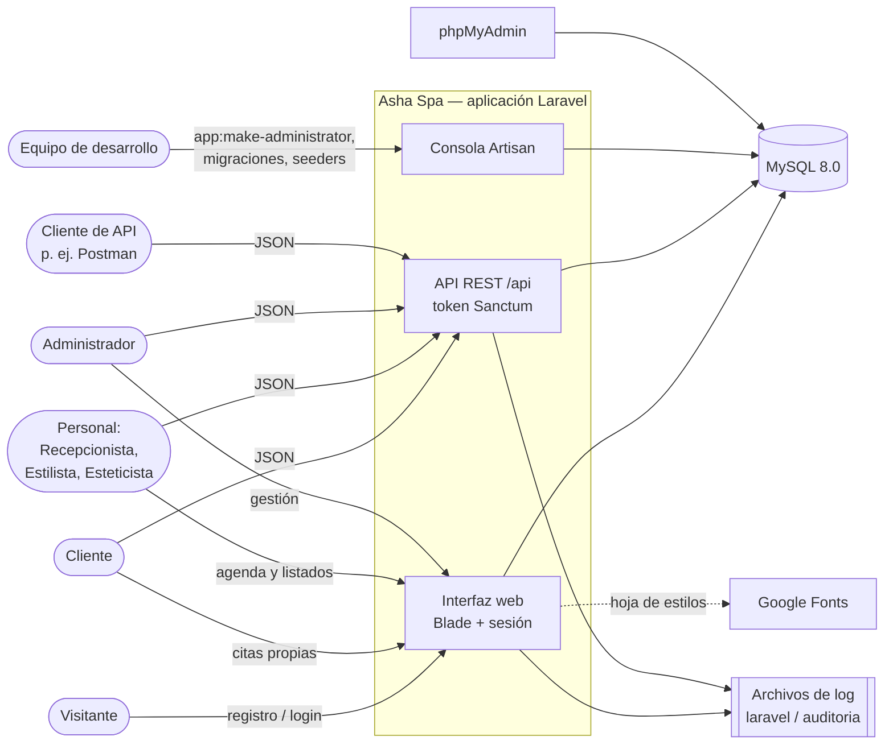

# 3. Contexto y alcance

> **Base de verificación.** Contrastado con `spaa_codigo.zip` (5 de noviembre de 2026). Volver a verificar si cambian las rutas, el `docker-compose.yml` o la configuración.

Este capítulo delimita qué queda dentro de Asha Spa y con qué actores y sistemas se comunica. El contexto de negocio muestra quién usa el sistema y para qué; el contexto técnico muestra por qué canales.

## 3.1 Diagrama de contexto

Las líneas continuas son comunicaciones que el código realiza; la línea punteada es una carga que hace el navegador del usuario. No hay integraciones con pasarelas de pago, servicios de correo, cámaras o servicios de IA.

## 3.2 Contexto de negocio

| Actor | Qué entrega al sistema | Qué recibe | Canal | Fuente |
| --- | --- | --- | --- | --- |
| Visitante | Datos de registro (nombre, apellido, documento, correo, teléfono, contraseña) | Cuenta de Cliente con sesión iniciada | Web `/register` | `backend/routes/web.php` L30–35; `Web/AuthController.php` L89–165 |
| Cliente | Solicitudes de cita a su nombre; consultas | Sus citas; por API, también su perfil, pagos y facturas | Web y API | `backend/config/permisos.php` L80–87 |
| Recepcionista | Datos de clientes y citas | Directorio de clientes, agenda completa, datos de contacto del personal | Web y API | `config/permisos.php` L56–64 |
| Estilista y Esteticista | Consultas | Agenda completa, catálogo, datos públicos del personal | Web y API | `config/permisos.php` L67–78 |
| Administrador | Usuarios, roles, servicios, personal, facturas, pagos, inventario | Toda la información | Web y API | `config/permisos.php` L53 |
| Cliente de API (herramienta) | Peticiones JSON con token Bearer | Respuestas JSON; errores 401, 403, 404, 409, 422 o 429 en JSON | API | `backend/bootstrap/app.php` L26–31 |
| Equipo de desarrollo | Comandos de consola | Migraciones, datos de prueba, asignación del administrador | Consola dentro del contenedor | `backend/app/Console/Commands/MakeAdministrator.php` |

La interfaz web y la API no exponen las mismas operaciones. La lista completa de cada una se documentará en `backend/flujos-por-operacion.md` y `api/endpoints.md`.

## 3.3 Contexto técnico

| Canal o sistema | Dirección local | Protocolo y formato | Protección | Fuente |
| --- | --- | --- | --- | --- |
| Interfaz web | `http://localhost:8000/` | HTTP, HTML renderizado en el servidor | Sesión de Laravel, middleware `auth` y `cuenta.activa`, token CSRF | `docker-compose.yml`; `backend/routes/web.php` |
| API REST | `http://localhost:8000/api/...` | HTTP, JSON | `auth:sanctum`, `cuenta.activa`, límite de 120 peticiones por minuto | `backend/routes/api.php` L50; `backend/bootstrap/app.php` L24 |
| Comprobación de salud | `http://localhost:8000/up` | HTTP | Pública | `backend/bootstrap/app.php` L15 |
| Base de datos | `127.0.0.1:3308` desde el equipo; `db:3306` dentro de la red Docker `red_db` | MySQL | Usuario y contraseña del `.env` | `docker-compose.yml`; `.env.example` L23–29 |
| phpMyAdmin | `http://127.0.0.1:8881` | HTTP | Inicio de sesión automático con las credenciales de la aplicación | `docker-compose.yml` L46–51 |
| Consola | `docker compose exec app php artisan ...` | Línea de comandos | Acceso al equipo anfitrión | `README.md` L13 |
| Logs | `backend/storage/logs/` (`laravel.log` y `auditoria-AAAA-MM-DD.log`) | Archivos de texto | Sistema de archivos | `backend/config/logging.php` L78–84 |
| Google Fonts | `fonts.googleapis.com` | HTTPS, CSS | — | `frontend/resources/css/app.css` L6 |

## 3.4 Límites del sistema

- **Dentro del alcance:** la aplicación Laravel de `backend/`, las vistas y recursos de `frontend/`, la base de datos MySQL y su esquema, y los contenedores de `docker-compose.yml`.
- **Fuera del alcance:** cualquier pasarela de pago (el método `pse` es solo un valor del campo `metodo` en `backend/database/migrations/07_ pago.php`), servidores de correo, almacenamiento en la nube (las variables AWS de `.env.example` están vacías), cámaras o servicios de Realidad Aumentada, y modelos de IA.
- **Datos que no salen del sistema:** no se encontró código propio que envíe información a servicios externos. Hay dos excepciones que dependen de componentes de terceros: la hoja de estilos de Google Fonts, que descarga el navegador del usuario (`frontend/resources/css/app.css` L6), y la regla `uncompromised()` de la política de contraseñas, que en producción consulta un servicio externo de contraseñas filtradas (`backend/app/Providers/AppServiceProvider.php` L152). Esta segunda consulta no se verificó.
